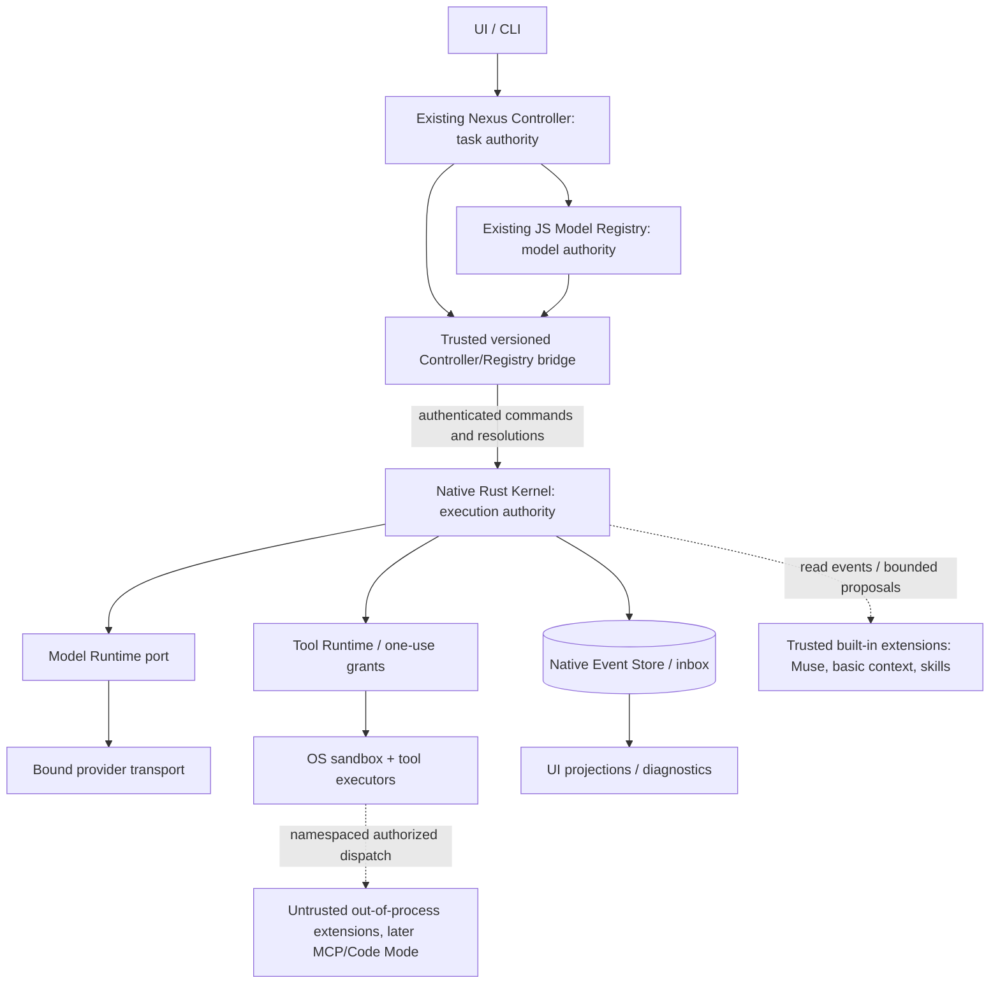

# NEXUS Native Core — Architecture & Contracts (A0)

> **Status:** PROPOSED / Architecture for review — **not approved for implementation or merge**  
> **Revision:** A0.3 — A1 contract closure proposal (supersedes A0.2)  
> **Date:** 2026-10-11  
> **Project:** [Kaloyan3D/Nexus](https://github.com/Kaloyan3D/Nexus)  
> **Repository evidence baseline:** `feature/model-registry-v1`, commit `8ae2fe3943750cd1d6c7c439b4771a49209b3849` (PR #33, Draft, at review time)  
> **Related specification:** `NEXUS_REGISTRY_ARCHITECTURE.md` v0.2, existing Controller/EMv2/CCv2 contracts; *Nexus Native Core: архитектура за стабилност преди DSH feature parity* (second research report)  
> **Scope:** Engineering architecture, interfaces, invariants, migration, tests. **No production implementation, PR merge, or cutover authorized by this document.**

## 0. One-page decision

NEXUS Native Core is a **small, stable Rust execution substrate**, not a feature-by-feature Rust clone of DeepSeek Harness (DSH). A smaller feature set is acceptable when it produces a demonstrably more reliable, observable, recoverable and securely bounded system.

**Architecture maxim:** *Core provides mechanisms; extensions provide behavior; the Controller and Registry retain their respective authorities.*

- **Core mechanisms:** agent-turn execution primitive; identity-bound lifecycle; bounded streaming/cancellation; immutable model target enforcement; canonical tool invocation; authorization and sandbox mediation; durable execution journal; replay/recovery; versioned extension contracts.
- **Control plane outside Core:** Nexus Controller owns task/attempt/verification/review/completion decisions; Nexus Model Registry alone resolves provider/model/route/reasoning/policy targets; connection broker alone handles credential material.
- **Extensions outside Core:** CCv2 context projection and checkpoint policy; Code Mode programmable tool composition; EMv2 Muse and future EMv3 orchestration; legacy Dual engine migration adapter; Skills, MCP, plugin packages, workflows, background jobs and UI functionality.
- **Provider/model adapters are replaceable *implementations* of Core ports**, not alternate model routers.
- **No unrestricted extension privilege at an API boundary:** every extension request must pass Core validation and Controller/Registry constraints. **In-process Rust extensions are trusted code, not OS-isolated sandboxes**; untrusted executable extensions MUST run out of process.

**Two different completion gates:** (1) *Native Muse works without DSH*, and (2) *all DSH dependencies required by the supported Nexus product can be removed*. Neither is synonymous with 100% DSH feature parity. The second gate also requires safe migration or deliberate retirement of existing user-facing functionality.

### A0.2 → A0.3 revision history and contract closure

A0.3 preserves A0.2's **small trusted Rust Core + external Controller/Registry + extension-first features**. The table below records what A0.2 already repaired. **A0.3 adds normative closure in §5.7–§5.12, and those sections take precedence over earlier illustrative DTOs whenever wording differs.** The stability-first research report is input, not automatically adopted implementation proof.

| # | A0.1 weakness | A0.2 correction | Required proof |
|---|---|---|---|
| 1 | One object mixed Registry target and task/run identity | Separate `RegistryResolutionV1`, `ControllerRunAuthorizationV1`, `KernelExecutionPinV1` | Cross-generation rejection + semantic digest fixtures |
| 2 | Conceptual permission scope was not a single-invocation grant | `ToolDescriptorV1` + durable, one-use `ToolGrantV1` + effect classification | Replayed/forged grant cannot execute |
| 3 | Cross-store receipt insufficient for crash windows | Controller durable outbox + Kernel inbox/receipt + reconciliation/fencing | Crash at every transition |
| 4 | Provider-bound struct did not prove wire fidelity | Attested `PreparedModelRequest` before network dispatch | Wrong endpoint/model/effort/session refused |
| 5 | Rollback backend not explicitly generation-sticky | Immutable `executionBackend` chosen at task generation creation | Never resume a Native mutating generation in DSH |
| 6 | Context continuity underspecified | `NATIVE / REFUSE_CONTEXT_EXHAUSTED` P0; structural ContextView validator | No silent truncation or broken tool continuation |
| 7 | AgentEngine callbacks not replay-safe | Versioned engine state + durably accepted proposals + stable correlation | Callback replay has no duplicate effect |
| 8 | Skills deferred despite current Nexus dependency | Minimal Skills extension, task-local todo, output spill/ref in usable P0 | Precedence and large-output fixtures |
| 9 | In-process APIs blurred extension trust levels | Internal Rust traits **vs** authenticated external IPC; trusted/untrusted separation | OS process-boundary tests |
| 10 | Stability gate lacked measured thresholds/method | Failure taxonomy, controlled crash matrix, suggested live/canary SLO | Published baseline and confidence caveats |

#### A0.3 change register — A1 blockers only

| Closure | A0.2 ambiguity | A0.3 decision | Implementation gate |
|---|---|---|---|
| CL-01 | `registry_revision`, `mode_revision` and new target fields lacked source definitions | Content-addressed Registry/Mode snapshots + explicit field provenance and typed `target-incomplete` | A1 contract/fixture; complete Live target required by A2 |
| CL-02 | Pin retained hashes but not proven replay bytes | Durable immutable target, authorization and policy snapshots committed with pin | A1 restart/corruption test |
| CL-03 | Controller outbox existed only as a diagram | Command acceptance protocol, Controller durable-intent boundary, receipt replay and generation fencing | A1 synthetic shadow; real Controller durability proof before A2 |
| CL-04 | Event sequences and recovery state were implicit | Global journal offset + per-generation sequence, guarded FSMs and ambiguity taxonomy | A1 deterministic replay/model-based tests |
| CL-05 | Local JS↔Rust IPC mechanism unnamed | Linux shadow IPC profile, explicit same-UID threat assumption and stricter A2 gate | A1 forged-peer tests |

**A0.3 intentionally DOES NOT settle** the live `rust-genai` adapter choice, production Linux sandbox backend, full Code Mode/CCv2 protocols, or Dual migration. Those belong to their later phase gates and must not block a no-effects A1 shadow. **A1 approval is not approval for model traffic, real tools, or Native backend cutover.**

**Compatibility correction:** `engineering-v2` is the **Muse single-agent** mode (`muse_main`); legacy `engineer_normal`, `engineer_deep`, `reviewer`, `solver` belong to **EMv1/Dual**. The second research report sometimes conflates them; this document deliberately does not.

### Normative language

`MUST`, `MUST NOT`, `SHOULD`, `MAY` denote proposed engineering requirements. All code/contracts below are **design sketches**, not confirmed code/API signatures. A0 must be reviewed and accepted before implementation.

## 1. Verified baseline vs design proposals

| Topic | Verified from existing repository / docs | Native A0 proposal / unresolved |
|---|---|---|
| Installed substrate | `runtime/package.json` pins `@deepseek-ai/dsh` 0.1.1-rc.2, related packages and a Nexus-specific `dsh-agent` tarball. | Replace only needed runtime functions; do not assume parity from package names. |
| Registry | `config/registry/resolver.cjs` is a pure deterministic CommonJS compiler with fail-closed eligibility and hash-based `resolutionId`. | Reuse the compiler in an isolated adapter first; **one canonical resolver**. Porting to Rust requires fixture/hash equivalence. |
| Registry execution | R7 reports compatibility/equality-gated session binding with opt-in flag; direct Registry-authoritative DSH routing blocked. | Native model dispatch consumes an already approved immutable binding; no legacy equality gate after migration. |
| Preset failure | R7.1.1 documents missing mode assets in copied preset trees and a closure fix; isolated tests reported passing. | Clean-install tests and a single canonical runtime asset store; **live post-fix E2E still not established by reviewed docs**. |
| Identity | `taskId` is a non-unique display label; `taskInstanceId` is immutable actual task-generation identity. | Every native command/event/artifact MUST carry generation identity and immutable workspace scope. |
| Authority | Controller owns routing semantics, task/attempt state, verification, review, operator gates and completion. | Preserve Controller as authority via transactional command/ack bridge before any Controller rewrite. |
| EMv2 | **Muse V0** is single `muse_main` agent, with no subagents, independent reviewer, solver or fallback. | Native `muse-v0` orchestration extension, not a generic Dual executor. |
| EMv1 / Dual | Legacy Dual orchestration supports distinct Normal/Deep/Reviewer/Solver semantics and restrictions. | Separate compatibility/migration track; no claim that migrating Muse also migrates Dual. |
| CCv2 | Restricted production retains read-only compilation/validated request-time projection; durable mutation, active generation writes and mutating recovery are frozen. DSH still owns ordinary session compaction. | CCv2 is a restricted extension; do not turn experimental durable writers on as part of Native Core. |
| Managed Claude agent | R6.4 explicitly disables it as Engineering Mode orchestrator because spawn, resume binding, permission audit and live proof are insufficient. | Managed-agent execution is a **different trust/transport class**, disabled in native P0. |
| rust-genai | Research report identifies it as an adapter candidate. | Confirm installed-version provider semantics via SPIKE + recorded/live tests; not yet an approved dependency. |

**Evidence references** (pinned commit where possible):

- [Runtime package dependencies](https://github.com/Kaloyan3D/Nexus/blob/8ae2fe3943750cd1d6c7c439b4771a49209b3849/runtime/package.json)
- [Controller authority](https://github.com/Kaloyan3D/Nexus/blob/8ae2fe3943750cd1d6c7c439b4771a49209b3849/docs/architecture/controller.md), [Task identity](https://github.com/Kaloyan3D/Nexus/blob/8ae2fe3943750cd1d6c7c439b4771a49209b3849/docs/architecture/controller-identity.md), [Task lifecycle](https://github.com/Kaloyan3D/Nexus/blob/8ae2fe3943750cd1d6c7c439b4771a49209b3849/docs/architecture/task-lifecycle.md)
- [Muse V0 engine](https://github.com/Kaloyan3D/Nexus/blob/8ae2fe3943750cd1d6c7c439b4771a49209b3849/docs/architecture/muse-agent-plane-v0.md), [Engineering Mode legacy/Dual](https://github.com/Kaloyan3D/Nexus/blob/8ae2fe3943750cd1d6c7c439b4771a49209b3849/docs/architecture/engineering-mode.md)
- [Registry resolver](https://github.com/Kaloyan3D/Nexus/blob/8ae2fe3943750cd1d6c7c439b4771a49209b3849/config/registry/resolver.cjs), [binding](https://github.com/Kaloyan3D/Nexus/blob/8ae2fe3943750cd1d6c7c439b4771a49209b3849/config/registry/session-binding.cjs), [R7 readiness / R7.1.1](https://github.com/Kaloyan3D/Nexus/blob/8ae2fe3943750cd1d6c7c439b4771a49209b3849/docs/architecture/registry-r7-release-readiness.md)
- [CCv2 restricted production](https://github.com/Kaloyan3D/Nexus/blob/8ae2fe3943750cd1d6c7c439b4771a49209b3849/docs/operations/ccv2-restricted-production-scope.md), [CCv2 design](https://github.com/Kaloyan3D/Nexus/blob/8ae2fe3943750cd1d6c7c439b4771a49209b3849/docs/architecture/context-compaction-v2.md), [Claude agent assessment](https://github.com/Kaloyan3D/Nexus/blob/8ae2fe3943750cd1d6c7c439b4771a49209b3849/docs/architecture/registry-r6-claude-orchestrator.md)
- Research input: user-provided `deep-research-report(1).md`, *Nexus Native Core Architecture: Preserving the DSH Model While Removing DSH as Runtime Authority* (research/proposals, not code proof).

**Roadmap note:** The checked-in Registry architecture v0.2 lists EMv3 before the long-term Native Runtime. **This A0 proposes a changed sequence**—Native before EMv3—based on the subsequently agreed stability-first direction. This is a new decision requiring explicit acceptance; it does not retroactively change v0.2 or existing implementation.

## 2. Goals, deliberate non-goals and release policy

### 2.1 Required product properties (priority order)

1. **Correct authority:** no phantom task completion, cross-generation leakage, silent model switching, unauthorized tool effects or permission downgrades.
2. **Crash safety:** recovery must distinguish completed, interrupted and unknown-effect work; never fabricate a successful result or repeat unsafe writes automatically.
3. **Operational reliability:** understandable errors, bounded resource usage, cancellation, clean installation, non-corrupting upgrades, per-OS verified sandbox capabilities.
4. **Model quality and coding ergonomics:** streamed responses, tool use, file editing, verification and explicit task resume.
5. **Extensibility:** extensions add context/agent/tool behavior without changes to the privileged kernel's invariants.
6. **DSH feature compatibility:** selective, justified by actual Nexus usage and tests—not an unconditional goal.

### 2.2 Deliberate non-goals of P0

- Implementing full DSH plugin lifecycle, Code Mode, PTYs, subagents, background jobs, general workflows or marketplace.
- Multi-agent EMv3 or arbitrary-model eligibility inside current Muse V0.
- Introducing active-task CCv2 compaction or re-enabling frozen CCv2 durable writes.
- Immediately rewriting the mature PowerShell Controller or the entire JS Registry.
- Guaranteeing exact-once arbitrary shell/file effects across process crashes (in general not achievable).
- Treating subscription-backed managed agents as if they were raw-model APIs.
- Linux/macOS/Windows security equivalence without proof for each backend.

### 2.3 Feature admission tiers

| Tier | Criteria | P0 treatment |
|---|---|---|
| **MUST KEEP** | Needed for safe native engineering execution or authoritative continuity | Implement, test, do not cut corners. |
| **SIMPLIFY** | Existing user value but can be supplied by a narrower contract | Implement minimum proven behavior. |
| **DEFER** | Valuable enhancement that can sit behind an extension API | Define seam/fixtures; implement later. |
| **DROP** | DSH-only feature not required by supported Nexus workflows | Intentionally omit; document effects. |

| Capability | Tier | Proposed handling |
|---|---|---|
| Immutable routing, target pinning and no fallback | MUST KEEP | Registry + Kernel bind contract |
| Bounded model/tool turn loop and ordered streaming | MUST KEEP | Core execution primitive |
| Durable session events, task-generation identity, recovery | MUST KEEP | Core execution journal + Controller bridge |
| Tool calls, file read/search, controlled patch/write, process execution | MUST KEEP | Core Tool Host + built-in adapters |
| Approval, permissions, sandbox, cancel/timeout | MUST KEEP | Core enforcement path |
| Controller verification/completion/gates | MUST KEEP | External Controller authority; never replaced by inference |
| Basic conversation/context construction | MUST KEEP | Core ContextView input contract; default simple implementation |
| Session UI/CLI | SIMPLIFY | Thin native protocol adapter; preserve essential user flows |
| Git commands and structured diff | SIMPLIFY | Safe `argv` process adapter + explicit read-only Git tools |
| DSH native compaction | DEFER lossy compaction | P0 context is `NATIVE` or typed refusal only; no silent truncation |
| Legacy Dual engine and review path | DEFER for Muse prototype; **required if still supported at DSH removal** | Separate migration gate |
| Skills | SIMPLIFY / P0 usable | Minimal `SKILL.md` discovery, deterministic precedence, scoped lazy loading; **extension** not Core authority |
| MCP | DEFER | Tool adapter after cutover; all calls pass ToolGrants |
| Task-local todo and large tool-output spill | SIMPLIFY / P0 usable | Minimal structured todo adapter + bounded content-addressed output references |
| Code Mode | DEFER | Isolated worker + guarded tool RPC |
| PTY, background jobs | DEFER | Owner-bound service protocol, bounded lifecycle |
| Durable subagents, workflows, EMv3 | DEFER | Orchestration extensions using Core ports |
| Open-ended DSH plugin replacement of kernel services | DROP | Rejected by design |
| Every historical DSH preset/consumer UX variant | DROP unless proven needed | Supported-surface inventory and migration notice |

The proposed statuses above are **product decisions**, not a claim that all DSH features have been exhaustively audited. Before DSH removal, record any removed user-visible behavior in a migration/compatibility ledger.

## 3. Topology, authority and extension trust boundaries



Arrows show request/data flow, **not transferable authority**. Model adapters do not call Registry to resolve another route; extensions do not mutate Controller task truth. Kernel checks authoritative inputs instead of assuming that a JSON hash is a signature. Neither Controller nor a plugin may write Native sequence IDs directly.

### 3.1 Ownership matrix

| Domain | Decision authority | Kernel enforcement / output | Extension rights |
|---|---|---|---|
| Task creation, `taskInstanceId`, attempts, verification, review, completion | Existing **Controller** | Validate command correlation; record execution facts, not completion | Propose actions and evidence only |
| Model, provider, route, reasoning, data-use/billing and connection choice | **Registry** (with Controller-approved mode/role intent) | Verify semantic digest and target eligibility, bind immutable exact route | Request role/capability, never route directly |
| Backend choice | Controller at **new task generation** | Persist and refuse changes to `executionBackend` | None |
| Credential material | Trusted secret/connection broker | Use opaque refs; dispatch-time entitlement and endpoint verification | None |
| Model call and tool effect scheduling | Kernel | Bounded run FSM, cancellation, one-use grants, approval+OS sandbox | Submit validated proposals |
| Task-local workspace | Controller binding | Immutable root ID, handle-based confinement | Restricted workspace resources only |
| Native execution history | Native single writer | Typed events and projections | Read filtered views; no direct mutation |
| Legacy DSH session history during transition | DSH until deliberately migrated | Read-only bridge, no simultaneous Native session writer | None |
| Context policy/projection | Context extension (non-authoritative) | Verify source, structure, budget and continuity | Candidate `ContextView` only |
| Mode orchestration | Mode extension and Controller | Commit/reject proposed run actions | Engine proposals; no task completion |
| Tool capability descriptors | Trusted registration service | Namespace admission, immutable toolset epoch | Declare tools and their maximum effects |

### 3.2 Trust model and dependency rules

- **Trusted computing base (TCB):** Controller authority source, Registry compiler/issuance bridge, Kernel enforcement, store writer, credential broker, permission/approval mediator and relevant sandbox executor. Minimize code with these privileges.
- **Trusted first-party Rust extensions:** may run in the same address space for simplicity/performance. `trait` restrictions express **design discipline**, not OS security; dependencies that are malicious or unsafe inside the process can bypass ordinary Rust API contracts. Audit/pin them as part of TCB or move them out of process.
- **Untrusted executable extensions:** third-party code, MCP processes and Code Mode workers run out-of-process with authenticated/versioned IPC, resource limits and sandbox. MCP itself is not a security guarantee.
- **Untrusted data:** model messages, skills, external tool descriptions/results and repository content cannot grant authority.
- `kernel` MUST NOT import DSH, EMv2, CCv2, Code Mode, an MCP server, UI or provider-specific model resolution code.
- `registry-core` MUST NOT import Kernel, DSH or Controller policy. In P0 it remains **CommonJS in an external trusted process**; the Rust Kernel only consumes its verified outputs through the bridge.
- All extension tool requests, including nested Code Mode calls, MUST re-enter the Tool Runtime. No secondary `shell`/`fs`/HTTP authority path is exposed to an untrusted worker.
- Presets are immutable configuration references, not copied runtime implementations. Every installed binary/asset is explicitly manifested and verified.

### 3.3 P0 platform and deployment posture

**Proposed initial Native stability target: Linux first.** Existing Nexus Linux/Windows support remains unchanged on legacy DSH; Windows Native is a separately gated target, not silently assumed to be equivalent. macOS is explicitly deferred until separately approved. This is a **proposal**, not an already-approved product deprecation. Unsafe write tools MUST fail closed where sandbox capability is not proven.

### 3.4 No duplicate authority by convenience

- `RegistryResolutionId` is a legacy compiler identity; the new `targetSemanticDigest` is a **different** value unless fixture equivalence is explicitly proven.
- Controller chooses roles/execution classes, Kernel controls *when* already-authorized executions start, and Provider runtime performs **no selection**.
- Session engine identity is generation-scoped; new role/target transitions require explicitly authorized new target pins without mutating past pins.
- The Store is authoritative for **Native execution events**; Controller ledgers remain authoritative for **task lifecycle** until a separately approved cutover.

## 4. Rust workspace: small, explicit seams

Start with one Cargo workspace and **7 cohesive library crates plus 2 host binaries**, not the research report's 20+ crates. Crates are architectural suggestions; create them only when their interfaces/test boundaries are proven.

```text
native/
  Cargo.toml
  Cargo.lock
  crates/
    nexus-contracts/           # typed IDs, schema revisions, canonical target/event DTOs
    nexus-kernel/              # run/turn FSM, verified pins, cancellation, budgets
    nexus-store/               # one SQLite writer, durable inbox/outbox receipts, artifacts
    nexus-model/               # verified transport port, prepared-request attestation
    nexus-tools/               # tool descriptors, grants, sandbox/OS executors, todo/spill
    nexus-extension-api/       # engine/context/tool/skill ports and versioned proposals
    nexus-bridge/              # authenticated JS Registry + Controller command adapter
  apps/
    nexusd/
    nexus-doctor/
  extensions/
    nexus-muse/                # EMv2 single-agent, first-party extension
    nexus-basic-context/       # deterministic native history view, first-party
    nexus-skills/              # minimum project/user/bundled skill service, first-party
    nexus-ccv2-bridge/         # read-only; not required for initial model-only slice
    nexus-dual-legacy/         # separate later supported-mode migration
    nexus-code-mode/           # later isolated worker (not in P0)
    nexus-mcp/                 # later untrusted tool gateway (not in P0)
  schemas/
  tests/{contract,crash,provider,install,live,security}/
  adr/
```

**No `kernel ↔ tools` cyclic crate dependency.** Define narrow invocation traits/events in `nexus-contracts` (or `nexus-extension-api` where appropriate), implement `nexus-tools` separately, and wire it at composition root `nexusd`. `nexus-model` has no access to the Registry resolver or credentials outside a one-target transport capability. A small `nexus-skills` implementation lives outside Kernel even though it joins the *usable P0* milestone.

First-party static linking provides modular maintenance only. Third-party binary plugin ABI is NOT exposed in P0; later plugins use a versioned out-of-process protocol, with a separate identity/admission manifest and sandbox requirements.

### 4.1 Composition root and separate protocol contracts

- **Internal Rust ports:** optimized typed traits (`ModelRuntime`, `ToolExecutor`, `AgentEngine`, `ContextExtension`, `SkillCatalog`). Object-safe adapters use associated boxed streams/futures or explicit async-trait tooling where dynamic dispatch is required; the snippets below remain pseudocode.
- **Cross-process IPC:** strictly versioned wire DTOs for Controller, Registry issuer bridge, CLI and plugin workers. IPC is not equivalent to calling a Rust trait; it needs authentication, request IDs, freshness/replay rules and bounded message sizes.
- **Bootstrap:** packaged asset manifest and `BootConfig` identify a single canonical DataRoot; `nexus-doctor` verifies schema, mode assets, DB access and installed-binary hashes without the source checkout or DSH runtime present.

## 5. Critical A0.3 contracts (normative semantics, pseudocode types)

**These are proposed DTO/trait designs, not compiled Rust or shipped JSON schemas.** Freeze wire formats, canonicalization and golden vectors before implementation; do not invent a competing Registry catalog or task ledger.

### 5.1 Three-stage model authority: resolution → authorization → pin

```rust
// PSEUDOCODE; deliberately not an ABI.
struct RegistryResolutionV1 {
    registry_resolution_id: String,   // existing JS compiler ID, unchanged
    source_snapshot: RegistrySnapshotIdentityV1,
    target_core: ExecutionTargetCoreV1,
    target_semantic_digest: Sha256,   // new, separate from registry_resolution_id
    issuer_provenance: TrustedRegistryIssuer,
}
struct ExecutionTargetCoreV1 {
    mode_id: ModeId,
    mode_definition_digest: Sha256, // no numeric mode-definition revision in baseline
    engine_id: EngineId,
    role_id: RoleId,                  // internal Registry slot e.g. muse_main
    route_id: RouteId,
    provider_id: ProviderId,
    catalog_model_id: ModelId,
    remote_model_id: String,
    connection_id: ConnectionId,     // never credentials
    endpoint_id: EndpointId,         // references immutable allowed origin/path
    transport: TransportId,
    execution_kind: ExecutionKind,   // RawModel | ManagedAgent
    reasoning: ReasoningContract,
    data_use_tier: DataUseTier,
    billing_class: BillingClass,
    limits: ModelLimits,
    capabilities: CapabilitySet,
    provider_session_semantics: SessionSemantics,
    fallback: Forbidden,
}
struct ControllerRunAuthorizationV1 {
    task_instance_id: TaskInstanceId,
    session_id: SessionId,
    run_id: RunId,
    engine_id: EngineId,
    requested_role_id: RoleId,
    execution_class: ExecutionClass,
    execution_backend: ExecutionBackend, // Native | Dsh; sticky for generation
    workspace_root_id: WorkspaceRootId,
    policy_digest: Sha256,
    expected_controller_revision: u64,
    controller_fence_epoch: u64,
    command_id: CommandId,
}
struct KernelExecutionPinV1 {
    pin_id: PinId,
    task_instance_id: TaskInstanceId,
    run_id: RunId,
    registry_resolution_id: String,
    target_semantic_digest: Sha256,
    durable_target_snapshot_ref: SnapshotRef,
    authorization_snapshot_digest: Sha256,
    controller_command_id: CommandId,
    bound_journal_offset: u64,
    generation_sequence: u64,
    toolset_epoch_digest: Sha256,
}
```

The Registry alone resolves exact model/provider/route/reasoning/data-use/billing; Controller alone authorizes *which task generation/role* may use the resolution; Kernel verifies both inputs and **atomically commits a pin plus durable exact target/authorization snapshots before provider activity** (§5.8). Runtime cannot re-resolve, downgrade reasoning, silently change route or use a ManagedAgent route as a RawModel transport. Revocation blocks, never mutates, the pin.

**Canonical target identity:**

1. Validate an explicit `ExecutionTargetCoreV1` schema first (`additionalProperties: false` in security-sensitive objects); unknown required revisions fail closed. Explicit security fields MUST NOT be defaulted (`null`, missing and `"contributor"` are distinct).
2. The new semantic target digest is independent of Controller run IDs, timestamps, token credentials, mutable auth health and UI labels. No floats in hashed target; integer values crossing the JS/Rust boundary MUST be within the JSON safe-integer range (or encoded as validated decimal strings); ID fields obey stable ASCII patterns; sets such as capabilities are lexically sorted/deduplicated **before** canonicalization. RFC 8785 does not normalize Unicode: validate allowed strings explicitly and preserve exact code points. Reject duplicate JSON keys before canonicalization.
3. Serialize with **RFC 8785 JSON Canonicalization Scheme** (normative JS/Rust fixture corpus; its property sort is not interchangeable with arbitrary JSON serialization). Compute `SHA256(UTF8("nexus.execution-target.core.v1\0") || JCS_UTF8(target_core))`, represented in lowercase hexadecimal. The digest field is outside the hashed body.
4. Preserve the current JS `registryResolutionId` unchanged. Store both IDs and prove exact mapping through golden cases, including falsified provider, endpoint, tier, billing class, auth reference and reasoning changes. A hash identifies bytes/semantics; **it does not authenticate its issuer**.
5. While Registry remains Node/CommonJS and `nexusd` is Rust, **an in-process Registry interface is NOT assumed**. Use a dedicated authenticated local bridge, with peer access control and a pinned trusted-process channel; define the threat model for same-UID hostile processes rather than claiming a Unix socket alone prevents them. Kernel rejects unauthenticated or unbound issuer data.
6. `taskInstanceId` is the task-generation identity; GUI `taskId` is never used as an authorization key. Existing Muse legacy decision maps `executionClass=muse_main, role=null` to Registry internal role `muse_main` **only within a documented bridge rule**; NULL is not silently interpreted as an arbitrary role.

### 5.2 Durable native events and Controller receipts

```rust
struct NativeEventV1 {
    schema_version: u32,
    event_id: EventId,
    task_instance_id: TaskInstanceId,
    session_id: SessionId,
    run_id: RunId,
    turn_id: Option<TurnId>,
    attempt_id: Option<AttemptId>,
    journal_offset: u64,      // globally monotonic native-store commit order
    generation_sequence: u64, // monotonic within task_instance_id
    causation_id: Option<EventId>,
    correlation_id: CorrelationId,
    payload: VersionedEventPayload,
}
struct ControllerCommandV1 {
    command_id: CommandId,
    task_instance_id: TaskInstanceId,
    expected_controller_revision: u64,
    controller_fence_epoch: u64,
    authorization_digest: Sha256,
    backend: ExecutionBackend,
    action: AuthorizedKernelAction,
}
struct KernelReceiptV1 {
    command_id: CommandId,
    receipt_id: ReceiptId,
    accepted: bool,
    journal_offset: u64,
    command_payload_digest: Sha256,
    controller_fence_epoch: u64,
    effect_state: EffectState,
}
```

Minimum events: `SessionOpened`, `ControllerCommandAccepted`, `EngineBound`, `ExecutionPinCommitted`, `ToolsetEpochBound`, `TurnOpened`, `ModelRequestPrepared`, `ModelRequestStarted`, `ModelStreamFrameCommitted`, `ToolProposed`, `ToolGrantIssued`, `ToolGrantRedeemed`, `ToolStarted`, `ToolResultCommitted`, `ToolOutcomeIndeterminate`, `ApprovalRequested`, `ApprovalResolved`, `EngineProposalAccepted`, `RunInterrupted`, `RunTerminated`, `EvidenceLinked`. **`RunTerminated` is not `TaskCompleted`**. Native execution events NEVER write Controller completion authority.

The single-writer Store allocates `journal_offset` and `generation_sequence` during the same SQLite transaction and preserves committed prefixes; their scopes are defined in §5.10. UI stream deltas not yet persisted are labeled provisional; a durable watermark distinguishes recoverable data. Large outputs are bounded and spilled to content-addressed artifacts with correct fsync/rename/commit ordering. Event schema upcasters and compatibility policy are versioned; unknown security-critical events fail closed.

### 5.3 Tool descriptor, scope and single-use grant

```rust
struct ToolDescriptorV1 {
    tool_id: ToolId,
    tool_version: Version,
    input_schema_digest: Sha256,
    declared_max_effects: EffectEnvelope,
    side_effect_class: SideEffectClass, // None | Idempotent | NonIdempotent | Unknown
    approval_requirement: ApprovalRequirement,
    required_sandbox: SandboxRequirement,
    provenance: Provenance,
}
struct CapabilityScopeV1 {
    scope_id: ScopeId,
    task_instance_id: TaskInstanceId,
    workspace_root_id: RootHandleId,
    role_id: RoleId,
    permitted_tools: ToolAllowlist,
    effect_ceiling: EffectEnvelope,
    expires_at: Option<Timestamp>,
    parent_scope_id: Option<ScopeId>,
}
struct ToolGrantV1 {
    grant_id: GrantId,
    invocation_id: ToolCallId,
    execution_pin_id: PinId,
    tool_id: ToolId,
    tool_version: Version,
    toolset_epoch_digest: Sha256,
    canonical_arguments_digest: Sha256,
    capability_scope_id: ScopeId,
    workspace_root_id: RootHandleId,
    deadline: Timestamp,
    max_output_bytes: u64,
    one_use_nonce_hash: Sha256,
}
```

`ToolDescriptorV1` declares **maximum** effects; it never grants anything. Effective rights are the intersection of descriptor, mode/role policy, session/operator grants and actually enforceable OS sandbox. Tool args are schema-validated *before* approval. Kernel mediates policy and the Tool Runtime atomically redeems the exactly bound grant (`issued → redeemed`) once, before invoking an effect. Raw token/nonce never enters diagnostics. On replay, a second redemption fails; a previously committed result can be returned idempotently by call identity when safe.

**Important limit:** Single-use grants prevent repeated *authorization*, not exactly-once external effects. After a crash between effect and result commit, mutating/non-idempotent/unknown calls enter `outcome_indeterminate`; no blind retry. Only a proven idempotency key or explicit reconciliation/approval permits a new call. `ToolCallId`, `pinId`, `taskInstanceId`, args digest, sandbox plan, parent Code Mode call and grant must all appear in audit lineage.

`argv` and shell are separate capabilities. Rooted handle-based filesystem checks and OS sandbox are both required for untrusted paths. `read-only reviewer` has an ungrantable write capability; solver approvals never come from model text.

### 5.4 ContextView and continuity certification

```rust
// ContextExtension produces candidates; Core validates and chooses.
enum ContextDecisionV1 {
    Native(ContextViewV1),
    RefuseContextExhausted { diagnostics: ContextBudgetEvidence },
    // Not P0: Compacted { view: ContextViewV1, certification_id: CertificationId }
}
struct ContextViewV1 {
    source_session_id: SessionId,
    source_sequence_watermark: u64,
    source_digest: Sha256,
    target_semantic_digest: Sha256,
    toolset_epoch_digest: Sha256,
    messages: Vec<ProviderNeutralMessage>,
    provider_continuation_refs: Vec<ContinuationRef>,
    capacity_evidence: ContextBudgetEvidence,
}
```

P0 accepts only faithful Native event-history projection or a **typed refusal**. It MUST NOT silently summarize/drop old tool results, reasoning continuity, developer/system instructions or the active turn. Verify role/order, tool call/result pair integrity, provider continuation IDs, complete/partial assistant frames, current target context + output reserve, snapshot watermark and content digest. If pressure is unmeasurable, refuse. A future CCv2 extension may propose `Compacted` only with a separately admitted certification policy and tested crash-safe ownership, never by reviving currently frozen durable CCv2 writers.

### 5.5 Versioned engine proposal (external orchestration)

```rust
struct EngineStateSnapshotV1 {
    engine_id: EngineId,
    extension_version: Version,
    run_id: RunId,
    state_revision: u64,
    state_digest: Sha256,
    opaque_state_artifact: Option<ArtifactRef>,
}
struct EngineProposalV1 {
    proposal_id: ProposalId,
    based_on_event_sequence: u64,
    expected_engine_state_revision: u64,
    requested_action: EngineAction,
    proposed_state_delta: EngineStateDelta,
}
```

A trusted Mode extension computes proposed actions from read-only snapshots; Kernel validates generation/role/tool ceilings and **atomically commits accepted proposal + state revision + scheduled effect intent** before effects. Replaying the same proposal ID yields the same receipt, not a new call. Engine state schema versions are pinned per run; incompatible upgrades cannot rewrite in-flight state. An unknown extension state version suspends safely instead of inferring policy. A child-run/delegation capability may be added later via a **new versioned generic contract**, not by injecting `if engine == emv3` into Kernel.

### 5.6 Contracts to finalize before A1

The five categories in A0.1 are now split into **at least nine concrete schema families**: target core/resolution, controller authorization, execution pin, native events + receipts, tool descriptor, capability scope, tool grant, context view, and engine proposal/state. This is a deliberate increase in *contract clarity*, **not** an instruction to create one Rust crate per DTO. Publish JSON Schema/Serde fixtures and shared JS/Rust golden vectors; version every security-relevant wire change explicitly.

### 5.7 CL-01 — Registry snapshot identity and field provenance (A1 normative)

**Verified baseline at the pinned Registry commit:** `compileModeConfig` returns `configurationRevision`, `resolutionId` and per-role bindings with `modeConfigRevision`, `modeId`, `orchestrationEngineId`, `roleId`, `logicalModelId`, `routeId`, `providerId`, `remoteModelId`, `connectionId`, `executionKind`, `accessType`, `protocolId`, `reasoning`, requirements and `dataUseTier`. Its `resolutionId` hashes a *projection* of resolved role bindings, **not the entire Registry catalog**. `config/registry/modes/engineering-v2.json` has no numeric mode-definition revision. Route/provider/model catalog documents contain other attributes that are not emitted by the existing binding. These claims are scoped to the source commit in the front matter.

```rust
// PSEUDOCODE: NOT existing JS Registry output.
struct RegistrySnapshotIdentityV1 {
    registry_snapshot_digest: Sha256,      // exact validated catalog bytes/semantic snapshot
    mode_definition_digest: Sha256,        // exact engineering-v2 mode definition
    mode_configuration_revision: u64,      // current modeConfig.revision
    mode_configuration_digest: Sha256,     // prevent revision-number reuse across branches
    legacy_resolution_id: Sha256,          // EXACT old resolver resolutionIdOf(payload)
    compiler_version_digest: Sha256,       // compilation algorithm/declared built-ins
}

struct EffectiveTargetEnvelopeV1 {
    source: RegistrySnapshotIdentityV1,
    target_core: ExecutionTargetCoreV1,
    target_semantic_digest: Sha256,        // domain-separated JCS digest
    derived_field_provenance: FieldProvenanceMapV1,
    issuer_authentication_context: IssuerContextRef, // not a self-attested string
}
```

**Field provenance ledger — do not silently manufacture missing authority data:**

| Effective target field(s) | Currently available source | A0.3 ownership and completion rule |
|---|---|---|
| `mode_id`, `engine_id`, internal `role_id` | Mode definition, resolved role binding | Registry; hash exact mode definition; Muse legacy `role:null` maps only through explicit bridge contract |
| `mode_configuration_revision` | `modeConfig.revision` / `modeConfigRevision` | Registry; do not call it catalog revision; zero is legal in existing schema |
| `registry_snapshot_digest` | Full validated Registry snapshot **input**, not current `resolutionId` | Trusted Registry issuer/packager computes content identity and retains exact snapshot |
| `mode_definition_digest` | Exact mode JSON asset | Registry issuer; no fabricated `modeRevision` integer |
| `provider_id`, `route_id`, `remote_model_id`, `connection_id`, `reasoning` | Existing resolved binding | Existing Registry; no re-resolution in Kernel |
| `transport` / protocol | Binding `protocolId`, provider `transportId`, route compatibility metadata | Trusted resolver/transport policy reconciles identities; `unknown` cannot execute Native |
| `endpoint_id`, origin/path | Provider `baseUrl` when present + explicitly approved provider/transport endpoint manifest | **New issuer-controlled resolution contract**, NOT a URL selected by adapter; missing policy is `target-incomplete` |
| `data_use_tier` | Logical model field / nullable resolved binding | Explicit value required for effectful/live target; never default missing to `contributor` |
| `billing_class` | **Not present as a first-class field in reviewed binding** | Add trusted Registry/operator billing-route policy; `accessType` alone is not equivalent to billing class |
| `provider_session_semantics` | Transport continuity metadata and Muse/OpenCode Go contract | Make explicit trusted route capability; live conformance still required before A2 |
| Context/output limits | Logical model optional capacity fields and route constraints | Combine only by documented conservative rule; unknown required capacity => typed refusal |
| `execution_kind` / tool capabilities | Existing binding, role slot requirements, model capabilities | Registry supplies exact constraints; Runtime may reject, never expand |
| Credential status / secret material | Connection record and secret broker | Only immutable `connection_id` is pinned; revoke checked just before dispatch; **secret bytes never snapshotted** |

**Publication rule:** The Registry *or its trusted issuer/manifest packaging component* MUST issue every security/billing/routing field with source provenance. `nexus-bridge` may validate and serialize but MUST NOT independently choose endpoints, models, tiers, billing or providers. Any field without trustworthy provenance is `target-incomplete`; A1 may shadow-log that result, but it MUST NOT create an executable pin. The full candidate target is useful for diagnostics only.

**Canonicalization:** existing `resolutionId` remains unchanged. For the new digest use the domain-separated RFC 8785 rule in §5.1, with a frozen fixture specification for normalized input snapshot serialization. Source snapshots use a separately declared schema + digest domain; do not confuse their digests with the target semantic digest. Missing/`null`/explicit tiers are **not** equivalent. A1 fixtures must include source-order permutations, duplicate JSON keys (reject), Unicode key ordering, safe integer limits, mode asset changes without mode-config revision changes, and changed provider `baseUrl` without a changed old `resolutionId`.

### 5.8 CL-02 — Immutable target materialization and replay (A1 normative)

A hash/pointer alone is insufficient to recover a run. In the **same local SQLite transaction** as `ExecutionPinCommitted`, the Kernel MUST commit references to **already-staged, durable, immutable** snapshots (or inline snapshot bytes) of:

1. `ExecutionTargetCoreV1` exactly as accepted, without credentials;
2. `RegistrySnapshotIdentityV1` and the minimal validated source evidence required to prove the issuer and role/route/connection relationship;
3. `ControllerRunAuthorizationV1` and its authorization/policy snapshot, with workspace root identity and generation fencing epoch;
4. toolset epoch identity if the first epoch is bound at pin creation.

Artifact ordering: write and `fsync` immutable content → establish content digest → atomically publish blob + sync parent directory as supported → transactionally append references and pin. Alternatively, put small snapshot bytes directly inside SQLite. Orphan blobs can be garbage-collected only after a retention-safe scan; a committed pin may never reference missing bytes.

```text
Kernel.open_existing_run(pin_id):
    load pin + exact snapshots by digest; do not re-resolve Registry
    verify schema, digests, issuer evidence and backend/generation binding
    check current credential revocation separately, without changing pinned target
    replay committed event prefix and restore engine/toolset version locks
    inspect in-flight dispatch/effect intent -> terminal / interrupted / unknown
    reject or suspend if evidence missing/corrupt/incompatible
```

**Subtle distinction:** replay validates *historical authorization evidence* and rejects corruption; it does **not** demand that an old Registry snapshot still be current. Conversely, permission revocation or withdrawn credentials are checked at **new dispatch time** and may prohibit further actions without mutating history. All secrets remain broker-side.

The `pin_id` is an immutable authorization of one bound target for an explicit execution scope/attempt; `taskInstanceId` identifies the encompassing generation. An explicitly approved role/route transition creates a **new pin**, never edits an old one. The backend (`dsh`/`native`) stays generation-sticky.

### 5.9 CL-03 — Controller durable command contract (A1 shadow; A2 live gate)

**Ownership:** Controller still owns `taskInstanceId`, attempt creation, task-state transitions and completion. Kernel owns only execution intent acceptance and actual model/tool effects. There is **no distributed transaction** and the present PowerShell/JSON task ledger must NOT be assumed to support atomic Controller state + outbox publication until demonstrated.

**Required Controller publication protocol:**

```text
(0) Lock/gate task generation, verify expected revision + backend; allocate
    stable taskInstanceId / attemptId / commandId and monotonically increasing
    controllerFenceEpoch under ONE Controller-owned durable authority.
(1) Commit ONE durable Controller intent envelope containing both
    attempt-intent identity and an outbound command (same storage transaction
    or atomic journal record, with checksum/fsync and serialization lock).
(2) Materialize task-ledger UI projection from that intent (may lag); show
    pending_native_accept, never 'running' until Kernel receipt.
(3) Send exact commandId + canonical payload digest over authenticated IPC.
(4) Kernel atomically checks generation/backend/epoch + receipt uniqueness,
    stores inbox command and either pin or explicit refusal, then ACKs.
(5) Controller replays receipts by commandId; transition implementing only
    after accepted ACK; Controller alone later runs verification/completion.
```

**Acceptable implementation choices:** (a) augment Controller's storage with a **single committed intent envelope** (file journal and atomic replace only if fsync/locking guarantees are validated), or (b) a Controller-owned local transactional mini-store. *A second, independently written JSON "outbox" after attempt creation is NOT sufficient.* The actual choice is a decision gate before live A2, not a false claim about current code. A1 tests the normalized protocol with a synthetic durable Controller fixture, entirely without production Controller side effects.

`ControllerCommandV1` binds `taskInstanceId`, `attemptId`, backend, `commandId`, payload digest, expected Controller revision, `controllerFenceEpoch`, scope and authorization digest. Kernel `Unique(taskInstanceId, commandId)` returns the **same durable receipt** for identical duplicates, rejects mismatched command payloads and rejects stale epochs. For *same epoch* race, enforce per-generation expected Kernel state revision and single-in-flight effect intent. Cancellation/approval races use an incrementing authorization epoch and a final fence check at grant redemption, not a stale approval snapshot.

**Fencing scope/limit:** the native single-writer store issues monotonically committed generation states and rejects observed stale owners. It cannot retroactively prevent an already-started external effect, nor authenticate an arbitrary peer solely from a self-declared epoch. A1 requires tests for stale command writers, concurrent request arrival, after-inbox-before-ACK crash, mismatched replay payload and Controller projection lag. A2 requires audit of the real Controller durable path and consistent epoch allocation.

**Example crash resolutions** (not a claim of exactly-once external effects):

| Crash window | Restore rule |
|---|---|
| Before Controller intent is durably committed | No authorized command exists; UI must not say it was running |
| Intent committed but projection not written | Rebuild Controller projection from same intent ID; never mint a second attempt |
| Projection committed but IPC unsent | Send the original command and unchanged IDs |
| Kernel inbox/pin committed but ACK lost | Query same command ID; return original receipt, no duplicate dispatch |
| Model send was attempted but no final durable result | `model_outcome_unknown`; do not automatically make an identical billable request |
| Mutating tool side effect uncertain | `tool_outcome_indeterminate`; reconcile before any new grant |
| Kernel evidence committed but Controller not yet verified | Re-deliver evidence; Controller's verification/completion remains authoritative |

### 5.10 CL-04 — Journal ordering, lifecycle FSMs, recovery truth (A1 normative)

**Two explicit sequence domains** (neither must be inferred from wall-clock timestamps):

- `journal_offset`: globally increasing across the one Native SQLite writer; assigned in commit order in the same transaction as the event. Unique globally, gap-free is not required when uncommitted allocations are rolled back. Always monotonic for committed events.
- `generation_sequence`: monotonically increasing *per `taskInstanceId`*; unique (`taskInstanceId`, `generation_sequence`), used by engine/context watermarks. Runs/attempts carry distinct IDs and are **not** independent sources of truth. A snapshot of one generation uses its sequence; a cross-generation UI query uses the journal offset.

**Event identity:** unique immutable `event_id`, `schema_version`, `taskInstanceId`, optional `sessionId`/`runId`/`attemptId`/`turnId`, `causation_id`, `correlation_id`, payload digest and both sequences. No extension directly supplies either sequence. Native `RunTerminated` is **not** Controller `TaskCompleted`.

**Guarded state transitions** (a sketch to be made executable in A1):

| FSM | Current → accepted event → next | Required guard/atomic state |
|---|---|---|
| Command | `unseen → CommandAccepted → accepted` | Issuer/channel + backend + generation + fence + payload digest; receipt and transition in one tx |
| Command | `accepted → duplicate same id+digest → accepted` | Return original receipt, no new schedule |
| Command | `accepted → conflicting id/digest → rejected` | No state mutation/effect; log typed protocol refusal |
| Run | `created → ExecutionPinCommitted → bound` | Durable exact target+authorization snapshot and generation-scoped backend |
| Run | `bound → EngineProposalAccepted → active` | Proposal based on matching event watermark, engine version/state CAS; schedule intent committed |
| Run | `bound/active → CancelRequested → cancelling` | Increment authorization epoch, prevent later grants, cascade cancellation; don't declare OS process dead |
| Run | `bound/active/cancelling → execution outcome → interrupted / terminated / suspended` | Verified outcome; execution `terminated` never implies task PASS |
| Model attempt | `prepared → ModelDispatchIntentCommitted → dispatch_pending` | Intent durable before any bytes could be sent; exact prepared target plan |
| Model attempt | `dispatch_pending → network send begun → dispatch_uncertain` | Persist send/uncertainty marker; no automatic replay if provider may have accepted |
| Model attempt | `dispatch_uncertain → stream frames → streaming` | Commit recoverable frames; tool-call fragments not executable until complete |
| Model attempt | `streaming → FinalResponseCommitted → committed` | Complete provider terminal/continuation evidence; exactly one terminal model result |
| Model attempt | `dispatch_uncertain/streaming → disconnect/crash → outcome_unknown` | Recover durable prefix, no fabricated completion or blind billable retry |
| Tool | `proposed → args validated → awaiting_approval/grantable` | No external effect; validation/permission ceiling fixed |
| Tool | `grantable → ToolGrantIssued → granted` | Operator approval + current authorization epoch; one-use binding |
| Tool | `granted → ToolGrantRedeemed → effect_pending` | Atomic one-use redemption + final cancellation/policy/fence check |
| Tool | `effect_pending → effect started → executing` | Effect intent already durable; no post-crash automatic retry |
| Tool | `executing → ToolResultCommitted → committed/failed` | Result tied to original invocation ID, no second action |
| Tool | `effect_pending/executing → crash/unknown → indeterminate` | Requires reconciliation/explicit new grant; safe read-only operations can be re-issued as *new* calls only |

**Terminal classification:** `confirmed_succeeded`, `confirmed_failed`, `cancelled_confirmed`, `interrupted_recoverable`, `outcome_unknown`, `termination_unconfirmed`, `reconciliation_required`, `suspended_incompatible`. The Controller independently determines final task status. Retry safety is per operation: *no sent provider request and no tool mutation may be automatically retried unless the protocol/handler proves non-execution or supports safe idempotency/reconciliation*. A connection error before dispatch can be retried only within an explicitly recorded, still-valid Controller policy.

**Crash/replay proof:** replay of any committed journal prefix deterministically reconstructs one valid logical FSM state. If a crash occurred after external effect but before its result commit, it is legal to recover to a classified unknown state; it is **not** legal to synthesize success/failure or repeat the effect automatically. All proposed transition tables must be compiled into unit/model-based tests before native side effects are enabled. The A1 tests simulate effects and use deliberate fault points; A2/A4 perform real providers/tools.

### 5.11 CL-05 — Linux shadow IPC trust profile and threat model

**A1 default deployment:** existing JS/PowerShell Controller + Registry run in the trusted user session; Rust `nexusd` listens on a Unix-domain socket under a per-user runtime directory created with mode `0700`; socket mode `0600`; verify peer OS credentials/UID where supported; no unauthenticated TCP listener. Define max message size, schema version, command IDs, bounded outstanding requests, digest validation and strict rejection of stale/unknown command types. Record socket path from canonical `BootConfig`, never from per-preset copies.

**Security promise is intentionally limited:** an adversarial process with the same UID can often inspect/impersonate files or process resources. **Unix socket permissions + same-UID peer credential check do NOT authenticate the trusted Nexus Controller against a malicious same-UID process.** A1 shadow has **no model dispatch or tool effects** and treats arbitrary hostile same-UID code as *out of scope*. Before effectful A2, document and enforce the chosen trust posture: either explicitly accept same-UID code as trusted on a local workstation, or introduce a genuinely isolating OS identity/channel design (e.g. separately privileged service identity and protected capability handoff). A boot token stored in a file readable by the same UID must not be described as isolation.

**A1 wire DTO requirement:** `Hello(protocol_min,max,client_build,nonce)` → server protocol negotiation → authenticated *within declared A1 threat model* command envelope (`commandId`, generation, expected revision, fence, authenticated authorization evidence within the declared A1 peer-identity threat model, canonical payload digest) → durable receipt (`receiptId`, `journalOffset`, outcome code). The exact handshake encoding may be length-delimited JSON or protobuf; **pick one** in an ADR and freeze fixtures before implementing the IPC transport. Do not infer authentication solely from an `issuer: "nexus-model-registry"` string.

**Evidence tests:** wrong UID denied when OS permits, unauthorized socket path denied, unsupported protocol version rejected, old fence rejected, duplicate command returns identical receipt, modified payload with reused ID rejected, oversized frame rejected, daemon restart restores receipt from journal. No effectful A1 commands exist.

### 5.12 A0.3 exit and A1 acceptance contract

A0.3 does **not** require mature provider/sandbox/CCv2 implementations. It requires that a second engineer can create a non-effectful Rust shadow without inventing new identity, durability or authority rules.

| Gate | Evidence required before **A1** starts | A1 implementation acceptance proof |
|---|---|---|
| C-01 | Reviewed Registry source-field provenance ledger and `TargetCandidate` vs executable target distinction | Resolver fixture exports source identity; missing endpoint/billing etc yields `target-incomplete` |
| C-02 | Freeze `RegistrySnapshotIdentityV1` digest/canonicalization + legacy `resolutionId` identity | Cross-language golden fixtures; changing provider baseUrl without changed legacy resolution ID still changes source digest |
| C-03 | Freeze exact target/Controller authorization snapshot persistence schema | Pin survives Registry mutation/restart with identical bytes; corruption fails closed |
| C-04 | Freeze Controller command + receipt DTO and durable-intent semantics | Synthetic Controller journal and Kernel inbox crash tests: no duplicate accepted execution |
| C-05 | Freeze `journal_offset` / `generation_sequence` scopes and FSM guards | Replaying every test journal prefix reproduces deterministic state |
| C-06 | Decide Linux shadow IPC wire encoding + A1 same-UID threat assumption | Peer/version/replay/oversize rejection tests; no effects possible |
| C-07 | Preserve immutable generation backend and existing Muse engine mapping | `engineering-v2` → `muse-v0` / `muse_main` only, Dual refused for Muse generation |
| C-08 | Separate A1 shadow permission from A2 production authorization | A1 compiled without Live model transport / process tools; DSH still production authority |

**Real Controller durable writes, authenticated effectful IPC, provider transport and sandbox hardening are explicit A2/A4 blockers**, not hidden assertions of A1 readiness. Successful A1 shadow is **not** permission for real model calls or write-capable tools. The previously listed A0.2 tests remain acceptance requirements at the phase where their capability is introduced.

## 6. Core ports and extensions — precise privilege boundaries

### 6.1 ModelRuntime with prepared-request attestation

```rust
// PSEUDOCODE; transport event stream and async trait object details TBD.
trait ModelRuntime: Send + Sync {
    async fn prepare(&self, pin: VerifiedExecutionPin, input: ModelRequest)
        -> Result<PreparedModelRequest, ModelRuntimeError>;
    async fn dispatch(&self, prepared: AttestedPreparedModelRequest,
                      cancel: CancellationToken)
        -> Result<ModelEventStream, ModelRuntimeError>;
}
```

`prepare()` MUST NOT send bytes. Kernel's dispatch gate compares **actual prepared request** against pinned provider ID, immutable endpoint/origin+path policy, model string, transport, reasoning wire settings, allowed headers, auth connection, toolset schema digest, output limits and provider session affinity. `AttestedPreparedModelRequest` is only constructible after this comparison; a transport implementation cannot auto-select another adapter or connect to a different endpoint. This requires a trusted transport/egress enforcement layer: attesting a request object alone cannot stop a malicious adapter from emitting different network bytes. Runtime network client/transport broker should enforce the pinned destination as far as its trust boundary permits (including redirects/proxies). `rust-genai` is only a candidate implementation behind this port; an adversarial adapter conformance suite and live OpenCode Go test are mandatory. Preserve stable `x-opencode-session` conversation identity and correct `xhigh` encoding; never conflate OpenCode's provider conversation ID with Nexus `taskInstanceId`.

`ModelEventStream`: ordered text/reasoning (if contract permits), tool-call fragments/final, usage, provider continuation reference and exactly one terminal finish/error; incomplete tool arguments never execute. Bound queues, stream frames, cancellation and terminal state are tested under disconnect/restart. No secret material in prepared-request logs; audit normalized nonsecret semantic fields/digests only.

### 6.2 AgentEngine extension as replay-safe proposal producer

```rust
trait AgentEngine: Send + Sync {
    fn descriptor(&self) -> VersionedEngineDescriptor;
    async fn propose(&self, input: ReadOnlyEngineSnapshot)
        -> Result<EngineProposalV1, EngineError>;
}
```

All engine-specific policy stays OUTSIDE Kernel. The extension reads a revision-pinned snapshot and proposes `Continue`, `Yield`, `RequestVerification`, `AskOperator`, `StopAttempt`, or future `RequestChildRun` **only when the corresponding generic capability is admitted**. Kernel durably accepts a proposal before starting its effects; duplicate proposal/callback is idempotent by `proposal_id`+source watermark. Events and state deltas are versioned, replay reconstructs accepted state, and extensions cannot issue `TaskComplete` or direct tool/process work. EMv2 Muse remains one main agent, no reviewer/solver/subagents/fallback. Future EMv3 may introduce generic child-run protocols without weakening Kernel invariants; a backwards-compatible Kernel API addition is allowed and does not equal a Core rewrite.

### 6.3 ContextExtension

```rust
trait ContextExtension: Send + Sync {
    fn descriptor(&self) -> ContextExtensionDescriptor;
    async fn propose(&self, history: ReadOnlySessionSnapshot,
                     pin: &VerifiedExecutionPin)
        -> Result<ContextViewV1, ContextError>;
}
```

A context extension produces **untrusted derived content**, not a new authoritative transcript or completion evidence. P0 built-in Native history follows §5.4; restricted CCv2 bridge may read validated existing material but its old durable writer/recovery paths remain OFF. Kernel validates source watermark, message structure, tool continuity, provider continuation, capacity and scope before dispatch. No silent fallback from a rejected projection to an altered/truncated prompt; native faithful history only if it still fits, otherwise typed refusal.

### 6.4 ToolExecutor and SkillCatalog

```rust
trait ToolExecutor: Send + Sync {
    fn descriptor(&self) -> ToolDescriptorV1;
    async fn execute(&self, redeemed: RedeemedToolGrant,
                     cancel: CancellationToken) -> Result<ToolResult, ToolError>;
}
trait SkillCatalog: Send + Sync {
    fn list(&self, scope: ReadOnlySkillScope) -> SkillCatalogSnapshot;
    fn load(&self, id: SkillId, scope: ReadOnlySkillScope) -> SkillResource;
}
```

`RedeemedToolGrant` is created only at the central Kernel/Tool Runtime gate. A skill is instruction/resource data, never an executable privilege. Minimal P0 Skills service implements `SKILL.md`, explicit root precedence and scoped/lazy loading, tested against **actual pinned DSH/Nexus fixtures**; the second research report proposes project DSH → project `.agents` → custom → user DSH → user `.agents` → bundled (verify before freezing). Skill-bundled scripts require a normal tool grant. Task-local structured todo and content-addressed tool-output spill are narrow built-in tools, not new Kernel policy engines.

### 6.5 Manifest, trust and lifecycle

```yaml
schemaVersion: 1
id: nexus.ccv2
version: 0.2.0
kind: context
apiRange: '>=1.0 <2.0'
entry: builtin://nexus-ccv2-bridge
requestedCapabilities:
  - session.events.read
  - context.candidate.propose
integrity:
  manifestSha256: '<build-generated, verified>'
```

Extension lifecycles `discovered → validated → admitted → active → draining → stopped/failed` bind version, content digest, namespace and toolset epoch. No in-flight hot reload in P0. **An in-process first-party extension is not isolated from Core memory/process:** catch ordinary errors and design bounded callbacks, but never claim a malicious/corrupted static extension is safe without isolation. Untrusted Code Mode/MCP/plugin workers run out of process, through authenticated RPC and OS restrictions; disabled optional extensions do not gain authority or force a Kernel schema change.

### 6.6 Later extension families (explicitly not P0 unless usage proof promotes them)

| Extension | Contract | Enforcement rule |
|---|---|---|
| CCv2 advanced compaction | Certified `Compacted(ContextViewV1)` proposal + writer ownership ADR | Cannot rewrite native raw events/task truth |
| Code Mode | Isolated program worker + tools-only proxy | Nested tools re-enter the same `ToolGrant`/sandbox/audit gate |
| MCP | Protocol-adapted namespaced tools | MCP is a transport, not permission authority |
| PTY / background jobs | Owner-bound process handles, cancellation/unknown-state protocol | No implicit durable live process across reboot |
| Dual legacy | Independent engine policy and per-role target resolutions | Reviewer write forbidden; Solver approval mandatory |
| EMv3 / Nova | Generic child run, delegation ceilings, orchestrator state | Cannot choose target or mint privileges outside Registry/Controller |

## 7. P0 Native execution: exact sequence and acceptance

```mermaid
sequenceDiagram
    participant C as Existing Controller
    participant R as JS Model Registry
    participant B as Trusted bridge
    participant K as Rust Kernel
    participant S as Native Store
    participant E as Muse extension
    participant M as Model Runtime
    participant T as Tool Runtime
    C->>R: Resolve approved mode/role intent
    R-->>C: RegistryResolution + legacy resolutionId
    C->>C: Durable outbox(commandId, generation, backend=native)
    C->>B: ControllerRunAuthorization + RegistryResolution
    B->>K: Authenticated versioned command
    K->>K: Verify issuer/role/target/backend/scope
    K->>S: Atomic inbox receipt + ExecutionPinCommitted
    K-->>C: Durable receipt
    K->>E: Versioned read-only engine snapshot
    E-->>K: EngineProposalV1
    K->>S: Commit accepted proposal and model intent
    K->>M: Prepare pinned provider request (no send)
    M-->>K: PreparedModelRequest
    K->>K: Attest endpoint/model/effort/headers/session
    K->>M: Dispatch attested request, stream
    M-->>K: Assistant events / tool intent
    K->>T: Validate args and issue/redeem scoped ToolGrant
    T-->>K: Result or indeterminate side effect
    K->>S: Commit effect outcome and tool result
    K-->>C: Evidence/execution outcome; never task completion
    C->>C: Controller verification, review and completion policy
```

**Identity and routing distinctions:** Controller task/attempt ≠ Kernel run/turn ≠ provider call. Muse V0 maps legacy `executionClass=muse_main, role=null` to Registry internal `muse_main` under an explicitly versioned bridge, never a generic null-is-role fallback. Session engine stays pinned; role/target transitions require deliberate Controller authorization and new pins. Every Runtime/Tool action belongs to the bound generation and toolset epoch.

**P0 vertical slices:** (1) model-only Muse/OpenCode Go with DSH physically unavailable; (2) read/search tool plus deterministic Skills discovery; (3) sandboxed file patch / `argv` process with approval and result verification; (4) durable restart/cancel/testbed and Controller `/verify`; (5) Native UI/CLI experience. **Model-only success is not a DSH-removal gate.**

## 8. Durability, cross-store reconciliation and crash-safe effects

### 8.1 Native store: single writer, explicit uncertainty

Candidate: bundled vetted SQLite/WAL with single-writer actor and process lock, native events, command inbox, execution pins, tool grants, engine state, projections and content-addressed artifacts. Never rely on arbitrary host SQLite security/patch level; lock a reviewed build and validate integrity/backup/restore on installed artifacts.

- Within **one** SQLite transaction, commit native state transition + inbox receipt + effect intent (and grant redemption before external effects); assign sequence there. Sync policy (`synchronous`, filesystem flush/rename for artifacts) is explicit and fault-tested. A transactional intent precedes model dispatch/process spawn/file mutation.
- Large outputs write temp → fsync → content digest → atomic rename → durable reference. Clean up unattached orphans later; do not write a journal reference to an uncommitted blob.
- Persist bounded stream checkpoints. UI may stream provisional frames, but must expose a committed watermark and **never claim uncommitted prefixes survive crashes**.
- On replay, fail closed for malformed critical events and invalid hashes; reconstruct valid prefix, emit explicit recovery outcomes, do not invent completion.
- Side effect **`started` with no durable result** becomes `outcome_indeterminate` when effect may have occurred. Reconciliation and an explicitly new grant can follow; arbitrary local DB transactions cannot make remote API / subprocess effects exactly once.
- Cancellation terminates stream/process tree when possible; if not confirmed, report `termination_unconfirmed` / indeterminate instead of `cancelled_successfully`.

### 8.2 Existing Controller ↔ Native Kernel: durable outbox/inbox (see normative closure §5.9)

No distributed atomic transaction is assumed across existing PowerShell/JSON Controller ledger and Rust/SQLite journal.

1. Controller durably binds an immutable `taskInstanceId` and **`executionBackend = dsh | native`** at creation of a new task generation; for A1 shadow the authoritative task/attempt-intent journal requirements are defined in §5.9. Backend never changes within that generation. Bridge MUST NOT quietly upgrade an active DSH generation or restart an indeterminate Native generation in DSH.
2. Controller persists a **single authoritative attempt-intent + outbox envelope** `(commandId, taskInstanceId, attemptId, expectedControllerRevision, controllerFenceEpoch, authorizationDigest, action)` with a documented durable write primitive **before** sending (see §5.9). Existing Controller JSON writer does not automatically provide this semantic; a versioned additive outbox layer is part of migration, not claimed already implemented.
3. Native IPC verifies trusted issuer, generation, expected revision/backend, registry pin and schema version. Native store atomically inserts **inbox receipt** and matching execution state transition. Unique `(taskInstanceId, commandId)` and payload digest prevent divergent duplicates. Reject command-ID reuse with different payload.
4. Kernel returns a durable `receiptId` + watermark. Controller marks outbox acknowledged. On crash/timeout Controller queries/replays by `commandId` rather than minting a new task/attempt. Duplicate `AcceptCommand` returns the same receipt.
5. Controller alone advances attempt/verification/completion; Kernel alone records model/tool execution. Cross-store reconciliation compares command IDs, task-instance IDs, generation revision and event receipts. Reconcile under a generation fencing/lease protocol; on ambiguity freeze the generation and surface `reconciliation_required` instead of guessing.
6. Do not treat a successful Kernel model return as Controller PASS. Do not let a `Controller` status change retrigger a model/tool effect without a new authorized command.

**Crash-window table** (must become executable tests):

| Crash point | Legal recovery |
|---|---|
| Before durable Controller outbox | Command was never issued; Controller must not claim an attempt ran |
| Outbox committed, before IPC delivery | Resend same ID; Native accepts at most once |
| Native inbox committed, before response reaches Controller | Query same ID, return identical receipt; no second run |
| After ToolGrant redemption, before effect | Grant consumed; check journal/handler, do not blindly execute again |
| During external effect, before final result event | `outcome_indeterminate`, verify state or operator action |
| Result committed, Controller completion not yet processed | Replay committed evidence to Controller; no second effect or fabricated PASS |
| Cancellation request persisted, OS process not confirmed dead | `termination_unconfirmed`, never present as completed cancellation |

### 8.3 Concurrency, budgets and version upgrades

Run/turn FSM has bounded model/tool loops, max tool calls per turn, per-tool deadline, global pending event queue limits, result byte limits and artifact quotas; values are **configured/tested**, not guessed from provider maxima. Mutating tools serialize on workspace/resource key or use explicit optimistic CAS preconditions. Read-only tools may run concurrently under the same scope and snapshot constraints.

Versioned engine state and event upcasters must permit safe reading of supported old sessions or refuse/require migration **without losing evidence**. Release rollback requires an explicit backward-readable schema plan; never open a newer DB for writes using an older binary that cannot understand its critical events.

### 8.4 Platform sandbox posture

Recommend Linux Native P0 first with tested workspace confinement, network policy, process-tree kill, symlink/TOCTOU adversarial cases. Windows Native write permissions require their own release gate and Windows reparse-point/process semantics tests. macOS Native is not implied by compilation. If required sandbox enforcement is unavailable, deny the unsafe tool (do not downgrade silently to unsandboxed).

## 9. Model Registry bridge: one resolver, two identity digests

P0 reuses existing **`config/registry/resolver.cjs`** as the sole executable model/route compiler. This function currently uses its own deterministic `resolutionId` canonicalization over a role-binding projection, **not a full Registry snapshot**; it must **not** be replaced or reinterpreted as RFC 8785 implicitly. `targetSemanticDigest` is a NEW semantic digest over `ExecutionTargetCoreV1`. Map both in `RegistryResolutionV1` alongside `RegistrySnapshotIdentityV1` (§5.7); prove their expected identities via deterministic canonical fixture vectors and validate all security fields (including explicit data-use tier and billing route) before Kernel binding.

**Process boundary:** Existing Registry is JS/CommonJS, Kernel is Rust. Therefore the P0 interface is an authenticated **local IPC/bridge**, not the research report's hypothetical in-process Registry interface. Peer access, channel authentication, replay protections, message size/version checks, issuer/session binding and trusted installation path are explicitly defined. A same-UID malicious process is a separate threat-model case and cannot be wished away by Unix socket path permissions alone.

`NEXUS_REGISTRY_BINDING=1` belongs to the opt-in **DSH equality-gated compatibility path**. Native consumes the exact Registry resolution **without** comparing it to a legacy DSH route. Unchanged legacy bindings remain governed by their existing semantics until migration. Missing `dataUseTier` is not silently mapped to `contributor`.

`ModelRuntime::prepare` produces a nonsecret, inspectable *effective request plan*. A Kernel-owned dispatch gate validates actual adapter, URL origin/path, HTTP method, selected model, reasoning wire encoding, session-affinity header, credential connection reference, model limits and tool schema fingerprint. Verify real network behavior (including redirects/proxy behavior) in adversarial tests. `rust-genai` must earn admission by passing recorded + live OpenCode Go/Responses fixture tests; optional direct Responses transport remains an alternative, not a second router.

Managed subscription-agent routes are **not RawModel transports**. Existing Claude R6.4 restrictions on spawn/cwd, resume pin, tool audit, reviewer/solver controls and billing separation remain mandatory; do not enable managed-agent orchestrators in P0.

## 10. CCv2 is an extension; P0 context is conservative

Kernel preserves native source execution events and supplies immutable snapshots. **Basic Native Context** is a small trusted extension outside Kernel that builds faithful model history. Kernel owns only structural validation, capacity enforcement and safe dispatch; CCv2 owns compaction strategy, selection, checkpoint provenance and layout.

```text
P0 ContextDecision = NATIVE(ContextViewV1)
                   | REFUSE_CONTEXT_EXHAUSTED(typed evidence)

Later, separately approved = COMPACTED(ContextViewV1, certification_id)
```

P0 MUST NOT silently truncate older messages/tool results/reasoning, opportunistically summarize, substitute smaller context, or reroute models on context pressure. Continuity validation includes tool call/results, provider continuation IDs, turn boundary, source watermark/digest, system/developer instruction order and target context+output reserve. If capacity is unknowable or the request does not fit, stop with a typed refusal. A user/operator may explicitly start a new authorized workflow; that's not a hidden runtime fallback.

**Restricted CCv2 production protections remain active:** legacy A02/A10/A11 generation writers/repair/recovery are frozen and may not be reopened by a Native extension mount or compatibility flag. The read-only CCv2 bridge may inspect validated material, but cannot write DSH sessions, mint generations or become Controller truth. A future certified compaction/writer path requires a separate ADR for ownership, fencing, crash-tested commit protocol and reasoning continuity (including OpenCode Go provider continuation semantics).

## 11. EMv2 Muse, legacy Dual and future orchestration extensions

**Verified mode mapping:** `config/registry/modes/engineering-v2.json` declares `orchestrationEngineId: muse-v0` and exactly one internal role **`muse_main`**. Muse legacy routing records `executionClass: muse_main` and `role: null`; its adapter must map this intentionally to Registry internal `muse_main`, preserving generation-scoped engine binding and no fallback. EMv2 does **not** inherit Dual Normal/Deep/Reviewer/Solver policies.

`nexus-muse` extension handles single-agent preparation/proposals and bounded retries for the same permitted target; Controller owns task attempts, actual verification and completion. OpenCode Go and Meta Direct are separate explicitly selected Registry routes; quota/auth failure never switches them. Current Muse contract max output 32,768 and reasoning ceiling `xhigh` require concrete conformance and capability checking, not blind hardcoded protocol assumptions.

**Legacy EMv1/Dual** (`engineer_normal`, `engineer_deep`, `reviewer`, `solver`) is a separate engine extension/migration gate. Reviewer read-only and solver approval are mandatory if that mode remains supported after DSH retirement. A Native Muse success is not Dual parity.

**Future EMv3** may add child runs, delegation/resource ceilings and a scheduler **via versioned generic Kernel ports**. We do not promise that Kernel APIs can never evolve; the constraint is that no new feature may override immutable execution identity, Controller completion authority, Registry route authority or the central ToolGrant gate. EMv3 policy remains outside privileged Kernel.

## 12. Security invariants and explicit risk treatment

| Risk | Enforced response | Required test |
|---|---|---|
| Controller/Registry impersonation across JS↔Rust IPC | Trusted peer/channel identity, authorization evidence, command uniqueness; never trust unverified `issuer` string | Forged peer, stale revision, command replay denied |
| Provider adapter secretly reroutes | Validate *prepared* request and enforce pinned destination at actual transport boundary | Wrong endpoint/model/header/reasoning refused before send |
| Execution target tampering | Distinct JCS semantic digest + trusted Registry issuer provenance | Alter tier/billing/route/endpoint/effort → binding fails |
| Tool escalation by model/skill/plugin | Descriptor max ≠ permission; one-use grant and sandbox on each call | Forged/redeemed grant cannot perform effect |
| Reviewer/solver role confusion | Mode-specific policy enforces reviewer read-only and solver explicit approval | Mutating reviewer tool refused |
| Workspace escape | Rooted handles + OS sandbox, not just string canonicalization | Symlink race, `..`, reparse points, process child escape |
| Secrets in events/skills/processes | Opaque credential IDs; explicit tool env allowlist; secret broker only in transport | Secret scan including failure diagnostics/artifact metadata |
| Compaction corrupts continuity | Structural ContextView validator; P0 native-or-refuse | Dangling tool result, omitted provider continuation, unsafe pressure refused |
| Crash after write | Durable intent/grant redemption; indeterminate and reconciliation, never automatic unsafe retry | Kill before/after effect and restart |
| Untrusted executable extension | Out-of-process, authenticated RPC, OS sandbox, resource bound | Worker compromise cannot mint Kernel authority |
| Trusted first-party extension crash | Version pin, bounded host callbacks, safe Kernel recovery; **not a security sandbox** | Panic/fault injection does not invent success |
| Unsupported platform security | Explicit backend capability/strength and deny on unsafe lack | Native write tool refused if OS policy unavailable |
| Installed asset divergence | Single canonical modes/assets manifest, no preset-local code copies | Native installed E2E works with repo + DSH unavailable |

All actor-supplied descriptions, prompts, skills and tool results are untrusted data. Approval may be granted only by a trusted Controller/operator path and is bound to a specific tool invocation. No model message or plugin manifest is itself authority. Record raw data only when justified by retention/privacy policy; default diagnostics use IDs, digests and redacted metadata.

## 13. Stability-first migration, product gates and benchmarks

DSH remains the production backend until an explicitly authorized Native task generation is selected. `executionBackend` is **immutable per taskInstanceId**. Native failure never invokes an automatic DSH fallback; DSH rollback applies to **new generations only**. Removal does not require all DSH features, but it DOES require a documented supported-feature scope and explicit deprecations for remaining users.

| Phase | Scope | Exit gate |
|---|---|---|
| **A0.3 — Contract closure** | This document, 9 schema families, A1 closure C-01–C-08, cross-store crash map, ADRs, feature ledger | Architecture sign-off; security and source baselines frozen; **no production code implied** |
| **A1 — Rust shadow** | 7-crate skeleton, Kernel FSM, store/inbox, Registry IPC skeleton, synthetic fixtures | Schema/JCS golden tests and crash-point replay; no real effect or inference |
| **A2 — Model-only Native Muse** | Existing JS Registry resolution → verified pin → OpenCode Go/Responses transport | Live exact target/`xhigh`/session header and stream/cancel with DSH physically unavailable |
| **A3 — Read-only Muse** | Basic ContextView, read/search tools, minimal Skills extension, bounded output refs/todo | Provider tool E2E, skill precedence fixtures, resume/replay without duplicates |
| **A4 — Write-capable Muse** | One-use grants, sandbox, CAS patch + argv exec, Controller verification bridge | Disposable Git fixture write, approval/denial/escape tests, indeterminate crash matrix |
| **A5 — Native canary** | Installed packaging, doctor, UI/CLI, telemetry, durability soak, resource budgets | Security blockers zero; target stability/performance gates measured and reviewed |
| **A6 — Supported surface migration** | Separate legacy Dual extension if retained; user-visible supported/deprecated behavior decision | Reviewer/solver and completion gates pass; no unsupported silent regressions |
| **A7 — Native default / DSH retirement** | Native for new generations; explicit DSH rollback window; remove only after adoption gate | One stable release window, safe rollback and no required DSH dependency |
| **A8 — Later extensions** | CCv2 advanced, MCP, Code Mode, PTY/jobs, managed agent adapters | Independent conformance/security tests for each extension |
| **A9 — EMv3/Nova** | Multi-agent orchestration over generic child-run/delegation capabilities | No second target/tool/completion authority |

Some A8 work may be developed in parallel after protocol freeze but must not quietly widen P0 scope. Linux Native canary is proposed first; Native Windows/macOS have their own acceptance gates.

### 13.1 Mandatory test suite and cutover invariants (A0.3 adds C-01–C-08 in §5.12)

| ID | Test | Pass criterion |
|---|---|---|
| N-01 | Installed Native Muse with DSH/repo inaccessible | Real model-only + subsequent tool run complete without DSH runtime |
| N-02 | Provider errors / response variant / disconnect | No target replacement, exact typed terminal state, no fake success |
| N-03 | Registry revision changes mid-run | Existing pin unchanged; later authorized resolution explicit |
| N-04 | Revoked connection between pin and send | No request dispatched, no fallback |
| N-05 | Prepared-request mismatch injection | Wrong endpoint/model/reasoning/billing/session header refused |
| N-06 | Crash matrix around outbox/inbox/receipt/pin | One accepted command per ID; no phantom new attempt |
| N-07 | Crash after tool grant/side effect | Grant cannot replay; uncertain mutation stays indeterminate |
| N-08 | Attempt/reconnect/browser refresh | No duplicate task instance, run or mutating call |
| N-09 | Tool argument/schema/approval/OS sandbox | 0 unauthorized effects; hostile paths denied |
| N-10 | Context and provider continuation integrity | Native coherent or typed refusal, no silent compression |
| N-11 | Skills priority / helper script / output spill | Deterministic precedence, scripts only through tools, bounded memory |
| N-12 | Engine proposal replay and schema version | Same proposal has same result; unknown state version suspends |
| N-13 | Failing verifier / visual gate | Controller refuses false completion; executable evidence preserved |
| N-14 | Mode confusion | EMv2 Muse single-agent; Dual role cannot run in Muse generation |
| N-15 | Cancellation + child process cleanup | Truthful terminal/termination-unconfirmed; bounded latency |
| N-16 | Fresh installation and corrupted asset | Manifest/modes verified; invalid package fails before inference |
| N-17 | Platform security | Per-OS sandbox/exec/path suite before advertising Native writes |
| N-18 | Backend stickiness | Never migrate running/indeterminate Native generation to DSH automatically |
| N-19 | Version rollback and event migration | Older supported readers correctly reject/interpret critical events |

### 13.2 Stability metrics and conditional release criteria

Numbers below are **initial engineering targets from the second research report, not measured baselines or guarantees**. Freeze attribution rules and workload corpus first. In a live run, distinguish `provider_failure`, `model_behavior_failure`, `nexus_policy_failure`, and `native_runtime_failure`; do not blame upstream 429s on Kernel or hide Kernel faults behind provider errors.

| Metric | Proposed release target / rule |
|---|---|
| Wrong/unknown execution target, unapproved provider substitution, unauthorized tool effect, confirmed duplicate automatic side effect, leaked credential | **Zero permitted in acceptance suites / immediate no-go on any confirmed instance** |
| Crash/replay tests | **100% of documented injected crash points** produce *classified* outcomes (including legitimate indeterminate states) |
| Model-only Muse | Suggested **100 consecutive live** Nexus-controlled runs without attributable runtime failure |
| Canary workload | Suggested **≥500 representative new task generations** across actual read/write/restart workloads |
| Harness-attributable failure | Candidate **≤0.5%** and preferably **≥2× improvement** vs measured matched DSH baseline; do not claim statistical proof from sample alone |
| Provider/model errors | Accounted for separately; report raw rates, exclusions and attribution evidence |
| p95 time-to-first-token | Proposed ≤20% regression against same provider/model/network class (measure confidence/variance) |
| Process cancellation | Initial target p95 ≤1 s for local process tree where enforceable; otherwise truthful timeout/unconfirmed classification |
| Recovery/corruption | No unclassified recovery state and no unreadable committed event prefix in fault suite |
| Resource bounds | Predefined max events/queue, tool output bytes, artifact quota, active model/tool concurrency, max turn steps; expose pressure/refusal |

**Statistical caveat:** Zero failures in 500 independent observations has an approximate 95% one-sided upper failure-rate bound of 0.6%, not 0.5%; correlated sessions weaken that inference. The sample sizes are operational gates, not definitive reliability proofs. A matched DSH baseline is necessary before any claim of “2× more stable.”

### 13.3 Immediate NO-GO conditions

Any unauthorized tool execution, pin drift/silent route or billing substitution, fabricated Controller completion, automatically repeated indeterminate mutation, unclassified crash recovery, unrecoverable event corruption or cross-generation/backend contamination blocks release independent of average metrics. Fail-closed does **not** mean hiding errors from the operator.

### 13.4 Legacy and migration blockers not magically solved by this document

- Registry PR #33 remains Draft until separately approved; the preset closure fix needs legacy installed Live E2E retesting.
- CCv2's frozen mutation/repair operations remain disabled; no speculative native extension re-enables them.
- Managed Claude/agent-sdk orchestration stays disabled until explicit spawn/permission/resume/billing controls have real proof.
- DSH-removal gate includes supported legacy Dual/reviewer or an explicit approved product deprecation plan.

## 14. Proposed Architecture Decision Records — A0.3

No ADR below is automatically approved by this draft. A0.3 proposes content for review; each accepted ADR needs rationale, rejected alternatives, migration impact and test ownership.

| ADR | Decision to review | Status / proof |
|---|---|---|
| NC-001 | Stability-first selective replacement, not DSH clone | Proposed; supported-feature ledger |
| NC-002 | Privileged small Kernel with no feature-specific orchestration policy | Proposed; crate dependency check |
| NC-003 | Existing Controller task authority, existing JS Registry model authority | Required; authenticated issuer/generation test |
| NC-004 | Split `RegistryResolution` / `ControllerAuthorization` / `KernelExecutionPin` | Proposed; JCS mapping fixtures + no fallback |
| NC-005 | Controller durable outbox + Kernel durable inbox; no dual task writers | Proposed; cross-store crash/fencing tests |
| NC-006 | One-use ToolGrants and explicit indeterminate effects | Required; replay/cross-task tests |
| NC-007 | Prepared provider request attestation and pinned transport | Proposed; adversarial adapter tests |
| NC-008 | Basic Context P0 native-or-refuse; CCv2 advanced as extension | Proposed; continuity/provider-session fixtures |
| NC-009 | Engine state/proposal durability, extensions cannot complete tasks | Proposed; callback replay/versioned state tests |
| NC-010 | Trusted in-process first-party extensions; untrusted external workers isolated | Proposed; IPC process/bypass tests |
| NC-011 | Minimal Skills, todo and output spill in usable P0 | Proposed; DSH precedence corpus |
| NC-012 | Muse EMv2 first, legacy Dual separately, EMv3 later | Proposed; mode identity/regression fixtures |
| NC-013 | Existing Registry canonical ID preserved; separate JCS target semantic digest | Proposed; cross-language golden hashes |
| NC-014 | Native executionBackend immutable per task generation; rollback new generations only | Required; sticky backend suite |
| NC-015 | Linux Native first, explicit OS security gates | Proposed; product scope approval |
| NC-016 | `rust-genai` optional behind Nexus port; choose after conformance spike | Deferred; Responses/OpenCode Go live test |
| NC-017 | Auditable release SLOs and DSH matched baseline | Proposed; measurement plan and canary review |
| NC-018 | No general exactly-once external effect claim | Required; indeterminate effect test |
| NC-019 | Registry snapshot identity and explicit target field provenance; refuse incomplete live targets | Proposed; C-01/C-02 fixtures |
| NC-020 | Durable exact target + Controller authorization snapshots committed with pin | Proposed; C-03 crash/corruption suite |
| NC-021 | Controller attempt-intent and outbound command share one durable authority record | Proposed; C-04 staged receipt tests; real Controller integration before A2 |
| NC-022 | Global journal vs generation sequence and guarded model/run/tool FSM | Proposed; C-05 replay and unknown-outcome fixtures |
| NC-023 | Linux shadow IPC trust envelope with declared same-UID boundary | Proposed; C-06 local IPC threat model and tests |

### 14.1 Decisions requiring owner approval (separate A1 shadow from A2/A4 Live)

1. **A1:** Linux-first shadow deployment and the explicit no-malicious-same-UID assumption; Windows/macOS Native gates remain separate?
2. Which existing Dual/reviewer/solver UX remains supported post-cutover and which will be deliberately deprecated?
3. **A1:** Controller synthetic durable-intent protocol and receipt fixtures; **before A2:** real Controller atomic attempt-intent + outbox storage design?
4. **A1:** local IPC wire encoding, peer-check rules and declared same-UID trust; **before A2:** effectful channel authentication strategy; Windows ACL/named-pipe later.
5. **A1:** Registry source snapshot schema, policy field provenance and JCS implementation/golden-fixture ownership; **before A2:** authoritative endpoint/billing/session resolution availability.
6. Accepted single initial live transport: OpenCode Go/Muse (`xhigh`, stable `x-opencode-session`) vs Meta route.
7. Exact Linux sandbox and network isolation backend; write-capable-deny policy in degraded environments.
8. How to reproduce current Skills precedence from pinned DSH and resolve collisions, linked scripts and hidden resources.
9. Resource budgets and threshold calibration using matched DSH baseline and independent failure attribution.
10. Native DataRoot and asset migration strategy; controller/existing DSH session data must never be doubly written.
11. What initial plugin/engine state upgrade windows are supported before durable child runs are implemented?
12. Upstream OSS code/license/provenance plan if reusing security-critical Codex/Goose modules.

## 15. Concrete A0.3 completion artifacts and staged approval

The architecture Markdown alone is **not** a complete implementation sign-off. Freeze the **A1 subset** in §5.12 before Rust shadow work; complete the remaining capability-specific artifacts before each later phase (A2/A4/A5). These should be created/reviewed under a separately proposed Native A0 PR (no repository files were changed by creating this document):

1. `native/schemas/`: versioned schemas for `ExecutionTargetCore`, `RegistryResolution`, `ControllerRunAuthorization`, `KernelExecutionPin`, `NativeEvent/KernelReceipt`, `ToolDescriptor`, `CapabilityScope/ToolGrant`, `ContextView` and `EngineProposal/EngineState`.
    - **A0.3 A1 subset required first:** `RegistrySnapshotIdentityV1`, `TargetCandidate` vs executable target, pin snapshot refs, Controller intent/command/receipt, globally scoped journal/event version; the later-capability schemas can follow their phase.
2. `native/tests/contract/`: JS↔Rust semantic/JCS hash golden fixtures; exact mode identity and refusal codes; Registry current-resolution ID mapping.
3. `native/tests/crash/`: Controller outbox/inbox receipt replay, generation fencing and every effect window from §8.2; classify `indeterminate`, do not pretend no ambiguity exists.
4. `native/tests/provider/`: captured SSE/Responses framing, `x-opencode-session`, `xhigh`, tool calls, prepared-request destination/credential/effort attestation; real live probe separately tagged.
5. `native/tests/security/`: symlink/TOCTOU OS sandbox, forged IPC issuer, ToolGrant replay, child-process cancellation, plugin/skill permission bypass.
6. `native/tests/install/`: packaged binary/assets/mode catalogs/DB from clean root; DSH and source checkout inaccessible.
7. `docs/native-core/Feature-Ledger.md`: DSH capability family → **actual Nexus call site** → keep/simplify/defer/drop → native fixture → approved supported-surface impact. Uninspected DSH packages explicitly `unverified`.
8. `native/adr/NC-001...NC-023.md`: explicit decisions, alternatives, assumptions, test gates, owners, status.
9. `docs/native-core/Stability-Gates.md`: failure taxonomy, baseline DSH corpus, telemetry schema, candidate thresholds, confidence caveat and abort/rollback procedure.
10. Implementation work items: **A1 shadow**, **A2 Muse model-only**, **A3 read-only**, **A4 write-capable**, **A5 canary**, with clean commit/PR boundaries.

**A0.3 exit criterion:** a second engineer can implement A1 **without inventing a new target resolver, completion authority, unguarded tool path, implicit context rewrite, cross-store assumption or provider fallback**. The C-01–C-08 architecture gates in §5.12 must be reviewed before coding A1; real provider/tool execution requires later, separate evidence and owner approval. This document does not authorize merging unrelated Registry PR #33.

---

## Appendix A. Engineering references (not implicit dependencies)

- [Existing Nexus Registry compiler](https://github.com/Kaloyan3D/Nexus/blob/8ae2fe3943750cd1d6c7c439b4771a49209b3849/config/registry/resolver.cjs), [EMv2 manifest](https://github.com/Kaloyan3D/Nexus/blob/8ae2fe3943750cd1d6c7c439b4771a49209b3849/config/registry/modes/engineering-v2.json), [Muse V0 contract](https://github.com/Kaloyan3D/Nexus/blob/8ae2fe3943750cd1d6c7c439b4771a49209b3849/docs/architecture/muse-agent-plane-v0.md).
- [Existing task identity](https://github.com/Kaloyan3D/Nexus/blob/8ae2fe3943750cd1d6c7c439b4771a49209b3849/docs/architecture/controller-identity.md), [CCv2 production restriction](https://github.com/Kaloyan3D/Nexus/blob/8ae2fe3943750cd1d6c7c439b4771a49209b3849/docs/operations/ccv2-restricted-production-scope.md), [Registry R7 status](https://github.com/Kaloyan3D/Nexus/blob/8ae2fe3943750cd1d6c7c439b4771a49209b3849/docs/architecture/registry-r7-release-readiness.md).
- [RFC 8785 JCS](https://www.rfc-editor.org/rfc/rfc8785), [JSON Schema 2020-12](https://json-schema.org/draft/2020-12), [DSH/DeepSeek Harness](https://github.com/deepseek-ai/deepseek-harness), [OpenAI Codex](https://github.com/openai/codex/tree/main/codex-rs), [Goose](https://github.com/aaif-goose/goose), [rust-genai](https://github.com/jeremychone/rust-genai), [Agent Skills](https://agentskills.io/home), [official MCP Rust SDK](https://github.com/modelcontextprotocol/rust-sdk).
- Research input: `deep-research-report (1).md`, *Nexus Native Core: архитектура за стабилност преди DSH feature parity*; its design recommendations are **not** evidence of implementation.

## Appendix B. Explicit disagreements resolved against source material

1. **Second research report's EMv2=Normal/Deep/Reviewer claim is not adopted.** Repo's `engineering-v2` mode manifest is Muse-only, role `muse_main`. Legacy Dual roles remain EMv1 semantics.
2. **Second report's in-process Registry P0 suggestion is not adopted.** Registry is currently JS/CommonJS; Rust Kernel connects through explicit authenticated bridge until a separately verified compiler port.
3. **Existing Registry `resolutionId` is not RFC 8785 JCS by assumption.** Introduce a separate target semantic digest and test mapping.
4. **One-use tool grant is not exactly-once external mutation.** Ambiguity is a first-class recoverable/inspectable state.
5. **CCv2 restricted durable writers remain OFF.** Context intelligence extends Core without owning original events or lifecycle.
6. **Static Rust extension is not OS-isolated merely because it implements a trait.** Third-party executable extensions are out-of-process.
7. **Canary counts do not prove an exact failure rate.** Metrics and workload sampling must be reviewed against DSH baseline.
8. **Full DSH feature parity is not required; supported Nexus behavior and security invariants are.** Every removed user-facing feature needs an explicit supported-surface decision.

