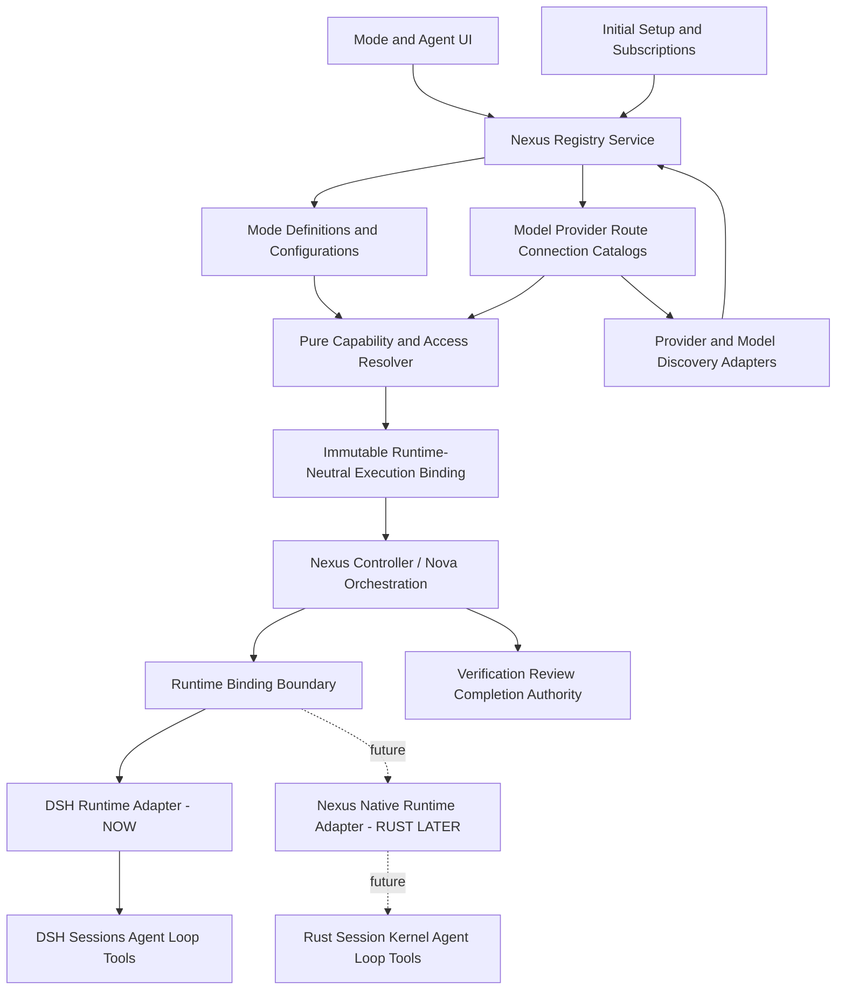

# Nexus Registry — Full Architecture Specification

**Status:** DRAFT / Target architecture (not implemented)  
**Version:** 0.2 — Runtime-independent Registry architecture refinement  
**Date:** 2026-10-08  
**Near-term sequence:** Restricted CCv2 dev baseline → Model Registry v1 → Engineering Mode v3 (Nexus Nova) → competition feature freeze / CI / benchmarks  
**Long-term sequence:** Nexus Native Runtime (Rust session kernel → native agent loop/tools) → incremental DSH/PowerShell retirement → full durable CCv2 native integration  
**Repository baseline:** Original review: `feature/content-compaction-v2` at `bb2a2be9d823f1b7ea45a7626e5a4de42a357feb`. Refreshed implementation review: `dev` at `9e81dadde73a` (2026-10-08 point-in-time). `main` was `194ee08b3376`; check again before coding.  
**Audience:** Nexus maintainers, implementation agents, reviewers, and future contributors

> **Scope note:** This file is the **updated version of the original v0.1 specification**, not a replacement design. Existing decisions remain in force unless a v0.2 refinement explicitly narrows them. Proposed `registry/*`, `Connection Registry`, host APIs and runtime interfaces are **targets, not implemented code**. In particular, **Registry v1 does not build the Rust runtime**.
>
> **CCv2 status correction (dev baseline):** Restricted CCv2 read-only compilation and validated request-time projection are integrated into `dev`. Durable CCv2 writes/session mutations, structured-memory production and mutating recovery are **frozen**; native DSH compaction remains usable. The legacy Nexus CCv1 writer has a separate known stale-writer ownership defect. Registry v1 neither depends on these future CCv2 features nor fixes them.

---

## 1. Executive summary

Nexus currently exposes profiles such as `deepseek-codex`, `glm-codex`, `muse-spark-1.3-contributor` (Meta) and `muse-spark-1.3-contributor-opencode` (OpenCode Go). This combines **orchestration architecture**, **agent-role configuration**, **model identity**, and sometimes **provider route** in user-facing profile choices. Every new model/provider combination risks adding another profile and duplicating configuration in multiple files.

**Decision:** The user-facing selector will contain only three Engineering Modes:

- **Engineering Mode v1** — deprecated, retained for compatibility;
- **Engineering Mode v2** — currently active, single-agent, still used to develop v3;
- **Engineering Mode v3 / Nexus Nova** — target next-generation multi-agent orchestration; **not yet implemented**.

After selecting a mode, users configure that mode's **agent slots** with **models and routes**. Providers, models, subscriptions and transport adapters are independent layers. **Added v0.2 invariant:** the entire Registry is Nexus-owned and **execution-runtime-independent**. DSH-specific projection, presets, session semantics and host APIs are confined to a replaceable **DSH Runtime Adapter**. The future Rust-based Nexus Native Runtime will consume the same stable Registry contract without migrating logical models, provider records, model routes or user mode configurations.

The six conceptual registries/entities are:

1. **Mode Registry** — orchestration architecture and agent-slot schema.
2. **Mode Configuration** — persisted user-selected assignments per mode.
3. **Model Catalog** — logical models and their capability metadata.
4. **Provider Registry** — API providers, transport protocol and endpoint metadata.
5. **Model Route Registry** — provider-specific offers of logical models.
6. **Connection Registry** — installed accounts, credentials references, supported subscription integrations and authorization state.

**Critical constraint:** Registry refactor must *not* change controller semantics, task identity, routing decisions, reviewer permissions, verification authority, CCv2 behavior, or task lifecycle. v1/v2 behavior must remain equivalent until deliberately changed under separately approved milestones. **No permanent DSH or PowerShell dependency is permitted inside the Registry Core.**

### 1.1 Expected user experience

```text
NEXUS
  Mode: [ Engineering v2 ▼ ]

  Agent Configuration
    Main Engineer
      Model:      [ Muse Spark 1.3 Contributor ▼ ]
      Route:      [ OpenCode Go ▼ ]
      Reasoning:  [ XHIGH ▼ ]

  [ Configure Providers ] [ Add API ] [ Save ]
```

For v1, the UI offers **three user-facing model slots**, while existing internal roles remain intact. For v3, the expected **~five roles are provisional** until its agent-runtime contract is finalized. The UI renders what the selected mode manifest declares, not a hardcoded `if (mode === 'v3')` form.

---

## 2. Baseline: existing Nexus implementation

The following describes **the reviewed branch**, not the proposed architecture.

### 2.1 Existing configuration chain

```text
UI / profile selection
     |
     v
config/nexus-profiles.json
  -> entry id / engine = dual | muse
     |
     +--> config/engineering-profiles.json   [dual]
     |       -> execution-class / role bindings
     |
     +--> config/muse-profiles.json          [muse]
             -> model.primary / reasoning policy
     |
     v
config/model-registry.json
  -> provider id, model id, capabilities, reasoning maps
     |
     v
data/settings.yaml (installed runtime copy of config/settings.yaml)
  -> llm-pi-ai.providers: API, baseURL, credential reference, models
     |
     v
DSH / PiAi transport substrate
```

Observed module responsibilities:

| Existing file | Present purpose | Refactor impact |
|---|---|---|
| `config/nexus-profiles.json` | User-facing profile → `dual`/`muse` engine | Legacy catalog → migration source, then retire old profile combinations |
| `config/engineering-profiles.json` | Dual role → model/reasoning bindings | Preserve v1 semantics; translate to v1 slot configuration |
| `config/muse-profiles.json` | Muse single-agent model and reasoning policy | Preserve v2 semantics; migrate to one slot + policy |
| `config/model-registry.json` | Models + capabilities + provider mappings | Split into logical models and provider-specific routes |
| `config/routing-policy.json` | Execution classes, escalation, presets, routing safety | Remains authoritative for deterministic routing; evolve minimally |
| `config/settings.yaml` / `data/settings.yaml` | DSH provider transports + user settings | Generated/validated transport projection; user config preserved |
| `config/Nexus-Profiles.cjs` | JS Nexus profile resolver | Compatibility adapter; replace with a versioned registry resolver |
| `config/Engineering-Profiles.cjs` | JS dual resolver and role capability checks | Temporary adapter; deduplicate via authoritative contract |
| `scripts/NexusProfiles.ps1` | PowerShell Nexus profile resolver | Temporary adapter for deterministic controller |
| `scripts/Routing.ps1` | Deterministic routing & engine dispatch | **Protect**, adapt only configuration input boundary |
| `scripts/EngineeringProfile.ps1` | Profile editor state / authoritative save | Introduce versioned mode-config endpoints, preserve old calls |
| `scripts/SettingsMigration.ps1` | Additive managed provider route migration | Continue supporting old installs; replace vendor-special paths with generic projector |
| `config/AihController.cjs` | GUI ↔ deterministic task controller | Protect identity/lifecycle logic; consume compiled snapshot |
| `config/Muse-Isolation.cjs` | Enforces complete controller-produced Muse target | Preserve fail-closed enforcement; do not re-resolve per request |
| `ui/nexus-controller/lib/engineering.cjs` | UI-side role metadata / mirror validation | UI becomes server-schema driven |
| `ui/nexus-controller/lib/client.js` | Profile UI and engine state bridge | Replace profile combinations with modes + slots |
| `ui/nexus-mode-selector/lib/client.js` | DSH agent-preset selection / model synchronization | Expose real mode identities; internal preset mapping only |

### 2.1A Refreshed `dev` status and review scope (2026-10-08)

The original v0.1 file described the pre-merge feature branch. The refreshed `dev` baseline (`9e81dadde73a`, commit subject `merge: restricted CCv2 development integration (#29)`) changes the release interpretation, **not** the Registry design goal:

- Restricted CCv2 compiler/read-only projection and model-context pieces exist, with safeguards; **do not claim durable CCv2 is complete**.
- DSH still owns actual agent loop, conversation/session data, tool execution host and its native compaction.
- PowerShell controller/routing/profile migration code remains an authoritative compatibility path.
- Registry-specific DSH coupling is observed in preset selection, active `data/settings.yaml` / `llm-pi-ai.providers`, DSH service access and provider-specific request/session wiring.
- The audit below is **exhaustive for the known Registry-related boundaries reviewed**, not a claim that every incidental DSH reference anywhere in the repo was enumerated. R0 must repeat a repo-wide dependency search on the exact implementation commit.

**Do not merge Registry directly from an old CCv2 branch without rebasing on the approved `dev`/release baseline and running the restricted-CCv2 guards.**

### 2.2 Architectural debt to remove

- **Mixed identity:** `Profile` currently mixes configuration and orchestration choice.
- **Identity duplication:** `muse-spark-1.3-contributor` and `muse-spark-1.3-contributor-opencode` represent the same nominal checkpoint offered via two routes.
- **Mirrored validation:** role requirements and engine compatibility are implemented in PowerShell, CJS and UI code; lockstep tests prevent drift but duplicate maintenance burden remains.
- **Implicit mode/engine mapping:** the UI's visible `aih-engineering` selection can map to internal `aih-muse` depending on preferred profile state.
- **Hardcoded bootstrap models:** `MODE_SELECTIONS` still carries DeepSeek defaults even when the effective profile/mode routes elsewhere.
- **Static provider migrations:** DSH route additions involve template and migration code; there is no general user-facing provider management contract.

### 2.2A DSH coupling inventory — temporary adapters versus architectural lock-in

**Classification key:** **TEMP** = acceptable inside the DSH/runtime integration layer during migration; **LOCK-IN** = prohibited if it becomes a stable Nexus Registry Core concept; **KEEP** = existing authority/boundary, not replaced as part of Registry.

| Existing component / seam | Observed coupling | Classification and action |
|---|---|---|
| `config/settings.yaml`, installed `data/settings.yaml` | DSH `llm-pi-ai.providers` entries, transport aliases, wire-format knobs, model listings | **TEMP:** DSH settings projection. **LOCK-IN** if this YAML becomes the canonical model/provider store. |
| `scripts/SettingsMigration.ps1` | Additive, sometimes hardcoded textual DSH provider-route migrations | **TEMP:** legacy install/upgrader compatibility. **LOCK-IN** if every new provider needs bespoke PowerShell template surgery. |
| `config/model-registry.json` | Logical model catalog currently embeds provider-specific target keys and provider mappings | **LOCK-IN** if reused unchanged as the new domain schema. Split logical model, model route and provider identities in new core, import legacy entries. |
| `config/nexus-profiles.json`, `config/muse-profiles.json`, `config/engineering-profiles.json` | Engine identities, model/profile combinations, DSH-associated preset selection and legacy role bindings | **TEMP:** migration inputs. **LOCK-IN** if public Registry mode identities equal DSH preset names or vendors. |
| `config/Nexus-Profiles.cjs`, `scripts/NexusProfiles.ps1` | Top-level profile → engine/preset validation, including pinned DSH agent-preset grammar | **TEMP:** compatibility resolution. New Registry mode manifests must not expose `aih-*` as public mode identifiers. |
| `config/Engineering-Profiles.cjs` | Core is mostly pure CJS, but install-root discovery can prioritize `DSH_HOME`; resolves old settings/profile files | **TEMP** for loading historical state. **LOCK-IN** if canonical Registry resolver or storage paths depend on `DSH_HOME`. |
| `scripts/Routing.ps1` | Deterministic Dual/Muse routing; controller persists model/provider/reasoning decisions | **KEEP** existing authority. **TEMP** shim converts a validated Registry snapshot to its old target contract; never put DSH decision logic into Registry. |
| `scripts/EngineeringProfile.ps1` | Preferred profile persists under `engineering-profile:` in DSH-owned user settings | **TEMP** legacy read/write and migration alias. **LOCK-IN** if Registry settings directly patch YAML text as normal persistence. |
| `ui/nexus-mode-selector/lib/client.js` and `index.js` | Hardcoded `aih-engineering`/`aih-muse` mapping, live DSH session preset synchronization and model directory usage | **TEMP:** DSH UI runtime adapter. **LOCK-IN** if new Mode Registry imports DSH client services or assumes preset/session structures. |
| `ui/nexus-controller/lib/client.js`, `lib/index.js`, `lib/engineering.cjs` | UI mirrors legacy profile validation, reads DSH settings, uses DSH controller state and web-server bridge | **TEMP** for the installed host. New UI uses Nexus Registry host API and schema; DSH state reading stays in host adapter. |
| `config/AihController.cjs` | DSH plugin lifecycle/session binding, env metadata, task authority, event/usage observation | **KEEP** controller and task invariants; **TEMP** DSH binding/event projection. **LOCK-IN** if the Registry imports DSH events, mutates session histories or relies on DSH plugin hooks. |
| `config/Muse-Isolation.cjs` | Enforces a controller-persisted Muse target against DSH `aih-muse` binding and session state | **KEEP** fail-closed contract. **TEMP** DSH enforcement adapter; Registry must not resolve a different model while an active session is bound. |
| `config/ContextCompaction.cjs` and restricted CCv2 bridge/runtime files | DSH session events, context surfaces and native compaction integration | **OUT OF SCOPE** of Registry Core. Future native CCv2 integration belongs to a later runtime milestone, not v1. |
| DSH/PiAi provider transport, session headers (including OpenCode session continuity) and tool APIs | Transport/streaming, provider-specific egress, live sessions and tool calls | **TEMP** inside DSH Runtime Adapter and provider-wire adapters. **LOCK-IN** if provider identities, model discovery or durable Nexus configuration require DSH boot. |

**Audit search in R0:** include `DSH_HOME`, `AIH_INSTALL_ROOT`, `llm-pi-ai`, `agentPreset`, `aih-muse`, `modelDirectories`, DSH remote sessions, providers, tool events, context surface/events and session headers; record remaining references with owner and removal criterion. A reference is not automatically a defect: dependency *direction* matters.

### 2.3 What must NOT be rewritten as part of Registry

- Deterministic task controller and routing authority.
- `taskInstanceId`, workspace/repository/checkout identity, session generation guards.
- Attempts, evidence, verification, review gates, completion authority.
- CCv2 snapshots/checkpoints/trust semantics and compacted-context integrity.
- Separate v1 Dual and v2 Muse agent-plane behavior until parity proven.
- Existing read-only reviewer and approval-gated writable solver boundaries.
- Provider isolation and no-silent-fallback guarantees.

**Preservation principle:** replace configuration *feeding* the controller; do not replace the controller.

---

## 3. Goals and non-goals

### 3.1 Goals

1. Mode selector shows only `v1`, `v2`, `v3`, with honest status/availability.
2. Mode manifest defines visible agent slots and the mapping to internal runtime roles.
3. Each slot selects an eligible logical model, provider-specific route, and valid reasoning policy.
4. Same checkpoint can be reached via multiple separately identified routes.
5. User can add OpenAI Responses-, Chat Completions-, and later Anthropic Messages-compatible providers from settings **without writing new application code** when their supported capabilities match an existing adapter.
6. Initial setup can discover connected subscriptions/API providers and **verified eligible routes**, with a clear distinction between subscriptions and API access.
7. Support explicit manual model addition when discovery endpoints are unavailable.
8. All resolution is validated on the authoritative backend; the UI never invents model compatibility.
9. Persist a stable, reproducible resolved configuration for new tasks/sessions; preserve running tasks' bound targets.
10. Safe migration from existing built-ins and operator custom profiles; reversible during rollout.
11. Registry domain objects, schemas, discovery, entitlement/capability resolution and mode configurations remain stable when the DSH execution backend is replaced by Rust.
12. Support a small, explicit Nexus-owned **runtime binding boundary** now, backed by a DSH adapter; no Registry Core import of DSH, PowerShell or Rust types.
13. Preserve manual model refresh and support opt-in, rate-limited new-model discovery/notifications without silently activating or changing models.

### 3.2 Non-goals for Registry milestone

- Building Engineering v3 itself, agent orchestration heuristics, new roles, or agent runtime code.
- Implementing a Rust session kernel, native tool runtime, native agent loop, native storage or transactional ownership/fencing as part of Registry v1.
- Creating a generic cross-runtime execute/cancel bridge if the installed DSH boundary does not yet require it; define evolvable contracts without reimplementing the loop.
- Changing or completing CCv2 algorithms, durable writes, session mutation, structured-memory production, mutating recovery or the separate legacy CCv1 stale-writer defect.
- Replacing the DSH/PiAi transport implementation wholesale. DSH is a **temporary, replaceable execution adapter**, not the target architecture.
- Generalizing arbitrary subscriptions into unrestricted HTTP model APIs.
- Scraping browser sessions, extracting third-party tokens, or bypassing subscriptions' usage policies.
- Promising all advertised models are usable in every slot or with every provider.
- Creating automatic failover across vendors by default.
- Changing v1/v2 output quality, reasoning escalation, tool restrictions, safety policy or permissions.

---

## 4. Core architecture and responsibility boundaries



**Provider ≠ execution runtime.** A provider supplies inference; a runtime owns the session/agent/tool execution process. The selected **Engineering Mode** is an orchestration policy/generation, not automatically an execution host. The DSH adapter implements the initially supported host; the Rust adapter comes **after Registry v1 and Nova**. Registry Core neither imports DSH client APIs nor writes DSH session state.

### 4.1 Strict separation of responsibilities

| Concept | Owns | Must NOT own |
|---|---|---|
| Mode Definition | Orchestration engine identity, slots, permissions requirements and role mapping | Physical host ID, DSH preset names as stable public IDs, credentials |
| Mode Configuration | User selections for each slot, per-slot reasoning/options | Control-plane routing code |
| Logical Model | Identity, family/checkpoint, generic proven capabilities | Authentication, subscription billing, URL |
| Provider | Inference endpoint, protocol, dialect and supported model discovery interface | Engineering role semantics, DSH session lifecycle or Rust kernel state |
| Model Route | A provider's concrete remote model offer and verified capabilities | Agent orchestration policy |
| Connection | Account/credential reference, auth flow, entitlements, allowed billing source | Logical model identity or task completion truth |
| Resolver/Compiler | Logical model/access/route eligibility, slot + runtime capability intersection, exact portable target compilation and errors | DSH preset selection, session writes or model execution |
| Controller | Execution class, task/role routing, attempts, evidence, verification, completion | Secret lookup from UI; dynamic provider catalog edits |
| Provider Adapter | Inference HTTP/SDK wire dialect, auth injection at execution boundary, streaming and provider errors | Mode selection, session ownership or unapproved fallback |
| Model Discovery Adapter | Authorized model listings/probes and their provenance | Direct writes to DSH session/configuration or automatic activation |
| Runtime Binding Adapter | Map a **validated immutable Nexus binding** to a host-specific setup and capability report | User-facing model identity, credentials persistence, re-resolving an active task |
| Execution Runtime | Host sessions, agent turns, tool lifecycle, cancellation/continuity, host persistence | Model catalog authorship, provider-entitlement assumptions or mode policy decisions |

---

### 4.2 Dependency rule: Core must compile and test without DSH

- `registry/core` (suggested TS/Node module) may depend on JSON schemas, pure validators, local **Nexus-owned** persistence ports and injected provider/connection descriptors. It **must not import** DSH modules, `llm-pi-ai` YAML parsers, DSH GUI client services, PowerShell or Rust FFI.
- Model/provider discovery adapters may call **documented vendor endpoints** with explicitly authorized credentials. Discovery happens outside any agent session and never requires DSH initialization.
- DSH integration projects a compiled binding into DSH-compatible agent presets, provider routes, setting fragments and session binding APIs. It is an anti-corruption adapter, not Registry persistence.
- Future native integration consumes the same `ResolvedExecutionBinding`, preserving Nexus-owned IDs and policies. The Rust runtime may have its own provider egress implementations, but it cannot redefine the Registry's canonical model identity or mode configuration.
- Provider wire compatibility is tested **per runtime**: provider route capability (`toolCall`, `reasoning`, `streaming`) is insufficient unless the selected execution host can faithfully handle it.

### 4.3 Stable versus host-specific identifiers

| Stable Nexus identity | Host-specific implementation detail |
|---|---|
| `modeId`, `orchestrationEngineId`, `slotId`, `roleId` | DSH `aih-engineering`, `aih-muse` preset, future Rust entrypoint |
| `logicalModelId`, `providerId`, `routeId`, `connectionId` | DSH provider key in `llm-pi-ai.providers`, Rust transport factory ID |
| `configurationRevision`, `resolutionId`, `taskInstanceId` | DSH session event index, future kernel commit sequence |
| requested and verified reasoning semantics, role permissions | provider-specific request fields, DSH request-level `reasoningEffort` |

Existing legacy IDs are **losslessly imported as aliases**; no forced rewrite of in-progress session bindings. An identifier's storage shape can be versioned without renaming a model merely because its execution host changes.

## 5. Data contracts (proposed schema v1)

**Naming rule:** persistent IDs are immutable; display names are not identifiers. Use an explicit schema version for every stored document. Never persist plaintext secrets in any registry.

### 5.1 Mode Definition

Built-in, signed/reviewed configuration; installed under a proposed `config/registry/modes/` directory.

```json
{
  "schemaVersion": 1,
  "id": "engineering-v1",
  "displayName": "Engineering Mode v1",
  "status": "deprecated",
  "orchestrationEngineId": "dual-v1",
  "slots": [
    {
      "id": "engineer",
      "label": "Engineer",
      "required": true,
      "internalRoles": ["primaryEngineer", "deepEngineer", "fallback"],
      "requirements": { "toolCalling": true }
    },
    {
      "id": "reviewer",
      "label": "Independent Reviewer",
      "required": true,
      "internalRoles": ["reviewer"],
      "requirements": { "readOnlyEnforced": true }
    },
    {
      "id": "solver",
      "label": "Approval-gated Solver",
      "required": true,
      "internalRoles": ["solver"],
      "requirements": { "writeRequiresApproval": true }
    }
  ],
  "optionalCapabilities": ["visualReviewer"]
}
```

**Important v1 detail:** Existing v1 configuration has **five required internal role bindings** (`primaryEngineer`, `deepEngineer`, `reviewer`, `solver`, `fallback`) plus optional `visualReviewer`. The new user-facing **three slots** group the major logical agents, **not** erase internal roles. Role-specific reasoning, fallback choice and optional visual review must remain configurable in an **Advanced** section or preserved through a compatible compiled mapping. This grouping is a proposed UI simplification, not an assertion that all old roles always used the same model.

**Engine v2 example:**

```json
{
  "schemaVersion": 1,
  "id": "engineering-v2",
  "displayName": "Engineering Mode v2",
  "status": "active-legacy",
  "orchestrationEngineId": "muse-v0",
  "slots": [
    {
      "id": "main",
      "label": "Main Engineer",
      "required": true,
      "internalRoles": ["muse_main"],
      "requirements": {
        "toolCalling": true,
        "adaptiveReasoningContract": "muse-v0",
        "singleAgent": true
      }
    }
  ]
}
```

**v2 generalization caveat:** v2 currently has Muse-specific reasoning governor, isolation and target handling. UI must **not** advertise arbitrary model compatibility solely because a model supports tool calls. A non-Muse model becomes eligible only after its adaptive reasoning and execution contract is verified, or after explicitly extending v2 under a separate tested adapter. For Registry Phase 1, preserve the current accepted Muse routes.

**Engine v3 design placeholder (NOT a frozen role contract):**

```json
{
  "schemaVersion": 1,
  "id": "engineering-v3",
  "displayName": "Engineering Mode v3 / Nexus Nova",
  "status": "planned",
  "orchestrationEngineId": "nova-v3",
  "slots": [
    { "id": "planner", "label": "Planner", "required": true },
    { "id": "engineer", "label": "Engineer", "required": true },
    { "id": "reviewer", "label": "Reviewer", "required": true },
    { "id": "verifier", "label": "Verifier", "required": true },
    { "id": "specialist", "label": "Specialist", "required": false }
  ]
}
```

These five v3 roles are **illustrative only**; final authority, tools and slot names belong to the v3 ADR. The compiler must reject activation of `planned`/not-runnable modes, while allowing preview/configuration where appropriate.

**v0.2 clarification:** `orchestrationEngineId` means the internal Nexus policy/runtime generation (`dual-v1`, `muse-v0`, `nova-v3`), **not** the execution host (`dsh` or future `native-rust`). The v0.1 proposal called this `runtimeId`; treat `runtimeId` as an import alias during transition, not a permanent host coupling. The compiler selects a **compatible runtime adapter only at task binding**, outside persisted user mode manifests.

### 5.2 Mode Configuration

Operator-owned file (illustrative): `data/registry/mode-configurations.json`.

```json
{
  "schemaVersion": 1,
  "activeModeId": "engineering-v2",
  "configurations": {
    "engineering-v2": {
      "revision": 7,
      "slots": {
        "main": {
          "logicalModelId": "meta/muse-spark-1.3-contributor",
          "routeId": "opencode-go/muse-spark-1.3-contributor",
          "reasoning": "xhigh"
        }
      }
    }
  }
}
```

The model and route are selected independently only when the route belongs to that logical model and meets that slot's required capabilities. Bindings support optional per-internal-role overrides (`reasoning`, `routeId`, `logicalModelId`) for legacy v1 cases. Unknown fields should be rejected in write APIs unless versioned extension fields are explicitly supported.

### 5.3 Logical Model Catalog

Built-in entries are versioned; user entries are added separately. A logical model represents a concrete model/checkpoint or an explicitly defined equivalence class—not merely a marketing family name.

```json
{
  "schemaVersion": 1,
  "id": "meta/muse-spark-1.3-contributor",
  "vendor": "Meta",
  "displayName": "Muse Spark 1.3 Contributor",
  "checkpoint": "muse-spark-1.3-contributor",
  "capabilities": {
    "textInput": true,
    "imageInput": true,
    "toolCalling": true,
    "streaming": true,
    "reasoning": true
  },
  "dataUseTier": "contributor"
}
```

Do not claim two provider offerings are the *same checkpoint* if it cannot be established. When provenance is uncertain, preserve separate logical models or mark identity as `unverified`. Dataset/data-use tier metadata follows the concrete route/checkpoint; do not silently equate contributor and standard variants.

**v0.2 runtime rule:** Logical model records carry **no** DSH agent/preset names, DSH session ids, Rust type names or execution-host assumptions. Context window and reasoning metadata require source/provenance/freshness, and actual usable token budgets are negotiated with the selected route and runtime.

### 5.4 Provider Registry

Describes transport capability, not login/account authorization.

```json
{
  "schemaVersion": 1,
  "id": "opencode-go",
  "name": "OpenCode Go",
  "transportId": "openai-responses",
  "baseUrl": "https://opencode.ai/zen/go/v1",
  "discovery": { "strategy": "provider-models-endpoint" },
  "status": "enabled"
}
```

The base URL shown above is taken from the reviewed Nexus settings; it is **not** a guarantee that an endpoint is currently accessible. The provider record does **not** contain a secret. Implementation must support route-specific adapters for contractual differences such as OpenCode session headers, developer/system-role support, max-token fields and tool-call continuation.

**Minimum transport IDs:**

- `openai-responses` — existing supported substrate path.
- `openai-chat-completions` — existing supported substrate path.
- `anthropic-messages` — **future/conditional** adapter, not presumed already available.
- `local-openai-compatible` — adapter reuse with local endpoint restrictions.
- `agent-sdk` — **separate kind of execution**, not a drop-in raw model transport.

**v0.2 transport rule:** `transportId` refers to a **wire protocol/dialect** such as OpenAI Responses, **not** the DSH implementation of that protocol. A runtime adapter reports which dialects it implements. Import current DSH provider keys as `legacyDshProviderId` in adapter-private mapping, not as the only way to find a canonical provider.

### 5.5 Model Route Registry

A route is a *specific* provider offer of a logical model, with a remote model ID and configuration constraints.

```json
{
  "schemaVersion": 1,
  "id": "opencode-go/muse-spark-1.3-contributor",
  "providerId": "opencode-go",
  "logicalModelId": "meta/muse-spark-1.3-contributor",
  "remoteModelId": "muse-spark-1.3-contributor",
  "accessType": "api-key",
  "connectionId": "conn-opencode-go-1",
  "executionKind": "raw-model",
  "reasoningLevels": ["minimal", "low", "medium", "high", "xhigh"],
  "compatibility": {
    "transport": "openai-responses",
    "toolRoundTrip": "verified",
    "streaming": "verified",
    "vision": "unknown"
  },
  "availability": "verified"
}
```

**Key distinction:** `executionKind: "agent-tool"` or `"agent-sdk"` must NOT be offered as a raw model route if the slot requires raw messages + controlled tool-result continuations. A model can be listed as *discoverable* yet be *not eligible* for a particular slot.

Suggested route states: `discovered`, `auth-required`, `probe-required`, `verified`, `unavailable`, `disabled`, `policy-blocked`, `unknown`; a provider list result alone is never proof of successful inference.

**v0.2 access rule:** `executionKind` (`raw-model`, `agent-sdk`, etc.) is independent from **execution host**. A subscription-backed SDK may be a provider integration with a **different execution contract**, but is never silently masqueraded as an API-key raw model and never earns eligibility solely from appearing in discovery results. This remains true after the Rust transition.

### 5.6 Connection Registry

Represents connection/auth/billing context. This supports both standard API keys and legitimately authorized subscription-backed integrations.

```json
{
  "schemaVersion": 1,
  "id": "conn-claude-pro-1",
  "providerId": "anthropic",
  "connectionKind": "subscription-agent",
  "authMethod": "official-supported-flow",
  "credentialRef": "credential://connections/conn-claude-pro-1",
  "subscriptionClaim": "pro",
  "subscriptionVerification": "pending",
  "executionKind": "agent-sdk",
  "permissions": [],
  "usageSource": "subscription-plan-limits",
  "status": "not-connected"
}
```

`subscriptionClaim` is **user-supplied and untrusted until verified**. A `subscription-agent` may expose an official agent workflow without any raw-model API route. UI must communicate that distinction.

---

## 6. Relationship rules and invariants

```text
ModeDefinition 1 ── * AgentSlots
ModeConfiguration 1 ── * SlotAssignments
SlotAssignment * ── 1 LogicalModel
SlotAssignment * ── 1 ModelRoute
ModelRoute * ── 1 Provider
ModelRoute * ── 0..1 Connection
Connection * ── 1 Provider
Provider * ── 1 ProtocolDialect (supported by zero or more execution runtime adapters)
```

**Validation order:**

1. Schema/version validation (no unsupported mode or stale data).
2. Mode is installed and selectable; orchestration engine is installed and selected execution **host/runtime adapter** is available if execution is requested.
3. Required slots fully bound; unsupported optional slots ignored only by explicit policy.
4. Logical model exists, is enabled, and matches the route's `logicalModelId`.
5. Route is enabled and its provider and connection are resolvable.
6. Authentication/entitlement is valid for the selected connection and execution kind.
7. Required capabilities exist at **route** level, not just model family level.
8. Reasoning request is explicitly supported/mapped; never silently downshift.
9. Security/policy requirements for read-only reviewer, tool access, write approval and data use hold.
10. Provider endpoint/dialect and **chosen runtime adapter** jointly support required requests, tools, streaming, context handling and session/continuation semantics.
11. Compile a deterministic, immutable **runtime-neutral** target for the session/task; delegate only the host-specific projection to the runtime binding adapter.

**Fail closed** for missing auth, incompatible transport, unknown reasoning, missing required roles, unsupported execution kind, or unintended data-use tier. No hidden substitution with another account or provider.

---

## 7. Runtime resolution, execution and session lifecycle

### 7.1 Two-stage resolution

**Stage A: Configuration compiler (before task starts):**

```text
selected mode + slot assignments
    -> validate and resolve each route
    -> check declared capabilities of the selected execution host
    -> compile a runtime-neutral ResolvedModeConfiguration
    -> pin config revision and route identities
```

**Stage B: Deterministic controller (during task):**

```text
pinned snapshot + task identity + existing routing policy
    -> choose execution class / internal role
    -> select corresponding pinned target
    -> persist provider/model/reasoning/role in routing state
    -> hand an immutable target to the selected runtime binding adapter
    -> DSH agent plane execution NOW; Nexus Native Runtime LATER
    -> preserve existing verification + completion authority
```

The Registry must *not* introduce its own opaque routing authority; it decides what configurations are valid and compiles targets, while the controller decides which step/role actually runs. **The Registry is not an agent loop, tool executor, or session kernel.**

### 7.1A Three distinct decisions (no DSH entanglement)

1. **Model/route/access resolution (Registry):** resolve desired logical model, verified provider route, entitled connection, role requirements, reasoning/context constraints and data-use policy. No DSH APIs.
2. **Execution-host compatibility and binding (runtime boundary):** intersect the resolved route requirements with the selected host's capabilities. Generate a versioned, immutable `RuntimeModelBinding` containing **opaque Nexus identity references**, no credentials or host session objects. Adapter privately converts it to DSH preset/provider format (now) or a native Rust request (later).
3. **Turn and tool execution (runtime + controller):** controller authorizes the role and task outcome; runtime owns per-turn session state, provider-specific continuity data, token-stream ingestion, tool call/response pairing and cancellation semantics.

Neither provider discovery nor the persisted Registry catalog requires a live DSH session. An **agent SDK route** is marked as a distinct execution kind and offered only when the host/runtime contract and role contract allow it.

**Provider-specific continuity owner:** the execution host's provider-wire integration stores and safely reuses required opaque continuation state (for example provider request IDs, tool-call handshake state or approved per-conversation headers). The Registry only pins the **chosen connection, route, reasoning mode and capability contract**. The adapter must not regenerate/change these choices during resume. When continuity state is missing or invalid, **fail closed** and return a typed error; do not synthesize unsupported provider state.

### 7.2 Resolved mode snapshot (illustrative)

```json
{
  "schemaVersion": 1,
  "modeId": "engineering-v1",
  "orchestrationEngineId": "dual-v1",
  "configurationRevision": 4,
  "resolutionId": "sha256-of-canonical-resolved-config",
  "roles": {
    "primaryEngineer": {
      "providerId": "zai-direct",
      "remoteModelId": "glm-5.3-flash",
      "reasoning": "high"
    },
    "deepEngineer": {
      "providerId": "zai-direct",
      "remoteModelId": "glm-5.3-flash",
      "reasoning": "max"
    },
    "reviewer": {
      "providerId": "sol-local",
      "remoteModelId": "gpt-5.6-sol",
      "reasoning": "medium",
      "readOnly": true
    },
    "solver": {
      "providerId": "sol-local",
      "remoteModelId": "gpt-5.6-sol",
      "reasoning": "high",
      "requiresApproval": true
    },
    "fallback": {
      "providerId": "zai-direct",
      "remoteModelId": "glm-5.3",
      "reasoning": "max"
    }
  }
}
```

The snapshot is **immutable for a bound task**. Credential references can be revalidated at request time without changing the selected account/model/route. Revocation makes the task fail safely, not switch models. Retain enough non-secret historical route metadata for audits and replay.

**v0.2 binding contract:** This snapshot is portable and does not contain DSH session IDs, DSH event indexes, DSH YAML blocks, Rust handles, API keys or refresh tokens. A separate adapter-owned execution record may reference the snapshot's `resolutionId` and track its host-specific session handle. This separation permits eventual host cutover for **new tasks**, not magical mid-session migration of DSH state into Rust.

### 7.3 When settings change

- A **blank/new session** can receive a newly selected mode and updated mode config.
- A **running session with task history** remains pinned to its original engine/config; surface “applies to next new session”.
- A **task resume** must recover the original `taskInstanceId`, engine, route, and config snapshot rather than reinterpret current global preferences.
- Settings writes are atomic, revision-checked and rollback-safe.
- If a route disappears while in use: report actionable error; no silent Meta↔OpenCode switch.
- Explicit switch/fallback can only occur via a later, separately designed, user-approved policy with telemetry; not part of Registry v1.

### 7.4 Mode mapping / internal presets

User-facing `engineering-v1` / `engineering-v2` / `engineering-v3` are independent of DSH identifiers. A Nexus-owned mode manifest maps modes to *orchestration engines*; the **DSH runtime adapter** privately maps v1/v2 to current DSH internal presets (and v3 to its later DSH host integration). The **future Rust adapter** will use native entrypoints instead. Neither the UI nor canonical Registry schemas know `aih-muse` or DSH bootstrap provider names.

**Do not rename/remove pinned DSH presets in Phase 1.** The compatibility adapter maps from the new user-facing mode to installed preset IDs and preserves existing guards.

---

## 8. Dynamic model and provider onboarding

### 8.1 Add Provider workflow

```text
Settings → Connections & Providers → Add Provider
  1. Name, supported protocol/adapter, base URL
  2. Choose auth method and save secret via trusted credential store
  3. Validate endpoint / authentication (opt-in network)
  4. Discover models where supported
  5. Choose models or Add Model Manually
  6. Probe route capabilities (including tool round-trip)
  7. Save route as VERIFIED only when required checks pass
  8. Eligible routes appear in compatible Mode slots
```

Adding a standard compatible provider does not require new provider-specific PowerShell routines. New wire protocols, security constraints, nonstandard SDKs, or vendor-only semantics may require a dedicated adapter. `Test Connection` is distinct from `Test Model Capability`.

### 8.2 Discovery and capability evidence

Three evidence levels:

| Level | Example | Eligible? |
|---|---|---|
| `advertised` | model ID appears in provider listing | Not enough for execution |
| `declared` | documented capabilities + route config | May be shown, needs checks for critical roles |
| `verified` | auth + actual round-trip + role requirements satisfied | Yes, for the tested slot/execution kind |

Minimum probes: auth, text completion, streaming (when required), tool-call emission, tool-result continuation, reasoning request mapping, stable session/header behavior, appropriate token-cap field, and normalized error semantics. Vision, structured output and parallel tools are optional probes when required. Probes use synthetic data; no source repository or private notes are sent just to list models.

Do not infer vendor limits or feature support from model names. Mark unknowns as `unknown` and refuse only those routes/slots requiring verified support.

### 8.3 Provider transport reuse

The existing DSH/PiAi substrate already supports configured `openai-responses` and `openai-completions` routes. **Reuse it in the temporary DSH Runtime Adapter**, rather than implementing one bespoke HTTP client per provider or creating Rust transport work in Registry v1. Model/protocol descriptors and discovery must nevertheless be Nexus-owned and runtime-neutral. The DSH adapter handles host-specific projection; a later Rust adapter implements the necessary wire transports independently or through its native provider drivers. Preserve exact wire semantics for reasoning, caching, streaming chunks, tool calls, provider-specific continuation and output limits.

**Avoid a false abstraction:** creating a `ProviderAdapter` contract does not require implementing HTTP twice now. In v1, pure discovery may use authorized provider endpoints and the existing DSH substrate still owns live inference. Introduce a native provider client only when a runtime actually needs it. The same provider record can be bound to either supported host if **its tested route capabilities** match both.

### 8.4 Local models

Local Ollama/vLLM/OpenAI-compatible endpoints may be registered if a supported transport adapter can reach them and probes pass. Local routes must have explicit endpoint/network policy (loopback by default), not automatic remote exposure. Unknown models can be manually added with route-level capability evidence.

---

## 9. BONUS: Initial Setup — Subscription & Provider Discovery

### 9.1 User story

At first launch, the user chooses the subscriptions and services they actually use, e.g. **ChatGPT Plus, Claude Pro, OpenCode Go**, plus separate API keys or local servers. Nexus guides the user through **officially supported authorization**, discovers offered models or agent capabilities where possible, validates eligibility, and populates the catalogs.

**Core rule:** “I pay for ChatGPT Plus/Claude Pro” is *not* equivalent to “I own unrestricted OpenAI/Anthropic API access.” A subscription may support an authorized **agent workflow**, while a separate API key supports programmable raw-model calls. An advertised model list is also not proof that the user's plan includes a particular model.

### 9.2 Proposed Wizard screens

```text
[1] Welcome / Choose Services
    [ ] ChatGPT / Codex subscription
    [ ] Claude / Claude Code subscription
    [ ] OpenCode Go / Zen
    [ ] OpenAI API
    [ ] Anthropic API
    [ ] Other API Provider
    [ ] Local Server

[2] Connect Each Service
    - Official sign-in / approved delegation OR API key
    - Do not request account password or copy browser cookies
    - Show plan usage vs separately billed API usage

[3] Discover & Verify
    - Discover API models when service supports it
    - Discover agent capabilities/approved models when available
    - Probe compatible routes without exposing private workspace data

[4] Assign to Modes
    - v1: Engineer / Reviewer / Solver + Advanced role policy
    - v2: Main Engineer
    - v3: preview only until runtime is implemented

[5] Review & Save
    - Show access type, billing source, data-use policy, limits
    - Explain unresolved/restricted models
    - Atomic commit of configs, secrets as references only
```

### 9.3 Connection capability taxonomy

| Connection kind | Typical setup | Possible output | Raw agent-slot compatibility |
|---|---|---|---|
| `api-key` | Official API key, possibly model discovery | `raw-model` routes | Only after probes and slot validation |
| `subscription-agent` | Official provider-supported OAuth/CLI/SDK authorization | Agent-tool / SDK workflows | **Not automatically** a raw-model backend |
| `subscription-delegated` | Participating third-party product integration, approved sharing | Provider-defined allowed requests | Only where Nexus is formally supported and contract fits |
| `local-server` | Local endpoint, no remote account | Local raw-model route | After local endpoint and capability probe |
| `manual-unknown` | User entry lacking verification | Discoverable metadata only | Not runnable until verified |

### 9.4 Provider-specific accuracy guardrails (as of 2026-10-08)

- **ChatGPT Plus:** included ChatGPT usage and standard OpenAI API billing are separate. Official *Sign in with ChatGPT* subscription sharing exists for **participating** tools and requires separate user authorization; **do not assume Nexus is approved**. Codex participation/allowance must be checked against the official integration contract at implementation time. Sources: https://help.openai.com/en/articles/6950777-what-is-chatgpt-plus and https://help.openai.com/en/articles/20001542-using-your-chatgpt-plan-in-other-apps-and-sites .
- **Claude Pro:** Claude Code can be used on a subscription plan; standard Claude API billing is separate. Anthropic documentation states that Claude Agent SDK / `claude -p` / eligible third-party use continue to count toward subscription limits under the June 2026 update, but these terms can change. Use only officially documented and permitted authentication/SDK surfaces; do not treat an existing login token as a general-use API credential. Sources: https://support.claude.com/en/articles/11145838-use-claude-code-with-your-pro-or-max-plan and https://support.claude.com/en/articles/15036540-use-the-claude-agent-sdk-with-your-claude-plan and https://support.claude.com/en/articles/9876003-i-have-a-paid-claude-subscription-pro-max-team-or-enterprise-plans-why-do-i-have-to-pay-separately-to-use-the-claude-api-and-console .
- **API model discovery** is independent from subscription/UI model pickers. Do not mirror every model visible in ChatGPT/Claude apps into Nexus as a usable raw-model route without proof.
- **Model lists and entitlements are mutable.** Track the `lastVerifiedAt`, mechanism, available scopes and source in Connection Registry; refresh on demand, login change and failed permission checks.

**Implementation constraint:** unsupported first-party OAuth/agent integrations must show `Not supported yet` with a clear official alternative (if any), not a fake connected state. No unofficial browser session reuse, credential extraction, ToS bypass or hidden API reuse.

### 9.5 Subscription vs API execution

```text
Choose ChatGPT Plus
    -> authorized Codex / participating integration, if supported
    -> agent-capability record / delegated route
    -> NOT automatically openai-responses raw-model access

Choose Claude Pro
    -> supported Claude Code / Agent SDK flow, if permitted
    -> agent-sdk execution kind / verified capabilities
    -> NOT automatically anthropic-messages API credentials

Choose OpenAI API or Anthropic API
    -> API key
    -> list models if supported
    -> probe compatible raw-model routes
    -> assign only eligible routes to agent slots
```

### 9.6 Refresh policy

- `Refresh Models` is explicit user action, rate limited and cancellable.
- **Preserve planned automatic new-model notifications:** an optional scheduled discovery job may compare versioned catalog snapshots, mark additions as `discovered`, and notify about newly available candidates. Only after auth/entitlement/capability verification may it label a route *eligible*; **never auto-select, auto-upgrade or mutate active bindings**. Auto-refresh/notifications remain a staged post-core feature, not a prerequisite for R1. Separate *model announced*, *accessible*, and *runnable* notifications.
- Startup does local metadata validation without surprise network requests; optional refresh can be opt-in.
- Failed refresh never silently deletes active user assignments; it marks routes stale/unavailable and reports why.
- Plan limits are displayed only when a sanctioned API exposes them; do not invent balance or remaining tokens.
- Subscription usage and API cost are distinct budget meters, with explicit source labels.

---

## 10. UI / UX contract

### 10.1 Main toolbar

```text
Mode [Engineering v1 | Engineering v2 | Engineering v3]
```

- Show v1 as **Deprecated**, v2 as **Active / Legacy**, v3 as **Planned / Preview** until runnable.
- Only mode IDs in the main selector. No `deepseek-codex` / `muse-direct` / `muse-opencode` variants there.
- On a newly selected mode, present its slots in a single configuration drawer/modal; preserve each mode's last assignment.
- Changing a mode in a running session stages the selection for the next new session.

### 10.2 Agent configuration panel

For each slot: logical model, route/provider selector (grouped by provider), reasoning (only valid choices), capabilities and connection/billing status, `Advanced` settings for role-specific overrides. Incompatible routes may be shown with an explanation but cannot be selected for execution.

For v1, advanced fields must preserve independent `primaryEngineer`, `deepEngineer`, `fallback`, `reviewer`, `solver`, and optional `visualReviewer` mappings; a simplified three-slot UI must not discard differences when loading existing configurations.

### 10.3 Settings screens

```text
Settings
  Models & Providers
    Providers
    Model Catalog
    Model Routes
    Connections & Subscriptions
    Discovery / Capability Tests
  Engineering Modes
    v1 configuration
    v2 configuration
    v3 preview
```

Buttons must have real behavior: `Add Provider`, `Add Model`, `Connect`, `Test`, `Discover`, `Refresh`, `Remove`, `Disable`, `Export Non-Secret Config`, `Validate`, `Save`. Removing a provider with pinned or saved references requires a warning; no destructive implicit cascade.

### 10.4 Errors and observability

Examples of actionable errors:

- `mode-runtime-not-installed`
- `mode-config-incomplete`
- `slot-capability-not-satisfied`
- `route-unverified`
- `connection-auth-required`
- `subscription-not-api-access`
- `reasoning-level-not-supported`
- `route-model-identity-mismatch`
- `existing-task-pinned-to-prior-config`
- `provider-transport-unsupported`

UI should display: **what failed, exact selected route, why, what user can do**. Telemetry may record error code and non-secret IDs only.

---

## 11. Registry service, APIs and storage

### 11.1 Suggested internal service boundary

`RegistryService` is the single **Nexus-owned and host-independent** configuration authority, with pure functions for resolution/validation and a small persistence adapter. Controller-facing calls consume *compiled snapshots*, not raw user settings. The code must be importable and testable with DSH uninstalled, PowerShell absent and Rust unavailable. Provider discovery and credential lookup are injected adapters, not Registry Core imports.

Suggested pure operations:

```ts
type ModeId = "engineering-v1" | "engineering-v2" | "engineering-v3";
type RouteId = string;
type LogicalModelId = string;

type ResolveResult =
  | { ok: true; snapshot: ResolvedModeConfiguration }
  | { ok: false; errors: RegistryValidationError[] };

function listModes(): ModeDefinition[];
function listEligibleRoutes(modeId: ModeId, slotId: string): EligibleRoute[];
function validateModeConfig(config: ModeConfiguration): RegistryValidationError[];
function compileModeConfig(config: ModeConfiguration, registry: RegistrySnapshot): ResolveResult;
function validateProviderConfig(provider: ProviderConfig): RegistryValidationError[];
```

Implementation note: **PowerShell and JS consumers must not independently decide model eligibility.** Make the versioned schema + backend compiler authoritative. During migration, a compatibility wrapper may call existing PowerShell validators; parity tests enforce equivalence until redundant copies can be retired.

### 11.2 Versioned host endpoints (proposed)

```text
GET    /nexus/registry/v1/modes
GET    /nexus/registry/v1/modes/:id/configuration
PUT    /nexus/registry/v1/modes/:id/configuration
GET    /nexus/registry/v1/models
GET    /nexus/registry/v1/providers
POST   /nexus/registry/v1/providers
POST   /nexus/registry/v1/providers/:id/discover
POST   /nexus/registry/v1/routes/:id/probe
GET    /nexus/registry/v1/connections
POST   /nexus/registry/v1/connections/:id/connect
POST   /nexus/registry/v1/resolve
POST   /nexus/registry/v1/migration/preview
```

These are design examples, **not existing routes**. Every mutation needs CSRF protections (when applicable), local/authenticated caller checks, input validation, expected revision (`If-Match` / equivalent), bounded payload sizes and audit records without secrets. Avoid unauthenticated loopback admin write APIs.

### 11.3 Storage layout (proposal, subject to repository conventions)

```text
config/registry/
    modes/engineering-v1.json
    modes/engineering-v2.json
    modes/engineering-v3.json       # planned / not executable
    built-in-models.json
    built-in-providers.json
    registry.schema.json

data/registry/
    mode-configurations.json        # operator-owned
    custom-providers.json           # operator-owned, no secrets
    custom-models.json              # operator-owned
    routes.json                     # operator-owned / materialized
    connections.json                # credential references only
    migration-state.json            # schema revisions / provenance
    snapshots/                     # immutable non-secret task bindings

# Host-specific projection/state belongs OUTSIDE data/registry/:
# data/runtime-adapters/dsh/...    # suggested DSH adapter-owned cache/bindings
# future native kernel store       # native runtime-owned session/persistence
```

`data/.credentials.yaml` (existing protected store) or a platform secret store remains responsible for secret values, with a precise owner and permissions. Use DSH settings only as a validated **adapter projection** into the existing transport, and do not overwrite user-owned provider routes during migration. Avoid a two-writer setup where UI edits the generated DSH file and another component independently edits the registry. The projected file must never become authoritative model metadata or require DSH to initialize Registry Core. New native runtime storage and transaction ownership are **future work**, not a Registry v1 dependency.

### 11.4 Installation and atomicity

Built-ins are upgraded from Git-managed files; operator-owned data is never blindly overwritten. Writes should use temporary file + fsync/atomic rename (where supported), backup, optimistic concurrency, schema validation and rollback. No partial mode-config save; one failed route rejects the full attempted configuration write.

---

## 12. Security and policy constraints

1. **Secrets:** never log/store API keys, OAuth access tokens, cookies or refresh tokens in registry artifacts, URL params, model messages, screenshots, traces or export files. Credentials are permission-restricted and referenced by opaque IDs.
2. **Subscription auth:** only official supported OAuth/SDK/CLI flows; no scraping or token theft. Distinguish identity login from granted subscription usage scope.
3. **Transport/network:** validate custom URLs, disallow implicit redirects to different hosts, block SSRF on untrusted private/local IPs unless explicitly and securely configured, restrict TLS downgrade, redact error bodies.
4. **Role permissions:** reviewer read-only is enforced by tool/runtime permissions, not inferred from the model/provider name. Solver writes still require controller approval.
5. **Consent:** disclose contributor/data-use tiers and provider logging/training policies where known, and require explicit approval before sharing repository data with a newly connected service.
6. **Tool control:** model routes never grant themselves tools. Modes define required capabilities and the existing controller enforces actual execution permissions.
7. **Provider failover:** no silent fallback between paid/free/training-data tiers; any future fallback policy must be separately reviewed, opt-in and auditable.
8. **Task binding:** persistent snapshots cannot be modified retroactively by UI settings changes or provider refresh.
9. **Plugin / adapter isolation:** limit filesystem/network permissions for third-party adapters; validated IDs and vetted transports only.
10. **Revocation:** disconnect immediately prevents future requests; resume fails clearly if its pinned connection has been revoked.
11. **Prompt injection:** provider discovery/model descriptions and external metadata are untrusted data; never treat them as instructions or executable configuration.
12. **Privacy mode:** surface the destination connection and data-use policy before any agent run using newly added providers.

---

## 13. Migration plan: no big-bang rewrite

### 13.1 Preconditions

- Restricted CCv2 read-only/projection development baseline is integrated and **stable** on the implementation branch; **do not require** frozen durable CCv2 functionality or claim it is complete.
- Native DSH compaction remains enabled where currently supported. No Registry code uses unimplemented CCv2 durable mutation. Legacy CCv1 stale-writer ownership is a **known separate defect**, not silently fixed or made more reachable by Registry.
- Choose and pin the approved integration base (`dev` contained restricted CCv2 at `9e81dadde73a` in the point-in-time review); check `main`/`dev` and updated tests before branching.
- Baseline v1/v2 regression suite and deterministic routing fixture corpus are frozen.
- Current settings/profiles from a live install are backed up and reversible.
- No simultaneous changes to CCv2 or v3 orchestration behavior during Registry rollout.

### Phase R0 — Baseline / Freeze

Document and snapshot actual execution semantics, all role requirements, preset selection, API routes, data-use policies, single-agent Muse behavior, task/resume contracts and profile persistence. **Complete the DSH coupling/dependency-direction inventory (§2.2A), record binding and session-continuity ownership, and add an offline no-DSH import test target.** Run current test suites and record baseline outputs. Expose no new UI yet.

**Deliverable:** current-behavior matrix; no runtime changes.

### Phase R1 — Schema and pure resolver

Introduce ModeDefinition, Model, Provider, Route, Connection and ModeConfig schemas; immutable IDs; **host-neutral `ResolvedExecutionBinding`**; pure compiler; validation errors; test fixtures. Generate migrated configurations from *existing* profiles in read-only mode and compare resolutions with legacy resolvers. Test `Registry Core` without DSH/PowerShell and with a fake `RuntimeCapabilities` descriptor.

**Deliverable:** proven new configuration model without changing execution paths.

### Phase R2 — Legacy compatibility adapter

Map:

| Old profile | New target |
|---|---|
| `deepseek-codex` | `engineering-v1` + DeepSeek engineer + Codex reviewer/solver + exact role overrides |
| `glm-codex` | `engineering-v1` + GLM engineer + Codex reviewer/solver + exact role overrides |
| `custom` | `engineering-v1` + every original binding preserved |
| `muse-spark-1.3-contributor` | `engineering-v2` + Muse via Meta Direct |
| `muse-spark-1.3-contributor-opencode` | `engineering-v2` + Muse via OpenCode Go |

Keep legacy profile IDs as import aliases. Do **not** claim all existing profiles can be represented by just three flat model IDs; retain per-role overrides and exact provider IDs. Compare resolved provider/model/reasoning, route permissions and fail-closed outcomes, not only display names. **Place DSH provider key/preset projection exclusively in a narrow compatibility/runtime adapter, never inside Mode/Model/Connection registries.**

**Deliverable:** reversible migration, no behavior change.

### Phase R3 — Registry-backed UI

Replace user-facing profile list with v1/v2/v3, dynamic slot form, mode configuration storage, route selection and capability-driven server responses. Keep DSH internal preset mapping **inside DSH Runtime Adapter**. New/blank sessions only; running sessions stay pinned. A user chooses models from Registry, **not a DSH model directory**.

**Deliverable:** clean UX without controller rewrite.

### Phase R4 — Provider Registry / Manual APIs

Implement add/edit/disable provider, independent route discovery, manual model entry, capability probes, credential references and DSH transport projection through the **DSH adapter**. Discovery must run with no DSH process/session. Preserve existing managed/user custom settings; no provider-specific static editing in the new UI pipeline.

**Deliverable:** add supported compatible API via UI, verified route becomes eligible.

### Phase R5 — Subscription Discovery Wizard

Add connection records and authorized discovery for integrations **actually supported** by each service. Show `subscription-agent` vs `raw-model` distinctly. Implement official supported connection paths first; mark unsupported auth flows accurately rather than inventing token reuse. Preserve `Refresh Models` and design opt-in new-model notifications as a separable discovery/notification worker; no automatic target swaps.

**Deliverable:** onboarding with truthful access model and guided configuration.

### Phase R6 — Controller integration / legacy retirement

Make the controller consume compiled **host-neutral** mode snapshots at session/task binding through the **thin DSH Runtime Binding Adapter** while retaining existing runtime/policy enforcement. No generic rewrite of `execute()`, tool loop or controller is required in v1. Remove duplicate resolution code and stale profile catalogs only after parity suite passes, upgrade/rollback paths are exercised, and feature flag rollout is stable.

**Deliverable:** one authoritative configuration service; no forced changes in task execution logic.

### Phase R7 — Release and gate for v3

Fresh install, upgrade install, Linux/Windows, restart, crash recovery, binding pinning, secret-leak checks, **Registry import/discovery without DSH**, all role/protocol probes, and end-to-end v1/v2 behavior equivalence. Tag Registry release. **Only then start v3.** Rust/native execution, CCv2 durable mutation and full DSH retirement are **not release blockers or work items** for Registry v1.

---

## 14. Compatibility and backward-compatibility rules

- Legacy config files stay readable during migration; remove only behind a versioned transition after backups and parity.
- Legacy environment precedence (e.g. `DSH_AIH_PROFILE`, `AIH_ACTIVE_PROFILE`, `engineering-profile:` in user `settings.yaml`, locked presets) is explicitly audited and translated; no silent precedence drift.
- `aih-deepseek` remains a locked DSH preset where needed, even if it is not a user-facing Engineering Mode entry. Its locked behavior must not be weakened.
- Existing `aih-muse` internal isolation only runs when the controller produced a valid v2 Muse target.
- Existing role class aliases (`deepseek_normal`, `codex_review`, etc.) continue to decode persisted records.
- New configuration does not mutate historical routing ledger entries, CCv2 projection artifacts, or any CCv2 checkpoint histories. No reactivation of durable CCv2 writers.
- Existing custom profiles containing different primary/deep/fallback/visual routes must survive migration losslessly.
- Migrations are idempotent and preserve user-edited provider settings and credentials.

---

## 15. Testing strategy and acceptance criteria

### 15.1 Deterministic contract tests

| Test category | Must prove |
|---|---|
| Schema | Invalid versions, unknown IDs, duplicate routes, malformed provider URL rejected |
| Mode manifests | v1 exact internal role mapping; v2 one main agent; v3 planned not executable |
| Compatibility | Legacy v1/v2 profiles compile to identical model/provider/reasoning targets |
| Permissions | Read-only reviewers cannot write; solver still approval-gated |
| Reasoning | Unsupported or unmapped efforts rejected, never downshifted |
| Route identity | Same model via multiple providers yields distinct routes and exact matches |
| Isolation | Dual task never enters Muse runtime, Muse task never enters Dual runtime |
| Persistence | Atomic save, revision conflict, restart integrity, rollback and idempotency |
| Pinning | Existing task stays on original route after global config switch |
| Secrets | No credential material in logs, routes, telemetry, exports, HTTP errors |
| User providers | Manual custom compatible provider can be installed without code edit |
| Discovery | Listing is not treated as verified runnable; failed probes surface accurately |
| Subscriptions | Paid ChatGPT/Claude plan never impersonates ordinary API credentials |
| CCv2 | Existing compaction/checkpoint/trust gates remain unchanged |
| DSH parity | Canonical **host-neutral** compiled targets project to identical valid DSH descriptors via the adapter |
| Core independence | Import/resolve/discover with DSH/PowerShell absent; no DSH YAML, session APIs or Rust types in public Registry schema |
| Runtime compatibility | Chosen execution host reports required capabilities; mismatch fails closed; no backend-specific assumption in catalog |
| Continuity | Provider headers, reasoning continuation and host session state remain adapter/runtime-owned, pinned, verified and never silently reset |
| Host migration | New task can bind the same catalog/config to another compatible mock runtime; active DSH task remains pinned |
| CCv2 restricted | Disabled durable writers stay disabled; request-time read-only projection and DSH native compaction unchanged |
| Upgrade | Existing runtime `data/settings.yaml` and custom profile survive upgrade |

### 15.2 Live/integration tests (credential-gated)

Run only with deliberate opt-in and legitimate credentials. Validate minimal text/streaming/tool round-trip/reasoning wire compatibility, error handling, connection revocation and optional capability probes. No repo data in routine integration probes; record only minimal redacted metadata.

### 15.3 Release acceptance (P0)

- [ ] User-facing selector has exactly v1/v2/v3 (status may disable v3).
- [ ] v1 existing DeepSeek+Codex, GLM+Codex, custom role variants preserve routing outputs and permissions.
- [ ] v2 Meta and OpenCode Go variants execute identically to pre-refactor under the same model/route and test inputs (allow nondeterministic text; compare controlled routing/state behavior).
- [ ] v2 reasoning governor and Muse isolation still enforce their precise contracts.
- [ ] New supported OpenAI-compatible provider can be added via UI without changing application source.
- [ ] Model route chooser filters by *verified route/slot* compatibility, not marketing name.
- [ ] Adding/refreshing a provider cannot change a running or resumed task's route.
- [ ] Settings and credentials are atomic, protected and migration-safe.
- [ ] Installer/upgrader are idempotent and preserve old installations.
- [ ] Subscription onboarding never claims raw API access from a subscription alone.
- [ ] CCv2, routing, verification, security and all relevant CI gates pass.
- [ ] Schema and migration documentation are versioned and checked into the repo.
- [ ] Registry domain logic and provider/model discovery work without a running DSH process, DSH SDK imports or PowerShell shell-outs.
- [ ] A single DSH adapter provides legacy preset/provider projection; canonical Registry files contain no `aih-*` preset or DSH YAML dependency.
- [ ] One mock second host with different capabilities can compile/check bindings without modifying model/provider/connection data. No Rust implementation required.
- [ ] Provider-specific continuation tokens/headers are not placed in Registry snapshots and cannot be silently reset by route refresh.
- [ ] Restricted CCv2 remains read-only/projection-only; durable writes and mutating recovery remain disabled.

### 15.4 Optional P1 improvements (not blockers for Registry release)

- Model search, grouping, favorites and per-slot presets.
- Explicit route health/latency and relative usage metrics.
- Cost and subscription budget warnings with accurate labeling.
- Export/import non-secret configuration and checksum validation.
- Automatic new-model discovery/notifications, opt-in, with backoff and provider-specific rate limits; announcements ≠ authenticated eligibility, and notification never silently replaces a pinned model.
- Dynamic provider feature flags and adapter conformance dashboards.

---

## 16. CI and engineering workflow

During Registry development, enforce formatting/static checks, schema validation, configuration compiler unit tests, legacy parity suites, UI integration, DSH substrate checks, Linux/Windows (where supported), fresh install + upgrade, security/credential tests and CCv2 regressions. Provider live tests are credential-gated and non-blocking when a required external account is absent; offline mock tests remain mandatory.

No production merge if differences in v1/v2 controller decisions, reviewer permissions, target identity or persisted task binding are unexplained. Compare input fixtures and expected **semantic** outcomes; raw natural-language model output is not a deterministic parity target.

After the restricted CCv2 baseline + Registry v1 + v3 are stable, keep the previously planned competition **feature freeze** until **John Atanasov**: focus on CI reliability and fair, controlled benchmarks versus Codex and Claude Code. **Long-term**, after Nova and the freeze, begin the Native Runtime in separately approved milestones, without folding Rust/kernel work into the Registry release. The Registry itself must not change the benchmark harness's scoring or task datasets.

---

## 17. Architectural decisions (proposed ADRs)

- **ADR-R001 — Modes are user-facing orchestration generations.** v1/v2/v3 are identities, not a product of mode × provider × model.
- **ADR-R002 — Slots are UI abstraction; internal roles remain authoritative.** v1 three visible agents do not delete five legacy internal role mappings.
- **ADR-R003 — Logical Model ≠ Route ≠ Provider ≠ Connection.** Avoid duplicate fake models per provider and unsupported same-checkpoint assumptions.
- **ADR-R004 — Controller is sole execution authority.** Registry validates/compiles; never routes or completes tasks independently.
- **ADR-R005 — Session/task snapshot is immutable.** No in-flight route changes from settings.
- **ADR-R006 — Backend contract owns compatibility.** No mirrored business logic in UI.
- **ADR-R007 — Reuse DSH transports temporarily via a DSH Runtime Adapter.** Protocols are Nexus-owned descriptors; not per-vendor HTTP rewrites and not a permanent DSH dependency.
- **ADR-R008 — Subscription discovery is entitlement-aware.** Official, permissioned integrations only; no subscription→API conflation.
- **ADR-R009 — Preserve v1/v2 behavior.** Strangler/compatibility migration, not a big-bang rewrite.
- **ADR-R010 — Registry precedes v3.** v3 consumes final configuration contracts and does not retrofit the legacy profile catalog.
- **ADR-R011 — Runtime-independent Registry Core.** Model/catalog, provider, discovery, access and policy resolution must not import DSH, PowerShell or Rust host internals.
- **ADR-R012 — Provider ≠ Runtime.** Inference source and host execution are separate identities and capability contracts.
- **ADR-R013 — DSH is an anti-corruption adapter.** DSH YAML, agent preset, session and tool events remain adapter-private.
- **ADR-R014 — Runtime-neutral immutable bindings.** Runtime adapter binds portable snapshots; active tasks preserve execution host, connection, route, reasoning and continuity contract.
- **ADR-R015 — Rust Native Runtime comes after v3.** Replace host capabilities behind adapter; preserve Registry schema and Nexus task authority.
- **ADR-R016 — Durable CCv2 deferred.** Restricted read-only/projection CCv2 is current; no durable CCv2 mutation in Registry v1.

---

## 18. Open design decisions before coding

1. **Final v1 slot UX:** how to expose `primaryEngineer` vs `deepEngineer` vs `fallback` when different models are intentionally configured; likely Advanced role overrides.
2. **v2 eligibility:** will Muse v0 remain Muse-checkpoint-specific until v3, or will we generalize its reasoning governor and isolation for other tool-capable models? Recommendation: **preserve Muse-specific v2 as-is in Registry** unless a separately tested extension is needed.
3. **v3 agent roles:** exact five-ish slots, write permissions, reviewers, verifier/controller separation and required interfaces are owned by v3 design.
4. **Registry implementation language:** **TypeScript/Node.js** Nexus-owned schemas/validation/compiler/discovery, published through a thin versioned interface for JS UI and current PowerShell clients. Avoid a PowerShell-owned or DSH-plugin-owned canonical resolver. Rust consumes the portable protocol later, not TS source through embedding.
5. **Storage:** JSON files vs SQLite for persistent registry data. Recommendation for Registry v1: schema-validated JSON + atomic writes and an explicit migration format; revisit only with concrete concurrency needs.
6. **Official subscription integration eligibility:** Nexus may not be an approved ChatGPT delegated-use integration; implement only available sanctioned paths and keep `not-supported` visible. Claude SDK availability/terms must be verified again at implementation time.
7. **Provider/account per-route policy:** one provider can have multiple accounts; clarify credential selection and billing consent without model identity duplication.
8. **Optional auto failover:** defer until after feature freeze; default remains no fallback.
9. **Capability evidence model:** define probe freshness, provenance, revocation behavior, and whether vendor docs or live test has precedence.
10. **Install root/data root identity:** legacy adapter maintains current `DSH_HOME`/`AIH_INSTALL_ROOT` behavior; new Registry Core uses an injected Nexus-owned configuration/data root. Changes require explicit tests for relocated installs.
11. **Runtime capability schema:** start with necessary tools/streaming/protocol/continuity/concurrency capabilities only, with tri-state `supported/unsupported/unknown` and scope/evidence. Avoid predicting the Rust kernel in Registry v1.
12. **Mid-session host transfer:** explicitly **unsupported** in v1/native transition by default. Existing DSH tasks finish or resume on DSH; only new tasks may bind to Rust after parity is proven.

---

## 19. Implementation handoff / instructions for coding agents

**Before any code change:** inspect the current branch (not this dated snapshot), compare `main`, `dev`, the **restricted** CCv2 integration and registry target branch. Verify which source is current for `Routing.ps1`, `AihController.cjs`, settings and UI. Read the related tests and docs. Do not assume a file from this document is unchanged or that durable CCv2 is enabled.

**Expected implementation order:** R0 baseline/DSH-coupling audit → R1 runtime-neutral schemas/resolve → R2 legacy parity + DSH projection → R3 UI → R4 provider discovery/management → R5 connections/subscriptions/refresh → R6 minimal DSH runtime binding adapter + controlled cutover → R7 release gate. Commit each milestone with reproducible tests and upgrade artifacts. Changes to CCv2, Nova orchestration or Rust execution are **out of scope** for Registry v1.

**Explicitly forbidden shortcuts:** replacing the controller, writing a new agent loop, folding DSH YAML/presets into Registry schemas, adding Rust/kernel code, touching CCv2 durable writers, collapsing v1 roles, accepting unsupported listed models, silently using pay-as-you-go API, copying browser cookies, mutating pinned task routes, disabling fail-closed guards, or changing security policy to make a demo work.

**Definition of success:** A user chooses one of v1/v2/v3 (v3 preview until installed), configures model slots, connects API accounts or sanctioned subscription integrations, and Nexus produces a secure, auditable, **runtime-neutral** immutable binding while keeping existing v1/v2 behavior unchanged via DSH. Engineering v3 can consume the Registry through the same interface, and future Rust can replace DSH for new executions without changing the Registry source-of-truth records.

---

## 20. Runtime-independent execution architecture (v0.2 decision)

> **Status:** Architectural direction is accepted for this specification; all types, ports and files below are **proposals**. Registry v1 implements only the minimum seams that current DSH-backed Nexus requires. No Rust, new agent loop or CCv2 durable implementation is authorized by this chapter.

### 20.1 Architectural ownership map

| Owner | NOW (Registry v1 / v2 compatibility) | LATER (Nova / Native Rust) | Forbidden cross-dependency |
|---|---|---|---|
| Nexus Registry Core (TS/Node) | Mode/model/route/provider/connection catalog, provenance, entitlement and role/capability validation, portable binding compile | Remains same source-of-truth contract | Importing DSH events, YAML, presets, Rust session internals |
| Provider/Discovery Adapters (TS/Node) | API authorization references, permissioned provider discovery, separate capability probes, immutable metadata updates | Same discovery contract; new protocols as needed | Calling the DSH agent loop to list models |
| Orchestration (existing controller/PowerShell, later Nova) | Task/role decision, approval, evidence, verification and task identity | Nova becomes long-term Registry consumer; controller authority can be migrated later | Redefining model identities or picking silent fallback routes |
| Runtime Model Binding (thin interface) | Validate selected host capabilities, project pinned binding to current DSH workflow | Project same portable binding to native Rust host | Modifying logical model/route/connection records, unapproved re-resolution |
| DSH Runtime Adapter (JS/installed compatibility) | DSH preset and provider settings projection, DSH session handle, SDK/tool/events, provider session continuity | Removed **only after** native parity and legacy task lifecycle plan | Becoming a permanent Registry API requirement |
| Nexus Native Runtime (Rust; not yet implemented) | **No work** | Authoritative session kernel/persistence, ownership fencing, agent loop, tools, host-side provider continuation | Maintaining competing copies of Registry catalogs or controller policy |
| CCv2 | Restricted read-only compilation and validated request-time projection; native DSH compaction possible | Full durable context/structured-memory integration after authoritative native session kernel | Registry writes to DSH context surface or CCv2 durable memory |

**ProviderAdapter** deals with how provider inference or metadata is represented; **RuntimeAdapter** deals with who owns sessions, tool turns and agent execution. The same provider can be supported in several runtimes, each with verified wire compatibility. An SDK that implements its *own* agent loop is explicitly marked as an `agent-sdk` execution kind, never confused with a raw-model provider.

### 20.2 Minimal interfaces — build only the necessary seam

This is a **TypeScript-like design sketch**; exact signatures and package boundaries require a short ADR. Favor plain data and a small set of pure operations. Do **not** implement these as a forest of classes in Registry v1.

```ts
// Stable Nexus-owned catalog/domain operations (Registry Core):
interface ModelRegistry {
  listModels(): readonly LogicalModel[];
  listRoutes(query: RouteQuery): readonly ModelRoute[];
  compile(input: ModeConfiguration, options: {
    access: AccessSnapshot;
    runtime: RuntimeCapabilities;
  }): ResolveResult<ResolvedExecutionBinding>;
}

// Optional adapters injected into the Registry service, not into runtime sessions:
interface ModelDiscoveryAdapter {
  discoverModels(connection: ConnectionRef): Promise<DiscoveryResult>;
}
interface ModelAccessResolver {
  resolveAccess(route: ModelRoute, connection: ConnectionRef): AccessDecision;
}

// Small boundary required by Registry v1. Implementation: DSH adapter now.
interface RuntimeModelBinder {
  describeCapabilities(): RuntimeCapabilities;
  prepareBinding(binding: ResolvedExecutionBinding): Promise<RuntimeBindingResult>;
}

// Not a Registry v1 implementation obligation. Extend when Nova/native
// actually requires runtime-controlled execute/cancel semantics:
interface AgentRuntime extends RuntimeModelBinder {
  execute(request: ExecutionRequest): AsyncIterable<ExecutionEvent>;
  cancel(executionId: string): Promise<void>;
}
```

In the first Registry PRs, `RuntimeCapabilities` can be a **fixture/data descriptor** and the DSH binder can be a **pure projector**. Don't wrap all currently active DSH remote APIs in `AgentRuntime.execute()` or change the DSH event loop just to satisfy a speculative interface. If compile-time capability checks only need a descriptor, implement that first. If task-binding needs a projection, add `prepareBinding` once there is a concrete safe host call site; no extra RPCs without a consumer.

Recommended initial `RuntimeCapabilities` fields: `runtimeAdapterId`, supported execution kinds (`raw-model`/specific SDK), supported protocol dialects, tool-round-trip and streaming support, continuation requirements, and schema revision. Add richer flags only when a real slot or DSH adapter check uses them. `unknown` must not be treated as supported for a hard role requirement.

### 20.3 Proposed portable `ResolvedExecutionBinding` contract

```json
{
  "schemaVersion": 1,
  "resolutionId": "sha256-canonical-nonsecret-binding",
  "modeId": "engineering-v2",
  "orchestrationEngineId": "muse-v0",
  "modeConfigRevision": 7,
  "roleId": "muse_main",
  "logicalModelId": "meta/muse-spark-1.3-contributor",
  "routeId": "opencode-go/muse-spark-1.3-contributor",
  "providerId": "opencode-go",
  "remoteModelId": "muse-spark-1.3-contributor",
  "connectionId": "conn-opencode-go-1",
  "executionKind": "raw-model",
  "protocolId": "openai-responses",
  "reasoning": "xhigh",
  "contextBudget": { "requestedTokens": 64000, "effectiveTokens": null },
  "requiredCapabilities": ["tool-round-trip", "provider-continuity"],
  "routeEvidenceRevision": 3,
  "policyRevision": 5
}
```

**Illustrative only**: values and budgets are not claims of live capability. The binding contains **no DSH preset**, DSH session ID, DSH YAML block, Rust object handle, key/token or host-specific continuity header. It may refer to a credential indirectly through `connectionId`; only the authorized execution boundary can resolve it.

- **Immutable identity:** bind `modeConfigRevision`, `routeId`, `connectionId`, remote model, reasoning and governing policy revision at task creation; persist an audit-safe `resolutionId` and an associated host binding record.
- **Capability freshness:** route evidence may expire for *new* tasks; refresh must not mutate a running task. For continuation, the host rechecks authentication/revocation and contract compatibility without selecting a different model.
- **Context budget:** distinguish advertised model maximum from provider/account effective limits and runtime reserve/overhead. `null` means unknown, **not infinite**; fail or request explicit allowance where required.
- **No mid-flight transfer:** DSH and Rust sessions are not bytewise compatible. Switch host on *new* tasks only until a separately proven/exported migration protocol exists.
- **Fail-closed:** missing or revoked credentials, protocol mismatch, lost required provider conversation state, unsupported reasoning and missing tools produce typed errors, **not automatic downgrade or provider substitution**.

The existing v1/v2 controller routing target remains the authoritative decision within each task. The binder consumes a validated selection; it does not create its own routing policy.

### 20.4 Runtime execution & session continuity boundaries

| Concern | Authority / v1 behavior | Rust future |
|---|---|---|
| User mode config, logical model, route, provider, access eligibility | Registry Core | **Unchanged** (Registry Core) |
| Execution-class/role selection, reviewer read-only, solver approval | Deterministic controller and existing guards | Nova/controller policy preserved; migrate deliberately |
| DSH engine preset, `llm-pi-ai.providers`, DSH model directory | DSH Runtime Adapter **only** | No DSH equivalent required; Rust binder uses native driver IDs |
| Active session, conversation events, tool pairing and cancellation | DSH host; controller owns task decisions | Rust session kernel/agent loop |
| Provider request continuation, headers, opaque reasoning/tool state | DSH provider wire implementation, behind adapter | Native provider wire implementation, under session kernel |
| Durable session ownership/fencing | Existing implementation/safety baseline, **not Registry** | Rust authoritative transactional ownership/fencing milestone |
| Context projection/compaction | Restricted CCv2 read-only request projection; DSH native compaction remains | Durable CCv2 integration **after native kernel safety** |
| Provider/model update notification | Registry discovery worker; user action for activation | Same worker and catalog, unchanged |

A **provider is not a runtime**: e.g. `opencode-go` denotes an inference/access offering; `dsh` denotes the execution host. `raw-model` versus `agent-sdk` is a third independent dimension. Never substitute one dimension for another because their names look similar.

### 20.5 DSH adapter implementation and anti-corruption boundary (NOW)

One thin host module translates portable bindings to **current verified DSH contracts**:

```text
Nexus Mode/Model/Connection Catalogs
       |  (pure resolve + authorization/capability checks)
       v
ResolvedExecutionBinding (immutable, host-neutral)
       |  (DSH Runtime Binding Adapter)
       v
Legacy profile / DSH provider route projection / agent preset mapping
       |  (unchanged controller and Muse isolation)
       v
DSH sessions + agent loop + tools + persistence
```

**Initial scope:** read installed DSH capabilities and known provider route descriptors; map resolved target to legacy IDs; validate complete target; ensure session bind is atomic under existing controller authority; retain existing DSH-managed custom/user routes and CCv2 restricted guards. Keep all DSH-specific YAML/SDK serialization inside that module. In Registry v1, use the existing DSH transport; no duplicate native HTTP inference client and no global refactor of `AihController.cjs`.

**Prohibited:** Registry Core reading `DSH_HOME`, editing DSH `session.events` or plugin state, importing Cordis/DSH modules, generating DSH presets in persistent canonical mode config, interpreting CCv2 context surfaces, or deciding task completion.

**Cutover rule:** never add a second live owner of provider/session/binding state. During R6, the legacy source remains authoritative until the exact new snapshot integration is enabled; after promotion, **one writer/authority** is nominated for each writable setting. Keep rollback and legacy alias import until parity is proven.

### 20.6 Replace DSH with Rust later — without Registry rewrite

**Prerequisites:** Registry v1 release and Nova v3 stable. Preserve the short-term competition feature freeze; Native Runtime is long-term and a separate project. No Rust implementation in Registry milestone.

1. **N0 — Contract verification:** freeze Registry schema and normalized execution event/conversation **requirements** from real Nova/DSH behavior; build conformance fixtures (not Rust implementation).
2. **N1 — Rust authoritative session kernel:** native durable session identity/storage, transactional ownership and fencing, crash recovery, replay semantics. Keep execution behind a feature flag; no silent cross-host task migration.
3. **N2 — Native agent loop/tool runtime:** implement controlled model turns, streaming, tool invocation/authorization and event normalization; bring provider protocols online one at a time using the **existing Registry route descriptors**, not DSH YAML.
4. **N3 — Runtime adapter conformance / gradual activation:** new session chooses native host only for explicitly supported modes/routes and successful contracts. Existing DSH tasks remain pinned. Compare routing/tool/continuity semantics, audit evidence and failure handling. Keep DSH fallback **only as an explicit new-task choice**, not within a bound task.
5. **N4 — Feature-by-feature migration:** move eligible PowerShell lifecycle/controller functions only after Rust/native boundaries demonstrably own those responsibilities; retire DSH/legacy adapters last.
6. **N5 — Full durable CCv2:** implement structured-memory production, durable session mutation and guarded recovery on the native kernel's exclusive session ownership primitives. Defer until the kernel enforces transactions/fencing and the stale-writer class is addressed in that domain.

**No Registry database migration is required solely by a runtime swap.** `modeId`, model/provider/route/connection IDs and revisioned user assignments remain Nexus-owned. Only host binding metadata and runtime-owned session state change. Cross-host resume is explicitly **not provided** unless separately designed and proven.

### 20.7 Registry v1 roadmap and PR slices — build NOW, not later

| PR / gate | Implement now | Deliberately defer | Done when |
|---|---|---|---|
| **R0 Baseline** | Freeze v1/v2 routes, Muse guards, DSH mapping and restricted CCv2 tests; inventory DSH imports and session continuity | Rust, CCv2 durable mutation | Reproducible parity fixtures and baseline matrix |
| **R1 Pure Registry** | TS/Node schemas, Nexus IDs, catalog and `compile` with injected runtime capabilities; offline no-DSH tests | Generic agent execute/cancel API | Pure compiler works with DSH absent; invalid bindings fail closed |
| **R2 Import and parity** | Read legacy profiles, preserve per-role overrides, alias IDs, compile exact provider/model/reasoning/permissions | Replacing routing policies | Deterministic v1/v2 target equivalence |
| **R3 UI** | v1/v2/v3 selector, per-slot route picker, advanced roles; server-provided compatibility | Making planned v3 runnable | Existing sessions remain pinned |
| **R4 Providers** | Provider/route management, safe credentials reference, discovery/probes; adapter-private DSH projection | Native inference drivers | DSH runs eligible custom supported route without vendor-specific core edits |
| **R5 Connections** | Official auth/entitlement discovery where supported; manual refresh; opt-in notifications as staged worker | Subscription token scraping, automatic provider switching | No subscription→API false claim; discovery independent of DSH |
| **R6 Binding integration** | Minimal DSH binder at task/new-session boundary, schema revision/pinning, feature-flag parity, rollback | Rewriting DSH loop/PowerShell | One authority, no route drift, no provider continuity loss |
| **R7 Release** | Linux/Windows/fresh install/upgrade/security/regression/CCv2 restrictions; offline contract CI | Native kernel, durable CCv2, cross-host resume | Registry v1 usable via DSH; green acceptance gates |

**After R7:** Nova v3 consumes the same Registry binding contract through DSH; only *after* Nova stabilization does the separately scoped Rust Native Runtime project begin. Freeze new features for competition CI and Codex/Claude Code benchmarks as already planned.

### 20.8 Additional conformance & failure tests

Registry v1 must pass all original §15 tests **plus**:

- **No-DSH imports:** `registry/core` loads and resolves with DSH modules, `DSH_HOME` and PowerShell unavailable; provider discovery uses mock HTTP/credential access without starting an agent session.
- **Runtime matrix:** identical Registry config checked against two mocked host capability descriptors returns an eligible binding for the supported host and `runtime-capability-unsatisfied` for the incompatible host.
- **Host-private projection:** DSH adapter projects known legacy targets exactly; public JSON contains zero `aih-*`, `llm-pi-ai` blocks, DSH session/event structures or secret material.
- **Session pinning:** changing provider offerings, active mode, account settings, model announcements or runtime preference never rewrites an active task's connection/route/model/reasoning/host.
- **Provider continuity:** route carrying required OpenCode (or other verified) provider session continuity preserves it across DSH reconnect/resume; missing required state fails closed instead of using a blank header/new model or changing reasoning.
- **Auth/access:** revoked account disallows new requests; subscription-only agent workflow never becomes a raw API route without a supported authorized path.
- **CCv2 isolation:** restricted request-time projection remains read-only; no disabled durable writer, legacy stale CCv1 writer or mutating recovery is invoked by Registry.
- **Upgrade/rollback:** projected DSH settings preserve operator-customized blocks and installed aliases, with one authoritative writer per setting.
- **Notification integrity:** new-model discovery is metadata-only; unverified announcement is not selectable as a verified executable route and never changes pinned tasks.

---

## 21. References

### Reviewed repository

- https://github.com/Kaloyan3D/Nexus/tree/dev (`9e81dadde73a` restricted CCv2 integration point-in-time)
- https://github.com/Kaloyan3D/Nexus/tree/feature/content-compaction-v2 (original v0.1 baseline)
- https://github.com/Kaloyan3D/Nexus/blob/feature/content-compaction-v2/config/nexus-profiles.json
- https://github.com/Kaloyan3D/Nexus/blob/feature/content-compaction-v2/config/engineering-profiles.json
- https://github.com/Kaloyan3D/Nexus/blob/feature/content-compaction-v2/config/muse-profiles.json
- https://github.com/Kaloyan3D/Nexus/blob/feature/content-compaction-v2/config/model-registry.json
- https://github.com/Kaloyan3D/Nexus/blob/feature/content-compaction-v2/config/routing-policy.json
- https://github.com/Kaloyan3D/Nexus/blob/feature/content-compaction-v2/scripts/Routing.ps1
- https://github.com/Kaloyan3D/Nexus/blob/feature/content-compaction-v2/docs/architecture/nexus-profiles.md

### Official subscription/API policy references (recheck before implementation)

- OpenAI ChatGPT Plus: https://help.openai.com/en/articles/6950777-what-is-chatgpt-plus
- OpenAI participating third-party usage: https://help.openai.com/en/articles/20001542-using-your-chatgpt-plan-in-other-apps-and-sites
- Anthropic Claude Pro / Claude Code: https://support.claude.com/en/articles/11145838-use-claude-code-with-your-pro-or-max-plan
- Anthropic Agent SDK and subscription plans: https://support.claude.com/en/articles/15036540-use-the-claude-agent-sdk-with-your-claude-plan
- Anthropic separate API billing: https://support.claude.com/en/articles/9876003-i-have-a-paid-claude-subscription-pro-max-team-or-enterprise-plans-why-do-i-have-to-pay-separately-to-use-the-claude-api-and-console

**End of specification — v0.2 runtime-independent refinement.**
