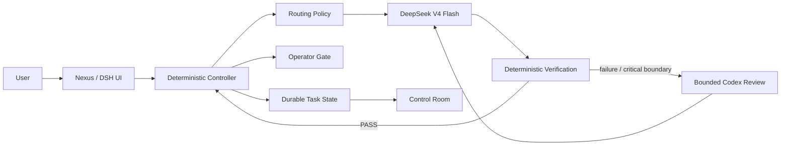

# Nexus

**A deterministic AI engineering harness with DeepSeek as the primary engineer, bounded Codex review, durable task state, and a live Control Room.**

Nexus turns a coding-agent session into a controller-owned engineering workflow. The model implements; the controller owns routing, attempts, verification, completion, and operator gates. The UI observes authoritative state instead of guessing from chat history.

> Windows-first. Built on the DeepSeek Harness (DSH) runtime without replacing its sessions, tools, permissions, Git integration, or web UI.

## Why Nexus

Most coding agents are conversation-first: the model decides what to do, remembers progress in context, and often decides for itself when the task is finished. Nexus moves the important engineering state out of the model and into deterministic controller records.



DeepSeek remains the normal root executor. Codex is not a parent agent and is not required for ordinary completion.

## Core features

- **Deterministic task controller** — task identity, execution class, attempts, evidence, verification, failures, review requirements, and completion live outside the model.
- **Execution classes** — mechanical checks, normal DeepSeek work, deeper DeepSeek reasoning, bounded Codex review, and explicit user-approved Codex solve paths.
- **Real attempt lifecycle** — GUI engineering turns create bounded attempts; reloads and reconnects do not create fake retries.
- **Verification evidence** — `/verify` records per-check command, status, exit code, attempt linkage, timestamps, and overall evidence.
- **Crash-safe reconciliation** — an interrupted verification is closed truthfully instead of remaining `verifying` forever or silently creating a new attempt.
- **Bounded Codex review** — fresh, read-only review packets with enforced file, diff, context, output, and call-count limits.
- **Operator gates** — controller-advertised actions such as Approve / Reject are validated server-side with stale/duplicate protection.
- **Control Room** — live Overview, Activity, Verification, and Files views backed by authoritative records.
- **RUNNING vs PREFERRED model visibility** — the UI separates the executor actually routed for the task from the session's preferred model/effort ceiling.
- **Workspace isolation** — identity is resolved as `session -> binding -> normalized workspace + taskId`; same task IDs in different repositories cannot contaminate each other.
- **Durable state** — JSON/JSONL task records survive model context limits, browser reloads, and Nexus restarts.
- **Fail-closed behavior** — missing, stale, corrupt, or unauthorized state is not silently converted into successful-looking UI state.

## Control Room

Nexus adds a lightweight compact Controller drawer plus an expanded **Task Control Room**.

| Surface | What it answers |
| --- | --- |
| **Overview** | What task is active, what state is it in, which attempt is running, which executor was routed, and whether operator action is required? |
| **Activity** | What authoritative lifecycle transitions happened, and when? |
| **Verification** | What checks actually ran, did verification PASS or FAIL, and what command/exit/timing data exists? |
| **Files** | What does Git currently report as changed for the bound workspace? |

The Control Room does not manufacture events from polling deltas. It reads controller/task records and renders them. Operator buttons are shown only when the current gate explicitly advertises those actions.

## Quick start

### Requirements

- Windows 10/11
- PowerShell 5.1+
- Internet access during installation
- A DeepSeek API key
- Optional ChatGPT/Codex authentication for bounded review

### Install

```powershell
git clone https://github.com/Kaloyan3D/Nexus.git
cd Nexus
powershell -NoProfile -ExecutionPolicy Bypass -File .\setup.ps1
aih-key
aih-auth   # optional: bounded Codex review
```

Then open Nexus from a project repository:

```powershell
aih -Open
```

Useful commands:

```powershell
aih-doctor -Offline
aih-test
aih-test-tiers       # live provider probes; may consume quota
aih-detect
aih-stop
```

Bulgarian quick start: **[docs/quick-start-bg.md](docs/quick-start-bg.md)**.

## Engineering modes

### Normal Engineering

DeepSeek V4 Flash is the root engineer. The controller may permit bounded Codex review when deterministic policy requires it.

### DeepSeek Only

DeepSeek V4 Flash remains the root engineer, while OpenAI/Codex inference is disabled and the policy fails closed instead of silently substituting another model.

## Execution classes

| Class | Purpose | Writable |
| --- | --- | ---: |
| `deterministic` | Mechanical lookup / verification with no LLM | No |
| `deepseek_normal` | Default implementation and debugging | Yes |
| `deepseek_deep` | Expanded DeepSeek reasoning after evidence-backed escalation | Yes |
| `codex_review` | Fresh, bounded, independent review | No |
| `codex_solve` | Exceptional explicit user-approved solve | Yes |

The default routing path is intentionally simple:

```text
deepseek_normal
  -> verify
  -> deepseek_deep repair when policy/evidence justifies escalation
  -> bounded codex_review when required
  -> DeepSeek repair
  -> deterministic completion
```

## Controller-owned completion

A model cannot mark its own task complete.

```text
acceptance criteria accounted for
+ required verification PASS
+ scope / architecture rules PASS
+ evidence present
+ policy-required review PASS (when applicable)
= controller COMPLETE
```

Critical or review-required failures may open an **operator gate**. The browser submits only bounded identifiers; the controller validates session binding, gate identity/revision, advertised actions, request identity, and current gate state before any transition.

## State and storage

Project-scoped engineering state lives under `.ai-harness`:

```text
.ai-harness/
  state/
    objective.json
    tasks.json
    decisions.jsonl
    learnings.jsonl
  runs/TASK-NNNN/
    manifest.json
    attempts.jsonl
    evidence.json
    context-manifest.json
    review-packet.json
    review-result.json
    telemetry.json
    artifacts/
    summary.md
```

Runtime bindings, routing history, gate journals, logs, credentials, installed packages, and sessions live outside committed project source. Credentials are never meant to be stored in task ledgers.

## Bounded Codex review

`codex_review` is an independent review service, not an unrestricted subagent. The current policy enforces a fresh packet and bounded call with limits for files, diff size, estimated context, output, and automatic calls per task. Full-repository context and writable Codex solve paths require explicit approval.

Automatic review is intended for repeated evidence-backed failure or critical boundaries—not simply because a task feels difficult.

## Security model

Nexus intentionally keeps authority narrow:

- the browser cannot directly edit task ledgers;
- session bindings resolve workspace/task identity server-side;
- stale or mismatched operator gates fail closed;
- verification failures are distinct from verification infrastructure failures;
- review results do not gain global completion authority;
- workspace escapes and sensitive external operations remain subject to controller/tool policy;
- `SEC001` detects potential persisted secret material while allowing explicit placeholder forms;
- `MIG001` surfaces tracked migration changes for explicit review.

See **[SECURITY.md](SECURITY.md)** for credential and reporting guidance.

## Documentation

Start at **[docs/README.md](docs/README.md)**.

- [Architecture overview](docs/architecture/overview.md)
- [Controller and authority](docs/architecture/controller.md)
- [Routing and execution classes](docs/architecture/routing.md)
- [Task, attempt, verification, review, and gate lifecycle](docs/architecture/task-lifecycle.md)
- [Control Room architecture](docs/architecture/control-room.md)
- [State and storage reference](docs/reference/state-and-storage.md)
- [HTTP endpoint reference](docs/reference/endpoints.md)
- [Setup, testing, and troubleshooting](docs/operations/setup-testing-troubleshooting.md)
- [Architecture decisions](docs/decisions/README.md)

Detailed implementation/history notes remain available in [docs/nexus-ui.md](docs/nexus-ui.md) and [docs/vnext-architecture.md](docs/vnext-architecture.md).

## Testing

Nexus includes deterministic PowerShell and Node regression suites for the controller, routing, lifecycle, verification contracts, gates, UI adapters, workspace isolation, patch idempotency, and architecture rules.

```powershell
powershell -NoProfile -ExecutionPolicy Bypass -File .\tests\Harness.Tests.ps1
node .\tests\NexusControllerPanel.Tests.cjs
```

Live provider probes are separate because they can consume quota.

## Design principle

> **The model performs engineering work. The controller owns engineering truth.**

That principle drives routing, attempts, verification, review, completion, persistence, and the Control Room.