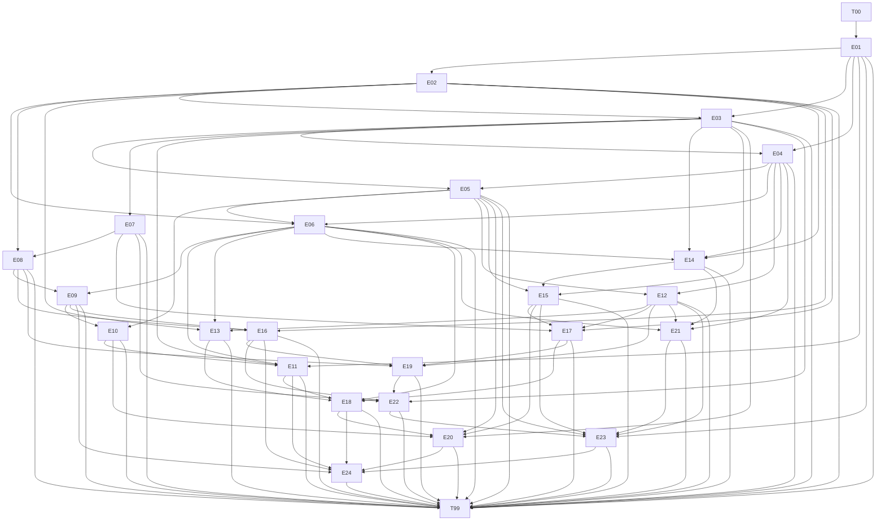

# Candidate dependency graph

UNFROZEN / LIVE_CALIBRATION_REQUIRED.

All 26 nodes have deterministic executable artifacts. Edges express consumed contract/data provenance; concrete consumer paths are verified separately by migration/API, recovery, retry/service, gateway and atomic-store probes. T99 runs all prior suites and integrates early, middle and late consumers. Graph validity is not proof of useful pressure or of an independently necessary effect for every edge.
