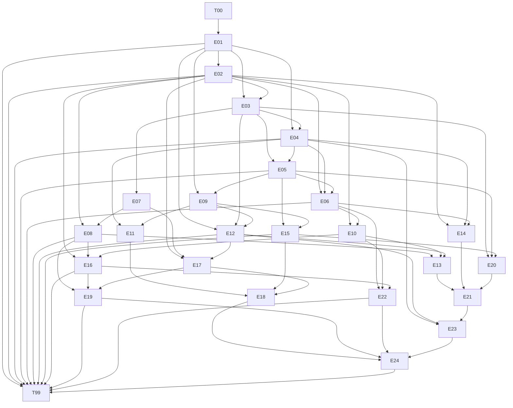

# Causal phase graph

The manifest defines proposed dependencies, not verified continuity. Executable consumer probes cover migration → API import and migration/authorization/prior commit → recovery; the complete graph remains a freeze requirement. E07–E24 and T99 are design only. Calibration executes T00 and E01–E06 once each. Far-distance edges include E02 → E14/E16/E17, E03/E05 → E20, E06 → E22. T99 refers to the established contract, without enumerating old facts. Hidden tests will check early/middle/late obligations independently; the official grader is not enabled in this delivery.
