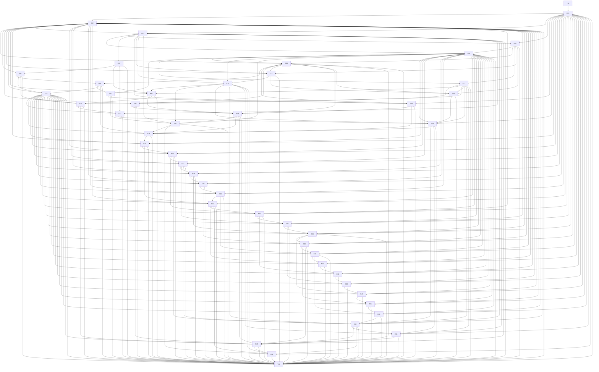

# Candidate dependency graph

The frozen candidate contains T00, 46 engineering phases and T99. Calibration validates the unchanged E01–E06 slice; eligible official comparisons additionally require a completed Native workflow, valid durable telemetry and an actual CP-500 snapshot.

All 48 nodes have deterministic executable artifacts. E07–E24 exercise actual ledger journeys across service, persistence, replay and authorization. E25–E42 introduce distinct financial and state-machine algorithms; their integration callers evaluate domain, migration, authorization and rollback results alongside the previous feature and a feature six stages earlier. T99 reruns every prior suite and the integrated release coordinator.

Edges describe consumed interfaces or contract provenance. Independent caller probes establish concrete interactions; graph validity alone does not establish an independently necessary causal effect for every edge or useful context pressure.

E43–E45 add actual atomic settlement, compensating reversal and statement closure with separate canonical state observations. They retain all previous50 obligations and19 critical requirements; three noncritical workflow obligations are required uniformly. Public and withheld callers verify actual writes/replays/revocations/failed preparation, original receipt preservation and read-only mixed-reader closure. The extension requires fresh live calibration and a new complete Native run; pressure is not inferred from source size.

E46 consumes existing grant/domain contracts and canonical persistence reads. Gateway writes in its sequential callers establish actual proof identity and cursor invalidation. Earlier pure E31 pagination and all prior module contracts remain required.
