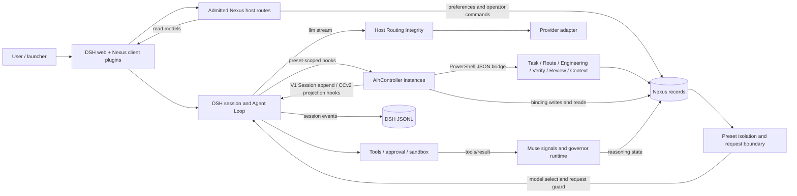
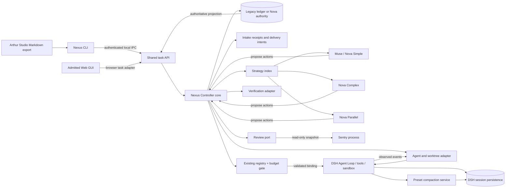
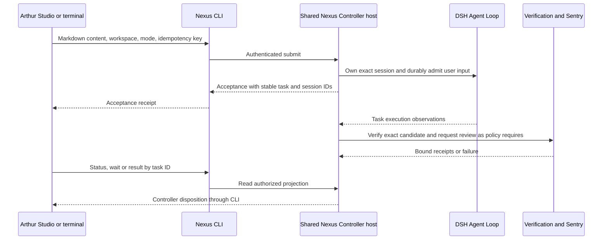

# Nexus DSH 0.2.2 plugin-first architecture · Revision 2

## 1. Decision

The hybrid DSH + Nexus architecture is approved. Make the **first-party Nexus CLI** a core interface to the same trusted task API as the GUI. Keep the default DSH Agent Loop, AgentFactory, tools, permissions, session store, and JSONL persistence. Add one trusted Nexus host service that owns the engineering task lifecycle. Register strategies and external providers at its composition boundary. Reuse the existing Nexus Model Registry for model eligibility, entitlement, target resolution and generation pins. Keep deterministic algorithms, schema validation, storage adapters and existing PowerShell commands as modules behind that boundary.

Move Muse through the new seam first, with equivalent behavior. Ship a CLI that targets the existing engineering modes before Nova. Connect it to the same long-lived DSH Web profile Nexus already launches, with a terminal-only host start and no browser requirement. Nova Simple then adds the verification and Sentry completion policy that Complex and Parallel will use. Build Complex and Parallel as separate orchestration policies over DSH agent lifecycles. Keep DSH Basic compaction in production and retain restricted CCv2 projections. A DSH-owned summarization experiment is viable in the lab. Durable CCv2 mutation stays disabled.

The most important extractions are authority boundaries. Today, preset closures instantiate Controller code, route authorization reads overlapping state through several paths, and the Controller calls multiple scripts that write related records. Moving those calls into packages would preserve the coupling. The first release should centralize ownership, keep the existing writers behind it, and prove that a new strategy can be added without changing completion logic.

### Evidence and scope

| Baseline | Verified identity |
|---|---|
| Initial working directory | `/Users/kaloyannikolov/Projects/Nexus`, `feature/dsh-migration` at `3b90bdd4bdbb39519ba5b4870de753db8d8ccea7`, with pre-existing untracked migration evidence and diagnostics. |
| Audit target | Clean local `feature/dsh-0.2.2-migration` in the linked `Nexus-dsh-0.2.2` worktree, `f80d0a324333851db55b4c81f27a1ef24b2b0161`, five commits ahead of the verified remote tip `0658c8387ba38536853f31c717861f9f4c842aef`. The local commits include macOS installation and actual-preset display fixes. This report uses the local tip. |
| Documentation | `codex/dsh-0.2.2-plugin-first-audit`, isolated worktree at `/Users/kaloyannikolov/Projects/Nexus/tmp/nexus-plugin-first-audit`, based on that local tip. |
| DSH | `dsh-v0.2.2-rc.1` resolves to `66491b05e3f05ad35bcdd4f6cd7ed26041d9e3db`. Inspected a separate shallow clone of that tag. [Tagged upstream source](https://github.com/deepseek-ai/deepseek-harness/tree/66491b05e3f05ad35bcdd4f6cd7ed26041d9e3db) |
| Runtime | [runtime/package.json](../../runtime/package.json), [lockfile](../../runtime/package-lock.json), [versions.json](../../config/versions.json). DSH, agent-loop, web-app, compaction-basic, session-persistence, JSONL backend and Codex subagent all resolve to `0.2.2-rc.1`. DeepSeek Cordis `4.1.0`, group `1.1.0`, openai-oauth `2.0.0`, React `18.3.1`, shipped Node `24.18.1`, PowerShell `7.5.3`. |
| Comparison with dev | Remote `dev` matches the initial checkout and is the merge base. Its JS runtime pins DSH `0.1.1-rc.2`, group `1.0.1` and the vendored patched agent. The target uses native 0.2 selection, profile patches, event accessors, and client plugins. The old patched agent and removed settings/preset scan are historical references. |

Nexus paths and line references below use the audited local tip. Upstream links use the pinned commit. **Contract** means an exported or documented surface. **Observed** means a property of this implementation or of existing recorded evidence. **Proposed** means work for a subsequent implementation. The Nexus CLI, Sentry adapter and managed-task interfaces below are proposals. Revision 2 inspects the CLI entrypoints and Complex activation seams in the same pinned sources. Arthur Studio is an external client of the proposed Nexus CLI. Sentry and Studio implementations were outside the inspected source.

## Reading map

- [Current Nexus audit](#2-current-nexus-audit) and [tagged DSH extension points](#3-dsh-022-extension-points)
- [Architecture decision](#4-alternatives-and-weighted-decision) and [target contracts](#5-target-architecture-and-contracts)
- [Engineering modes and Nova](#6-engineering-modes-and-nova), [Sentry](#7-sentry-review-and-completion-protocol), [Nexus CLI and Studio](#8-nexus-cli-and-arthur-studio), and [CCv2](#9-ccv2-ownership-and-compaction-feasibility)
- [Migration and critical path](#10-implementation-sequence-and-critical-path), [validation](#11-validation-and-release-benchmarks), and [approval decisions](#12-decisions-requiring-approval)

## 2. Current Nexus audit

### Execution sequence and authority

The local audit baseline remains five commits ahead of the remote migration branch. The extra commits cover native macOS arm64 provisioning, configurable host/OAuth endpoints and process identity, locale and apply-lock fixes, actual-preset UI display, and macOS evidence. Remote `dev` still matches the audited merge base.

The migration branch builds on DSH's stock agent lifecycle. Its largest changes relative to dev replace the vendored 0.1 route patch and discovery-based presets with 0.2 selection, scoped preset rows and host transport checks. Nexus still owns workflow policy and task records, so these changes remove the need to maintain a fork of the Agent Loop without eliminating the PowerShell and routing dependencies.

1. **Startup and composition.** `scripts/Install-NexusPresets.ps1:20–66` installs preset module closures and builds the patch. `scripts/Build-NexusHomePatch.cjs:41–66,143–212` derives Nexus planes from the installed web-app standard preset, emits absolute file URLs for in-memory preset closures, patches model/provider/default settings, and disables stock presets. [Static home patch](../../config/home.cordis.patch.yml) adds host Routing Integrity, OpenCode request header support, UI and optional Codex subagent provider. The launcher and UI own preferred settings and the generated patch, rather than an active task's route.
2. **Workspace and task binding.** The client chooses an open workspace and preset. The server admits requests through the DSH connection check. DSH owns session identity, workspace header and recorded preset. The Controller's optional `nexus/session-prepare` hook accepts an existing root session, matches its immutable cwd and actual preset, dry-runs the real resolver, and creates or reconciles a task generation. It verifies and flushes authority files before acknowledgment. The ordinary GUI path binds lazily on a root user turn, validates or repairs stale identity, and rejects incompatible preset/engine/repository identity. Display task IDs alone are insufficient. [AihController.cjs, binding guard](../../config/AihController.cjs#L683) · [bindSession](../../config/AihController.cjs#L2781) · [prepareSession](../../config/AihController.cjs#L2910)
3. **Routing and attempt admission.** `routeTask` sends a structured PowerShell payload through `Route.ps1` to `Invoke-AihRoutingDecision`. It records preset/profile/engine/role/provider/model/effort. Muse takes its dedicated route. The Controller consumes `Route.ps1` output, checks legacy/shadow/pinned/refused state and entitlements, rechecks existing task and starts at most one open attempt. Dual has a separate epistemic step path. Muse runs `muse_main` and skips that role router. Command paths for `/verify`, `/review` and visual review can short-circuit inference. [AihController.cjs](../../config/AihController.cjs#L1147) · [Routing.ps1](../../scripts/Routing.ps1#L332) · [root pre-step](../../config/AihController.cjs#L3378)
4. **Model request.** Preset isolation supplies the target. `Controller-RequestBoundary.cjs` selects the complete route synchronously on `agent/inbox/claimed`, and arms in `agent/pre-step` for subsequent preparation. It revalidates generation and entitlement around the identity subprocess and checks the captured selection, effective route and effort in the existing `agent/request` middleware. The DSH loop refuses a provider/model/effort change after capture. `Routing-Integrity.cjs` checks task requests again at `llm/stream`. It distinguishes auxiliary requests, so it is not by itself a budget or authorization gate for every LLM consumer. `OpenCode-SessionHeader.cjs` sets the transport session header via `llm-pi-ai/request-headers`. Route swaps produce durable selection/model-change context. Effort-only changes omit the notice. Adaptive effort armed during a step affects later preparation. [Request boundary](../../config/Controller-RequestBoundary.cjs#L124) · [Routing Integrity](../../config/Routing-Integrity.cjs#L29) · [OpenCode header](../../config/OpenCode-SessionHeader.cjs#L30)
5. **Tool execution.** DSH resolves the step tool set, executes through the scoped executor, applies permission and sandbox policy, and records tool call/result events. Muse's signal tool accepts validated phase updates. Its `tools/result` observer uses executed, trusted tool outcomes for adaptive reasoning. These outcomes are distinct from Controller-produced verification evidence. Dual/DeepSeek have the Nexus delegation block, with the Codex tool row restricted to Engineering and disabled by default. Muse omits delegation. The host provider's existence does not grant the tool. [Delegation block](../../config/delegation-block.yml#L13) · [Muse signal registration](../../config/Muse-ReasoningSignals.cjs#L489)
6. **Verification, review and completion.** The Controller plans checks through `Engineering.ps1` and runs `Verify-Project.ps1` against the bound workspace. It records per-check results and requirements coverage, updates attempts, and invokes the completion tail after passing verification. Dual can invoke `Review.ps1` with a bounded packet through its legacy Codex path, classify findings, route repair and surface an operator gate. This path's legacy limits depend on policy. The completion predicate also checks scope, traceability and required visual state. Approval does not make failed verification pass. Successful assistant termination alone is insufficient. Current automatic visual verification is conditional. Nova introduces a deterministic verification gate for every task. [Verify turn](../../config/AihController.cjs#L2389) · [Review turn](../../config/AihController.cjs#L2609) · [Completion tail](../../config/AihController.cjs#L2310) · [Task predicate](../../scripts/TaskController.ps1#L437)
7. **Recovery and context.** `session/event` sees usage and terminal turn reasons. Errors record failure and request rerouting, abort/interruption close attempts, and the next turn reconciles interrupted verification from real evidence. Some callbacks start asynchronous work after the event commits. They are not a joined transaction with the loop or a guarantee of terminal evidence. V1 completion compaction queues/evaluates a checkpoint and applies it at a later safe pre-step via Session and a durability barrier. CCv2 host observations/projections are installed here too. The restricted policy keeps its durable writers disabled. [Reconcile](../../config/AihController.cjs#L1664) · [V1 bridge](../../config/AihController.cjs#L1956) · [Observers](../../config/AihController.cjs#L3252)

### Component and extraction map

| Component | Confirmed responsibilities, dependencies and authority | Proposed disposition |
|---|---|---|
| `config/AihController.cjs` | Cordis plugin `apply`, declares `shellEnv` injection. Directly imports node filesystem/process APIs, session reader, preset shell environment, Engineering/Muse isolation, registry service/shadow/pin, V1 compaction and four CCv2 hosts (43–62). Owns binding cache, binding single-flight/persistence, attempt coordination, review/gate decisions, telemetry, context glue. It subscribes to `nexus/session-prepare`, `session/event`, `agent/pre-step`, `agent/disposed`. Writes binding file and log. Launches PowerShell with temp payloads, explicit arguments and diagnostic handling. Windows has a batch-launch path (846–1163). | Host Controller service around existing state writers, scoped lifecycle bridge and a single bounded command runner. Leave parsing, context formatting and reducers ordinary. Retire duplicated binding-map write authority only after parity. |
| Controller subprocesses | `Task.ps1` → `TaskController.ps1` for create, identity, attempt, failure, evidence and completion. `Route.ps1` → `Routing.ps1` for task route. `NexusWorkspace.ps1` resolves workspace identity. `Engineering.ps1` owns requirement/epistemic/working-set actions and usage recording. `EngineeringProfile.ps1` reads preference. `Verify-Project.ps1` executes checks using project detection. `Context.ps1` builds a review bundle. `Review.ps1`, `VisualReview.ps1`, `VisualLoop.ps1` handle independent, visual and bounded repair flows. `ContextLifecycleCli.ps1` handles usage/compaction lifecycle. Exact calls in `AihController.cjs:1066–1164,1299–1743,2389–2409,2532–2575,2704–2716,2805,3154–3245`. | Keep existing CLIs and their schemas for legacy users. Wrap by capability, not a general script-execution API. Preserve per-platform launch semantics, timeout, structured stdout, and cleanup. |
| `scripts/Routing.ps1`, `config/Engineering-Profiles.cjs` | Ordinary PS/JS modules. Profile/model compatibility and route state, engine immutability, legacy role aliases, task state paths and mutex. It hardcodes preset-to-engine mapping and branches for Dual and Muse. `Routing.ps1:320–338,397–507`. | Keep compatibility paths. New strategy selects an allowed role and budget. Existing registry resolves concrete target. The Controller commits the binding. Incrementally converge authorization reads without making preset names the strategy API. |
| `config/registry/` | Ordinary JS with public façade `service.cjs:createService`. `index.cjs` and `resolver.cjs:269,381` implement catalogue and immutable resolution. `config-store.cjs:266` owns revisioned configuration. Registry modules also implement eligibility, connection proofs, endpoint/transport policy, staged adoption and rollback. `dsh-adapter.cjs:56–141` maps modes, presets, provider keys and targets. `session-binding.cjs:23–157,164–end` derives and checks pins. The staged binding flag and per-generation state matter. `modes/engineering-v3.json` is planned, non-selectable/non-runnable. | One registry authority for model/connection/role binding. Extend the existing mode descriptor only after parity. Use a small in-memory strategy index keyed by strategy ID and contract major. It stores implementations only. No second model/entitlement database. |
| `Engineering-Isolation.cjs`, `DeepSeek-Isolation.cjs`, `Muse-Isolation.cjs`, `Controller-RequestBoundary.cjs` | First three are preset plugins. Last is a shared installer, not a separately registered service. Read durable binding/target state, enforce plane and step-role identity. Muse prepares adaptive effort from its runtime. Worker bypasses are conditional. | Keep guard enforcement and early selection. Inject Controller's trusted binding reader into compatibility wrappers when parity exists. Explicit Nova worker identity replaces header heuristics as authority for new work. |
| `Routing-Integrity.cjs`, `OpenCode-SessionHeader.cjs`, `Preset-ShellEnvironment.cjs` | Host plugins for final route fence and header. Shell environment is a helper that registers once on the host root. The route guard reads bound target state. Header and environment are transport/projection glue. `Preset-ShellEnvironment.cjs:18–66`. | Preserve defense in depth and existing semantics. Pin allowlisted aux routes too in Nova. Keep root environment resolver narrow. |
| Muse Governor, Runtime, Activity and Signals | Governor makes a pure effort decision (`Muse-ReasoningGovernor.cjs:326`). Activity classifies actual outcomes and reduces signals. Runtime persists reasoning/activity into route state (`Muse-ReasoningRuntime.cjs:221,296,500`). Signals provides a scoped tool and observer with validated inputs, identity and deduplication (`Muse-ReasoningSignals.cjs:131,239,310,469–537`). Reasoning effort and semantic phase are distinct. | Preserve signal/adaptive behavior. Keep pure modules, retain agent-scoped tool, and move write ownership under the Controller's serialized route-state lane once tested against PS routing concurrency. |
| `TaskController.ps1`, `Verify-Project.ps1`, `Project.ps1`, `Engineering/*` | Ordinary modules/CLI. Task generation and attempt IDs, ledger mutex and task authority, workspace evidence and completion. Verification builds and executes commands and logs exit statuses. The legacy completion helper can write `complete` and summary. It accepts `-CodexReviewPassed` as a legacy boolean input. | Retain semantics for EMv1/EMv2. Wrap legacy commands. Give Nova a controller-only typed evidence gate. Keep check discovery and interpretation pure. Scope legacy CLI entry points so they cannot complete a Nova generation. |
| `Review.ps1`, `CodexReview.ps1` | Ordinary review CLI and adapter. The CLI imports Routing and Telemetry, resolves reviewer/profile to the supported `sol-local` provider, constructs a packet and calls independent transport. Writes review artifacts. Existing operator path can resolve a gate and re-run the legacy completion gate. | Preserve Dual behavior through legacy adapter. Sentry has its own out-of-process boundary and strict evidence schema. Do not translate its result into a naked legacy PASS flag. |
| V1 and CCv2 | `ContextCompaction.cjs` is ordinary event/operation logic, including V1 readers and guarded V2 mutations. `Dsh-SessionEvents.cjs` isolates 0.2 event-read shape. `Context*HostV2.cjs` functions install hooks. Compiler/layout/retrieval/evidence modules are ordinary. CCv2 op, checkpoint, active apply, memory and generation files use their own authority/leases in lab code. | Preserve V1 and DSH Basic behavior first. A single projection adapter and pure CCv2 logic are sufficient today. Durable engine provider is a separate opt-in lab track. |
| UI and settings | `@nexus/controller` has host and client sides. Host mounts admitted routes through `webServer` and `connection`, reads authoritative snapshots, handles gate actions, registry edits, workspace and default mode. `@nexus/mode-selector` is a client plugin with mode/session and workspace guard. Its method wrapper is version-locked. `@nexus/ui-brand` is host/client branding. `ui/nexus-controller/lib/index.js:58–83,363,529–552,683–776`, `ui/nexus-mode-selector/lib/client.js:343–425`. | Keep UI slot composition and route admission. Make mutation routes call Controller methods and return typed results. UI state remains a projection. Preset display follows the actual host state. |
| Install and diagnostics | `Install-NexusPresets.ps1`, `Install-NexusUi.ps1`, `Build-NexusHomePatch.cjs`, `Verify-NexusComposition.mjs` generate/stage/verify deployment shape. Wrapper scripts and doctor handle installs and platform differences. | Keep deployment tools as CLI. Amend composition manifests only when a proven runtime boundary needs a row. Snapshot composed output in CI. |

### Existing terminal surface

The installed `aih` wrapper starts the pinned DSH Web profile with `--no-open` from a neutral working directory. It tracks host state and verifies process identity. The optional browser launch is separate. `scripts/Startup.ps1` considers an HTTP auth rejection evidence of a live listener. That alone cannot establish the trusted Controller or authenticate a CLI host. Existing `aih-task`, `aih-verify` and `aih-review` are script entry points. For example, `Task.ps1` can call ledger mutations directly. They provide compatibility commands, not an authenticated end-to-end task client. [Launcher](../../scripts/aih.ps1#L165) · [Startup probe](../../scripts/Startup.ps1#L33) · [Legacy task CLI](../../scripts/Task.ps1)

`AihController.cjs:2910–3053,3852–3865` already exposes a scoped preparation hook that binds a live root Session to the Controller. It does not create or drive the Agent. A first-party CLI must submit to a shared host operation which owns the whole prepare/admit/deliver sequence. `ui/nexus-controller/lib/index.js:532–552` currently writes a gate and can call legacy completion through PowerShell. The managed path must put that mutation behind the same Controller as CLI requests. [Preparation](../../config/AihController.cjs#L2910) · [Gate handler](../../ui/nexus-controller/lib/index.js#L532)

### Findings that drive the design

- A route file, registry pin, DSH model selection, and current adapter transport are four distinct facts. Pin the authorized target, recheck revocation/entitlement at dispatch, and compare the actual call. A static strategy pin cannot authorize a revoked connection.
- Current Controller observers can race later turns, disposal or each other. A real post-turn event should enqueue idempotent Controller work keyed by generation, attempt and event seq. Serialize state changes and await work at explicit admission/drain boundaries. Awaiting an observer registration or assuming Cordis listener order does not create a durable transaction.
- The legacy gate writes evidence under workspace `.ai-harness` and reads it back. The source paths alone do not prove that every shell, script, MCP or verification command is barred from forging these files. Test that boundary for legacy. For Nova, keep authoritative evidence and task state in a Controller-owned store outside worker write capability. If a worker shares an unconstrained OS user with that store, a separate directory is insufficient.
- Preset closure copies and JS/PS shared route files make writer coordination a migration concern. Keep a single coordinator for each authority record, preserve the existing mutex protocol during transition, and isolate schema/cutover from strategy changes.

## 3. DSH 0.2.2 extension points

The stability ratings apply to the pinned RC. **Use** means appropriate behind the existing adapter. **Pin** means use only with version and composition tests. **Lab** means an open feasibility gate. Where upstream exports both high- and low-level APIs, prefer the high-level owner.

| Seam | Exact source and contract | Ownership, replacement, failure behavior, Nexus fit |
|---|---|---|
| Cordis registration and DI | `ctx.plugin`, plugin `inject`, `ctx.inject`, `Service`, `ctx.provide`, `ctx.effect`, `ctx.on`. [Registry](https://github.com/deepseek-ai/deepseek-harness/blob/66491b05e3f05ad35bcdd4f6cd7ed26041d9e3db/vendor/cordis/src/registry.ts#L158) · [Service](https://github.com/deepseek-ai/deepseek-harness/blob/66491b05e3f05ad35bcdd4f6cd7ed26041d9e3db/vendor/cordis/src/service.ts#L34) · [Fiber](https://github.com/deepseek-ai/deepseek-harness/blob/66491b05e3f05ad35bcdd4f6cd7ed26041d9e3db/vendor/cordis/src/fiber.ts#L421) | Dependencies gate activation. Registrations belong to the accessing fiber. Capture the correct context, retain exact disposers and group ordered cleanup in one composite effect. Observed sibling disposal is concurrent (`fiber.ts:720`). Isolation and service replacement are composition operations. DI does not implement task leases or a sandbox. Readiness must assert mandatory services independently of a successful host boot. **Use.** |
| Agent registry/factory | `ctx.agents.get/list/create/resume`, `AgentFactory.createAgent(ownerCtx, options)/resume`, `AgentHandle.dispose()`, `setFactory`. [AgentRegistry and contracts](https://github.com/deepseek-ai/deepseek-harness/blob/66491b05e3f05ad35bcdd4f6cd7ed26041d9e3db/packages/core/agent/src/index.ts#L151) | The single factory slot rejects duplicate providers. Its disposer clears the slot. `setup(agentCtx, agent)` runs before agent publication and can return a synchronous commit. A caller owns the handle, not the Agent object alone. Loop acquires/restores Session, attaches scopes, publishes, cancels and awaits idle, disposes scope, drains/closes storage and unregisters. Failed setup preserves durable pending inbox and can leave a stored identity. Replacing the factory is supported but inherits the entire transaction and teardown contract. [AgentLoop transaction](https://github.com/deepseek-ai/deepseek-harness/blob/66491b05e3f05ad35bcdd4f6cd7ed26041d9e3db/packages/core/agent-loop/src/index.ts#L459). **Use default.** |
| Agent lifecycle and model route | `agent.model.current()/select()`, `agent/inbox/claimed`, `agent/pre-step`, `agent/request-error`, status and lifecycle hooks. [Event contracts](https://github.com/deepseek-ai/deepseek-harness/blob/66491b05e3f05ad35bcdd4f6cd7ed26041d9e3db/packages/core/agent/src/runtime-types.ts#L313) · [AgentModel](https://github.com/deepseek-ai/deepseek-harness/blob/66491b05e3f05ad35bcdd4f6cd7ed26041d9e3db/packages/core/agent/src/model-selection.ts#L98) · [Loop capture](https://github.com/deepseek-ai/deepseek-harness/blob/66491b05e3f05ad35bcdd4f6cd7ed26041d9e3db/packages/core/agent-loop/src/agent.ts#L285) | Claim is synchronous and precedes step preparation. `select` appends selection. It does not validate Nexus entitlement. Pre-step waterfall can reject or replace admitted input. Model and tools are already captured. `agent/request` at lines 353–373 is deprecated, can adjust other call controls but cannot change provider/model/effort. Legacy Nexus guard remains until a tested substitute exists. Use `AgentOptions.maxTokens` and the existing validated route gate. There is no general new per-request override API. Request-error retry must share budget and cancellation. **Use selection/hooks, pin legacy guard.** |
| LLM/provider | `ctx.llm`, `prepareCall`, `llm/stream`, provider adapters and model catalogue. [Runtime](https://github.com/deepseek-ai/deepseek-harness/blob/66491b05e3f05ad35bcdd4f6cd7ed26041d9e3db/packages/llm/llm/src/index.ts#L960) · [Loop check](https://github.com/deepseek-ai/deepseek-harness/blob/66491b05e3f05ad35bcdd4f6cd7ed26041d9e3db/packages/core/agent-loop/src/agent.ts#L620) | Adapter selection/prepared capability resolves transport, then logs request controls through the loop. Stream middleware extends interception and is not authorization by itself. Auxiliary summarizer/title and external subprocess model calls can bypass a root step's hook. Budget and authorize by purpose at each adapter boundary. **Use, pin policy tests.** |
| Tools and permissions | `ctx.tools.register/restrict/resolve/execute`, `setExecutor`, `guard/checkGuards`, `tools/pre-execute`, `tools/execute`, `tools/post-execute`, `tools/result`. Also `ctx.approval`, sandbox and permission presets. [ToolsService](https://github.com/deepseek-ai/deepseek-harness/blob/66491b05e3f05ad35bcdd4f6cd7ed26041d9e3db/packages/core/tools/src/index.ts#L98) · [Native executor](https://github.com/deepseek-ai/deepseek-harness/blob/66491b05e3f05ad35bcdd4f6cd7ed26041d9e3db/packages/core/tool-executor-native/src/index.ts#L8) · [Pipeline](https://github.com/deepseek-ai/deepseek-harness/blob/66491b05e3f05ad35bcdd4f6cd7ed26041d9e3db/docs/tool-execution-pipeline.md) · [Presets](https://github.com/deepseek-ai/deepseek-harness/blob/66491b05e3f05ad35bcdd4f6cd7ed26041d9e3db/packages/interaction/permission-presets/src/index.ts#L171) | Registrations shadow by scope. A restriction intersects inherited tools, but locally registered tools are exempt. Use guards and sandbox for enforceable denial. The selected executor is replaceable per scope. Unload leaves its selection unavailable rather than falling back to a different executor. The default executor handles step admission, parallel scheduling, results and tool-call pairing. A host subprocess or alternate executor can bypass this policy unless independently confined. A denial or absent approval cannot become approval by taking another code path. **Use native.** |
| Session and projections | `ctx.sessions`, `Session.append`, `eventAt`, `snapshotEvents` (deprecated for new readers), `surface`, `appendPluginRecord`, `ctx.sessions.flush(session)`. Events include `session/created`, `session/event`, `session/disposed`. [Session/store](https://github.com/deepseek-ai/deepseek-harness/blob/66491b05e3f05ad35bcdd4f6cd7ed26041d9e3db/packages/core/session/src/index.ts#L495) · [Flush](https://github.com/deepseek-ai/deepseek-harness/blob/66491b05e3f05ad35bcdd4f6cd7ed26041d9e3db/packages/core/session/src/index.ts#L1330) | In-memory append projects the logical log. Replacements append superseding events instead of editing history. `session/event` is a contained post-commit notification. It cannot veto append or prove durability. Flush is awaited on the exact live session, returns whether listeners participated, and propagates failure after listeners settle. `true` alone does not prove that a particular backend committed a particular event. Use mounted persistence plus required durable read-back when gating external finalization. Plugin records extend replay. An arbitrary plugin record is neither a fence nor independent evidence. **Use.** |
| Persistence and recovery | `ctx.sessionPersistence.create/open(id, 'read'/'write')/stat/list/flush`. `SessionHandle.read/append/flush/close`. [Service](https://github.com/deepseek-ai/deepseek-harness/blob/66491b05e3f05ad35bcdd4f6cd7ed26041d9e3db/packages/session/session-persistence/src/index.ts#L127) · [Handle](https://github.com/deepseek-ai/deepseek-harness/blob/66491b05e3f05ad35bcdd4f6cd7ed26041d9e3db/packages/session/session-persistence/src/handle.ts#L59) · [JSONL live routing](https://github.com/deepseek-ai/deepseek-harness/blob/66491b05e3f05ad35bcdd4f6cd7ed26041d9e3db/packages/session/session-persistence-jsonl/src/storage.ts#L529) | Backend is replaceable in composition. Default loop owns write handle. Backend routes live events through buffered, serialized durable append. Read handles do not activate or own a session. `stat.revision` is opaque to a backend instance and is not a fence or cross-process content identity. POSIX inode flock and Windows named kernel semaphore are lifetime exclusion, no expiry. No revocation parameter. Declared ownership-lost error is not raised by JSONL. Keep reads separate, use normal resume/recovery, and do not open another write handle for a live agent. **Use default, lab for fencing.** |
| Compaction | Abstract Cordis `CompactionEngine` exposed as `ctx.compaction`, `compactIfNeeded(agent, trigger, signal)`, `compactNow(agent, signal, commandId?)`, `compactRegion(start, end, agent, signal?)`. [Contract](https://github.com/deepseek-ai/deepseek-harness/blob/66491b05e3f05ad35bcdd4f6cd7ed26041d9e3db/packages/compaction/compaction/src/index.ts#L110) · [Basic](https://github.com/deepseek-ai/deepseek-harness/blob/66491b05e3f05ad35bcdd4f6cd7ed26041d9e3db/packages/compaction/compaction-basic/src/index.ts#L108) | BasicCompactionEngine owns pre-step pressure, model-switch and overflow hooks, maintenance and recovery behavior. Provider replacement does not install those hooks automatically. Protected `summarize` is the explicit subclass seam. Web-app disables base-level Basic/command/pruner and standard preset mounts an isolated compaction group. Replace the Basic row in one audited preset only. Check command, pruner and scoped hooks. **Use Basic, lab for custom.** |
| Preset generations and scopes | `@deepseek-ai/dsh-agent-preset` declares plugin rows. Use `ctx.agentPresets.mount/composeFrom/serviceFor/select` with scopes governed by `createScope/bindScopeParent`. [Preset registry](https://github.com/deepseek-ai/deepseek-harness/blob/66491b05e3f05ad35bcdd4f6cd7ed26041d9e3db/packages/preset/agent-preset-registry/src/index.ts#L265) · [Scope](https://github.com/deepseek-ai/deepseek-harness/blob/66491b05e3f05ad35bcdd4f6cd7ed26041d9e3db/packages/core/scope/src/index.ts#L42) | Preset generation is retained by live agents. A composed child can inherit the exact live parent revision. Blank selection uses `recompose`. Begun turns lock the preset. Host globals still change separately. Cold resume does not restore exact plugin bytes. Nexus report L4 records repeated blank switches failing with stale scope-parent ownership, followed by truthful UI read-back. Treat that as an observed RC limit. Use fresh sessions for Nova strategy/plane changes. **Pin.** |
| Profile/bundle/patch | Profile manifest `dsh.profile.bundles`, ordered patch lists, profile/home `cordis.patch.yml`, and CLI overlays. `loadProfile`, `composeEntries`, compatibility preflight (`engines.dsh` otherwise DSH peers). [Profile](https://github.com/deepseek-ai/deepseek-harness/blob/66491b05e3f05ad35bcdd4f6cd7ed26041d9e3db/packages/boot/app-boot/src/profile.ts#L668) · [Patch loading](https://github.com/deepseek-ai/deepseek-harness/blob/66491b05e3f05ad35bcdd4f6cd7ed26041d9e3db/packages/boot/app-boot/src/index.ts#L506) · [Compatibility](https://github.com/deepseek-ai/deepseek-harness/blob/66491b05e3f05ad35bcdd4f6cd7ed26041d9e3db/packages/boot/app-boot/src/plugin-compatibility.ts#L77) | Insert/disable/configure by stable row IDs and order. Unreadable/unsupported/incompatible bundles may be skipped with diagnostics. A parsed patch or an installed package does not prove live availability. Nexus derives rows from the installed pinned web-app, so test changed row IDs and group isolation on every upgrade. **Use, pin.** |
| Plugin Manager/HMR | `ctx.pluginManager` lists plugin/bundle/runtime state, enables/disables rows, installs/updates/uninstalls bundles, reports saved/applied/restart results. `ctx.hmr.runExclusive` serializes reload operations, `reconcileProfile` evaluates replacements. [Manager](https://github.com/deepseek-ai/deepseek-harness/blob/66491b05e3f05ad35bcdd4f6cd7ed26041d9e3db/packages/boot/plugin-manager/src/index.ts#L714) · [Manager reload](https://github.com/deepseek-ai/deepseek-harness/blob/66491b05e3f05ad35bcdd4f6cd7ed26041d9e3db/packages/boot/plugin-manager/src/index.ts#L1248) · [HMR](https://github.com/deepseek-ai/deepseek-harness/blob/66491b05e3f05ad35bcdd4f6cd7ed26041d9e3db/packages/boot/hmr/src/index.ts#L926) | HMR may dispose and reactivate affected fibers, or leave code pending until restart. Profile config watch is enabled in the base profile, module watch roots opt in. Package compatibility checks and build approval do not confine installed code. Manager cannot certify an in-flight Nexus task, retain external provider versions, or roll back subprocess effects. Keep engineering runtime composition startup-only in production and test preset preference writes with this policy. **Use for diagnostics, restrict management in product.** |
| Subagents and cancellation | `ctx.subagents.startActivation`, `registerProvider`, `sendMessage`, `waitForChildren`, `interrupt`, `drainChildren/drainDescendants`, durable lineage and parent control. [Service](https://github.com/deepseek-ai/deepseek-harness/blob/66491b05e3f05ad35bcdd4f6cd7ed26041d9e3db/packages/subagent/subagent/src/index.ts#L244) · [Manager](https://github.com/deepseek-ai/deepseek-harness/blob/66491b05e3f05ad35bcdd4f6cd7ed26041d9e3db/packages/subagent/subagent/src/manager.ts#L379) · [Spawn provider](https://github.com/deepseek-ai/deepseek-harness/blob/66491b05e3f05ad35bcdd4f6cd7ed26041d9e3db/packages/subagent/subagent-spawn-in-process/src/index.ts#L35) | DSH owns capacity, depth, startup cancellation, child ownership and teardown. Child release follows drain. Local spawn runs in the same process with a fresh transcript and defaults to the parent preset generation and cwd. The provider supports independent preset selection, route options, structured output and explicit cwd. These are configuration inputs, so Nova still has to enforce confinement. Use caller delivery, reserve a local child ID before spawn and await exact activation disposal as well as its result. The startup signal and disposal capability cover distinct lifecycle boundaries. External adapters have their own guarantees and cost attribution. Try host-owned activation with a constrained preset first. If it cannot prove isolation/pin, use an owned `ctx.agents.create` handle with constrained setup instead. **Pin.** |
| Jobs, Teams, Worktree | `ctx.jobs.start/list/get/read/wait/kill/remove/attachController` with jobs-local. Experimental `TeamService` handles roster, member messaging and tasks. Experimental `WorktreeService.create/restore` handles Git worktree lifecycle. [Job contract](https://github.com/deepseek-ai/deepseek-harness/blob/66491b05e3f05ad35bcdd4f6cd7ed26041d9e3db/packages/jobs/jobs/src/index.ts#L88) · [Local lifecycle](https://github.com/deepseek-ai/deepseek-harness/blob/66491b05e3f05ad35bcdd4f6cd7ed26041d9e3db/packages/jobs/jobs-local/src/index.ts#L640) · [Teams](https://github.com/deepseek-ai/deepseek-harness/blob/66491b05e3f05ad35bcdd4f6cd7ed26041d9e3db/packages/experimental/agent-team/src/index.ts#L56) · [Worktree](https://github.com/deepseek-ai/deepseek-harness/blob/66491b05e3f05ad35bcdd4f6cd7ed26041d9e3db/packages/experimental/worktree/src/index.ts#L61) | Local jobs provide owner-aware background cancellation, observation and bounded capacity. A producer must settle. Persisted lifecycle records do not make a process resumable. Teams uses subagents and session projections, but its task and roster state would compete with Nexus's canonical task DAG. DSH worktree plumbing can be evaluated behind a port. Neither provides Nova integration, dependencies, budgets or evidence. **Use jobs where useful, lab for worktree, defer Teams dependency.** |
| Web host/client | `webServer.register`, `connection.admit`, package client entry/slots, composer block registry, ModelDirectory. [Web registration](https://github.com/deepseek-ai/deepseek-harness/blob/66491b05e3f05ad35bcdd4f6cd7ed26041d9e3db/packages/host/webserver/src/index.ts#L445) · [Admission](https://github.com/deepseek-ai/deepseek-harness/blob/66491b05e3f05ad35bcdd4f6cd7ed26041d9e3db/packages/client/connection/src/rpc-host.ts#L129) · [Slots](https://github.com/deepseek-ai/deepseek-harness/blob/66491b05e3f05ad35bcdd4f6cd7ed26041d9e3db/packages/client/ui-conversation/src/client/contract/slots.ts#L350) · [Composer blocks](https://github.com/deepseek-ai/deepseek-harness/blob/66491b05e3f05ad35bcdd4f6cd7ed26041d9e3db/packages/client/ui-conversation/src/client/contract/composer-blocks.ts) | Route and slot registration are disposable. Raw web routes require explicit admission and request-to-workspace authorization. Slot seat selection and per-session composer blocking are extensions. Monkey-patching the workspace method is a compatibility shim. UI may reflect current state and request operator actions. Authorization stays host-side. **Use published contracts, pin shim.** |

### Reasons to keep the stock loop

The loop already owns message claiming and recovery, route capture, logging and replay, system prompt assembly, streamed output, tool pairing, cancellation, request retries, and agent lifecycle. Nexus needs to decide which agent acts, what it may do, when to verify, and when a task completes. Those decisions fit the existing setup and scoped hooks. A custom loop would inherit obligations for session generation, projections, cancellation ordering, tool results, and every upgrade. Reopen that option only if a required correctness property cannot be implemented with documented seams and a minimal upstream change. Compaction provider replacement also cannot supply a storage property the backend lacks.

## 4. Alternatives and weighted decision

Weights sum to 100. Scores are architecture judgments from 1 (poor fit) to 5 (strong fit) for a two-developer team. Weighted totals are `sum(weight × score) / 5` out of 100. They are not cost/quality measurements.

| Criterion | Weight | Targeted modularization | Hybrid DSH + Nexus | All capabilities as plugins | Replace loop/factory |
|---|---:|---:|---:|---:|---:|
| Correctness and recovery | 16 | 4 | 5 | 3 | 2 |
| Security and authority isolation | 16 | 3 | 5 | 3 | 2 |
| Extensibility | 10 | 2 | 5 | 5 | 4 |
| Maintainability | 8 | 3 | 4 | 2 | 2 |
| Development time | 12 | 5 | 4 | 2 | 1 |
| Regression risk | 12 | 4 | 4 | 2 | 1 |
| Cross-platform fit | 5 | 3 | 4 | 3 | 2 |
| DSH upgrades | 5 | 3 | 4 | 3 | 1 |
| Runtime performance | 3 | 4 | 4 | 3 | 2 |
| Token/compute cost control | 3 | 3 | 4 | 3 | 2 |
| Testability | 5 | 3 | 5 | 3 | 2 |
| Nova, Sentry and Studio readiness | 5 | 2 | 5 | 4 | 3 |
| **Total** | **100** | **68.0** | **90.4** | **58.6** | **39.2** |

Correctness and isolation carry the highest weights because lost authority or false completion is a release blocker. Time and regression risk come next because the team must ship incrementally. Extensibility has value at independently evolving boundaries. Plugin count carries no value. Cost and latency remain benchmark gates even with lower weights: the highest expected cost is from extra model calls, external processes and lost cache reuse. A label or package boundary has no inherent cost advantage.

- **Targeted modularization** is the first extraction technique and the fallback if DI adds runtime coupling. It yields fast parity but cannot by itself make strategy/provider loading and drain enforceable.
- **Hybrid** reuses most code while giving independently evolving strategies and adapters a lifetime and a stable contract. Its risk is the adapter surface at the RC boundary. Isolate and test it.
- **All plugins** increases composition graph and version edges, makes local pure calls remote-looking, and still needs one trusted state owner. Use multiple providers only when their behavior or deployment lifetimes genuinely differ.
- **Loop/factory replacement** offers maximum control but creates a second harness and incurs the highest regression and upgrade cost. Existing boundaries suffice for the proposed MVP.

## 5. Target architecture and contracts

All Nexus names and signatures in this section are **proposed**. DSH calls retain the meanings in section 3.

### Keep the Controller small

- **Core authority** is one service that validates identity and legal transitions, binds task/session/attempt, commits admission, owns budget and approvals, coordinates durable effects, and decides completion. The service takes typed commands and evidence. A single task queue orders mutations. Effect workers and providers return validated results to that queue.
- **Ordinary modules** implement pure reducers, schemas, projections, snapshot hashing, policy evaluation, durable stores, subprocess helpers and DSH adaptation. A schema, hash function, CLI formatter or storage helper needs no separate Cordis lifetime. Store adapters perform mechanics under the Controller's authority.
- **Replaceable capabilities** are strategies, review providers and model transport adapters at their natural composition points. Keep Basic compaction under the DSH preset. Optional context services are future capabilities. Use a small in-memory strategy index until a provider needs its own deployment lifecycle. Providers cannot commit task transitions.
- **Interface adapters** handle Web/CLI authentication, input and output schemas, invocation context and subscription lifetimes. Both forward to the same task API and consume the same task projection. Neither contains a task reducer, route resolver or completion check.

### Service surface

| Boundary | Responsibility and proposed surface | Dependencies, authority and failure |
|---|---|---|
| Host `nexusController` | `submit(input, principal)`, `getStatus/getResult/follow(taskId, principal)`, `cancel(taskId, principal)`, `respond(taskId, action, principal)`, and internal `prepare/drain`. One serialized queue per task generation, with bounded global admission. Checks scope/identity, pins contracts, dispatches effects, owns completion. | Inject live DSH stores/registry/tools only as needed. Uses existing Task/Route/Verify adapters first. Exact binding and required capability checks before attempt/work. Redacted refusal or recoverable hold on failure. Never entrust state changes to client or strategy. |
| Public task API | `hello`, `listModes`, and the versioned task operations in the [CLI contract](NEXUS-CLI-CONTRACT.md). | One Controller, two authenticated transports. Clients can disconnect independently of tasks. Status and result are read-only projections and do not activate Sessions. |
| Strategy index | `register(descriptor, factory): disposer`. Descriptor includes strategy ID, contract major, implementation build, supported role set, worker/worktree requirements and feature readiness. Unique ID/major under one composition. `open(pin)` returns a retained implementation. | Implement as a map owned by Controller composition initially. Use Cordis registrations only when lifetimes need separate providers. No model mapping, durable writes or task authority. Duplicates, incompatible manifests and missing mandatory strategies fail admission. |
| `StrategyV1` | `decide(TaskView, Event, ReadPorts): Decision[]` with decisions such as `runRoot`, `requestPlan`, `startWork`, `requestIntegration`, `requestVerification`, `block`. Separate bounded, schema-checked model plan requests from synchronous reduction. Reducer has no global context. | Controller validates decisions against allowed state transition, exact task key, role and concurrency limits. Workers return evidence candidates and artifact references. No `complete` action in this contract. Persist decisions before dispatch. Reject stale or replayed results. |
| Routing and budget | `bindRole(mode, role, resolution)`, `admitCall(binding, purpose, attempt, maxUsage)`, `settle(reservationId, usage)`. Existing registry resolves eligibility/effort. Adapter applies DSH selection before capture. | Controller owns immutable admission snapshot and mutable reservations. Recheck connection/sandbox revocations and adapter identity before call. Reserve before scheduling, settle from trusted usage, pessimistically hold unknown or interrupted usage, and prevent replay double spend. Missing usage or route mismatch blocks further discretionary calls. |
| Verification | `plan(snapshot, requiredChecks, policy)` and `run(snapshot, plan, signal): VerificationEvidence`. Retain project detection and runner, use fixed argv, pinned toolchain, deadline and bounded logs. | Controller selects authorized commands and execution sandbox. Receipt binds check IDs, snapshot, attempt, plan hash, process exit/status and log digests. Failure, skipped-required, timeout, missing scope or stale snapshot blocks completion. Tests/builds may execute untrusted repository code. Their process identity cannot write authority records. |
| Review provider | `capabilities()`, `review(request, signal): ReviewResult`. Use an adapter implementing the external protocol below. | Host Controller validates independent provenance and decides repair/hold/completion. No project write capability, Controller state access, unrestricted credentials or ability to launch implementation. Missing mandatory provider stops Nova admission. Required runtime failure holds the task. |
| Agent/worktree ports | `start(spec, workId, signal)`, `cancel(workId)`, `drain(workId)`. Worktree methods include `allocate(base, workId)`, `collect(workId)`, `cleanup(workId)`. | Trusted host owns DSH handles and every process/worktree. Workers receive pre-authorized scoped tools and paths. Persist operation intent and expected child ID before spawn. Failed setup or cancellation drains and quarantines uncertain artifacts. |
| Compaction provider | Keep Basic in all production presets. Later, an isolated Basic subclass or a `CompactionEngine` implementation in a lab preset. | Single live Session mutation path through the Agent Loop owner. No write handle held by Nexus compaction. Keep CCv2 policy disabled. See section 9. |
| Evidence and telemetry | Internal write port and read-only projection. Record lifecycle seq, event/decision IDs, owner, reason, task/attempt/work IDs, pinned versions, snapshot, budget, results, usage and redacted timings. | Controller evidence records only trusted origin receipts. Session events correlate via session ID/seq. Telemetry is best-effort and cannot satisfy required checks. Missing durable records or ambiguous commits force reconciliation. |

### Task identity and ownership

`TaskKey = { installId, workspaceId, repositoryId, sessionId, taskInstanceId }`. Expose a Controller-allocated opaque task ID to clients. Keep the workspace-local display ID for humans. Validate repository/worktree root through the trusted workspace resolver, including symlinks/reparse points and volume case rules. Never accept a client-supplied workspace path in an evidence or completion request. Carry attempt ID and expected task record revision on every mutating command. A worker also carries a controller-allocated work ID, declared scope and immutable base snapshot. Build the worker capability from the intersection of the task grant, strategy role and platform policy. Admit its real preset, sandbox and scoped tools during unpublished setup. Tool activation and prompt assembly can occur before pre-step, so a late rejection alone is insufficient. Session IDs and parent lineage do not substitute for authorization.

Use the existing ledger and mutex for legacy tasks. For Nova, use the Controller-owned authority partition recommended below. Use one per-task conditional transition with an expected revision and operation ID. Acquire install/session-store lifetime ownership before runtime boot and hold it through quiescence. CLI and GUI connections carry no writer authority. A protected legacy intake record maps idempotency and delivery to an existing TaskController task. It carries no execution status, budget or completion authority. Nova stores the equivalent intake fields in its own canonical journal. Expose one view across both cohorts.

| State | Canonical authority/writer | Consumers and constraints |
|---|---|---|
| Agent lifecycle and conversation | DSH Agent Loop and live Session, JSONL backend writes that log through its handle | Nexus may use documented hooks and trusted append APIs. Reads use projections or read handles. No second handle or direct log edits. |
| Workspace/preset and task binding | DSH owns its session header/effective preset. Controller owns the mapping and task/attempt state. | Settings express a preference. A chosen UI preset or agent prompt cannot update active task identity. |
| Model/connection config and route | Existing registry/preferences own available configuration. Controller binds authorized resolution per task. DSH writes what it actually selected/used. | Strategy proposes role. Live revocation takes effect at admission even with an immutable pin. Drift produces refusal. |
| Tasks, gates, plans, scheduling, budget | Controller, through its serialized state port and version checks | Operator can request an authorized transition. Provider, worker and UI have no writer capability. Only Controller may mark complete. |
| Code and integration | Worker writes its allocated worktree only. Controller grants integration operation to one integration owner. | Verify/review are read-only with respect to the reviewed source. Final apply compares destination base and workspace state before writing. |
| Verification/review | Controller-owned runner receipt and independent authenticated reviewer receipt, accepted and journaled by Controller | Worker reports are leads. No user-supplied evidence paths or booleans as authorization. |
| Context metadata | DSH log governs compaction markers. Existing restricted projections read available evidence. | If future CCv2 writes exist, choose one publication authority and make secondary caches reconstructable. |
| Export and prompt | Arthur Studio owns idea development and export. Controller owns authorized intake and prompt provenance. DSH owns the admitted user message. | Studio stores task IDs and reads status/result through Nexus CLI. Markdown has user-content authority only. |

### Nova ledger decision

**Source-confirmed.** Legacy records live in workspace `.ai-harness/state/tasks.json` and `.ai-harness/runs/<displayId>/`. The reader enforces schema 1. The mutex names a workspace path, and task update conditionally checks a supplied task-instance ID then replaces ledger and manifest separately. Attempt start updates the ledger under that mutex, then appends to `attempts.jsonl` outside the update function. Evidence is written separately before the state update. Completion reads evidence and optionally accepts legacy `-CodexReviewPassed` / `-CodexFindingsResolved`. A version field or atomic rename on one file cannot make those writes a transaction or authenticate their origin. The keyed legacy preparation path already offers safe task-allocation reuse and partial-artifact repair for an unexecuted matching Session. [Schema and mutex](../../scripts/TaskController.ps1#L49) · [Allocation](../../scripts/TaskController.ps1#L215) · [Update](../../scripts/TaskController.ps1#L302) · [Attempt](../../scripts/TaskController.ps1#L355) · [Completion](../../scripts/TaskController.ps1#L430)

| Criterion | A. Extend existing TaskController ledger | B. Controller-owned Nova authority journal |
|---|---|---|
| Writer and cross-process safety | Reuse existing mutex and task IDs. To support Nova safely, close legacy mutation paths, expand the scope of serialization and account for alias/partial writes. Existing per-workspace mutex alone neither guards every file operation nor proves storage identity across hosts. | One owner for new Nova tasks, behind the shared install/store guard and per-task conditional commit. Legacy writers remain limited to legacy. Proof of real exclusivity and lock survival through process failure remains mandatory. |
| Compatibility and rollout | Reuse read-model conventions. New schema conflicts with the existing strict reader unless every old caller is upgraded or separately filtered. Upgrading existing workspaces expands rollback risk. | Preserve legacy schema and calls. Present both through typed projections. Existing task data needs no bulk migration. Keep versioned Nova readers and admit one schema per new cohort. |
| Evidence integrity | Moving sensitive records out of the workspace and removing caller-supplied review booleans would change the trust model and need new adapters anyway. | Place receipts and authority outside worker write scope. Store artifact digests plus authenticated origins. Separate OS privileges or confinement still need a platform proof. |
| Crash recovery | Must reconcile sequential ledger, manifest, attempt, evidence and summary writes plus new external operation intents. Existing repair covers only specific seams. | New events encode effect intent, settlement, budget and completion in one journal per task. Replay and separately reconcile DSH/subprocess commits. Adds storage testing and compatible reader work. |
| CLI and GUI | Can share one API even with the old ledger if both route through the single Controller. CLI must never call scripts as a second writer. | Same shared API. P2 legacy CLI uses its existing ledger plus protected intake correlation. P3 adds Nova storage behind that API with no CLI redesign. |
| Cost and maintenance | Less initial code if requirements stay legacy. Full Nova retrofit costs compatibility shims, one-time migration and regression tests of broad direct writers. | Small new store and one additional read adapter. Bounded migration risk and simpler Nova reasoning, at the cost of two cohort readers until retirement. |

**Decision.** Choose B for new Nova generations and retain A's existing storage for legacy execution. Keep protected intake/correlation in P2 limited to request identity and delivery. For P3, start with a single append journal per Nova task under a protected authority root, sequential validated records, durable flush before external acknowledgement, and a rebuildable read index. Reuse proven repository IO patterns where they fit. Require unique sequence, strict schema/digest, explicit repair of an incomplete tail under the writer only, and refusal of corruption before any side effect. Task instance and store identity decide cohort. A legacy completion entry point must refuse a Nova ID. Disabling Nova admission and retaining compatible readers is rollback.

### Controller journal and effect delivery

Each event has a schema major, exact task key, task revision, attempt ID where applicable, timestamp, origin and stable event ID. Ingestion from DSH deduplicates by source session, event sequence and event kind. A work launch, verification run or Sentry review has a separate persisted operation ID, allocated by the Controller before dispatch. Record the expected result binding and the reserved budget with the intent. An identical response is idempotent. A conflicting response on the same ID enters a hold. Preserve attempts and state across process restarts even if the current UI is disconnected.

Start with one serialized Controller task queue and a small global effect dispatcher. Release the task queue while external processes run, then re-enter it to accept the response only if operation, attempt, state and snapshot still match. A state transition invalidating an operation also closes admission to its result. Reserve resources before dispatch and make the operation responsible for releasing them once, on settlement or proven cleanup. For multi-process exclusion, use the proven host platform mechanism or a single broker before enabling another host against the same Nova data root. Cross-process write exclusion and worker filesystem confinement are separate release tests.

### Composition and lifecycle

- **Install and boot.** Use the existing product patch generator and pinned dependency closure. Register the Controller as an allowlisted host row. Keep per-plane adapters scoped so worker sessions never receive root attempt hooks by default. Trusted host rows include route guard, registry/budget, evidence and provider adapters. Treat every loaded plugin as trusted host code with the host process privileges. Cordis scoping controls dispatch and service visibility. OS or process isolation provides the security boundary for untrusted execution. Agent scopes get only their tools, prompt, model admission hook and verified capability metadata. Keep existing `aih-*` compatibility commands within their legacy cohort. The first-party CLI connects to the installed shared Web host, including browserless startup through the approved launcher.
- **Readiness.** At boot, validate one Controller and writer, required DSH services, active preset rows and actual scoped service lookups. Check descriptor/contract compatibility and that expected guard order yields correct behavior using no-request probes. Mark feature readiness by strategy. Unknown or missing mandatory rows deny the affected mode and all engineering requests needing that boundary. A host guard independent of the Controller must deny engineering turns until the dependency set is ready. Require the guard itself in startup preflight and prevent stock agent fallback. Startup-only mode changes and the mode-default path need a composition probe because current profile config can reload on patch writes.
- **Pinning.** Persist a canonical pin containing DSH and Nexus build, strategy ID/major/build, preset ID/composition digest, model resolution/connection/role allowlist, policy hash, scope/limits, provider compatibility identities and evidence schema. Persist it before the first allowed task inference. Record only identifiers/digests, never credentials. Live task changes in ordinary preferences apply at the next allowed generation. Compatible reader upgrades require explicit support. On cold resume, compare the pin against installed exact builds and scope. If unavailable, park or perform an explicit validated migration at quiescence. DSH preset generation retention alone does not pin host plugin code.
- **Reload.** Disable automatic reload and unauthorized package/patch edits for the production engineering composition, with an explicit admission guard during maintenance. Do not assume live DI instances survive on references. Apply updated composition after draining or on a fresh isolated host and install generation. A DSH Manager operation can report a pending restart. The UI must distinguish saved preference from running state. Security revocation cancels or denies new dispatch immediately, independent of reload.
- **Unload and recovery.** Stop new tasks/calls first. Cancel provider requests, jobs and child agents with an owned signal, await settlement and process-tree exit, flush known DSH and Controller state, then release worktree ownership, registrations and services in that order. Do not await the agent's idle state from a callback that the same loop is awaiting. Use a supervising shutdown path for noncooperative processes and quarantine anything whose death or write exclusion cannot be proved. Unexpected dependency loss produces a hold, followed by same-pin reconciliation. Keep last-known-good composition and prior code/schema readers. Rollback changes startup selection after drain. Never restore an old log over newer user work or downgrade a 0.2 store without a proven conversion.

## 6. Engineering modes and Nova

| Mode | Existing or proposed execution | Preservation and admission |
|---|---|---|
| EMv1 Dual | Existing Normal/Deep and independent reviewer roles, optional authorized solver, current routing/review/verification behavior. | Keep `aih-engineering` and existing DeepSeek-only companion behavior, legacy role aliases, attempt semantics, route/provider guards, no-review and operator-gate rules. Leave Dual worker composition unchanged. Migration report already records lost per-worker persona/background options relative to 0.1.1. |
| EMv2 Muse | Existing one Muse agent, `muse_main`, Muse routing and isolation, Adaptive Reasoning Governor, structured phase signals and trusted tool activity, controller lifecycle and recovery. | First parity target. No Dual reviewer, fallback, workers or model-facing delegation. Preserve explicit review-unavailable behavior, adaptive clamp and timing, and existing verification/visual behavior. |
| EMv3 Nova Simple | One implementing agent, Muse-derived adaptive reasoning, Controller verification and risk-based Sentry gate. | Separate Nova pin/mode. Keep same provider/model for a task unless authorized in the pin and explicitly checkpointed. Zero coordinator/classifier model calls. |
| EMv3 Nova Complex | A strategic coordinator and one cheaper engineer, both using DSH execution primitives. | Planner can read approved evidence and propose structured plan or replan. It has no shell writes, direct dispatch authority or completion access. Controller gates plans and worker scope. |
| EMv3 Nova Parallel | Coordinator, bounded independent work items, isolated worktrees and deterministic integration. | Fresh worktree per work item from exact base. Only scheduling and integration rules are new. Maintain a parent budget and first-class work lineage. |

**Selection.** The Controller exposes authorized mode IDs and readiness to both interfaces. GUI and CLI pass requested IDs. The host resolves preset, profile and strategy through the same policy and existing registry. Prefer an explicit operator request for Complex/Parallel. For Auto, use cached deterministic facts from the trusted task declaration, changed paths and authorized resource limits. Default to Simple when unknown. Offer escalation at a safe boundary when independently schedulable work is evident or the current budget/repeated failure makes one coordinator call worthwhile. Escalation creates an explicitly linked fresh generation with a handoff snapshot and pin. Ambiguous scope, missing authorization or insufficient budget stays blocked or Simple before admission according to policy. A requested mandatory strategy is never silently substituted. Count prompt, completion, cache, title, compaction, Sentry, planning, retry and repair costs separately. Aux calls need their own permitted budget or must be disabled for that deployment.

**Complex.** Validate the plan schema against task scope and allowed tools. Persist one plan and success conditions. Drive one worker across related implementation steps without asking the coordinator to re-evaluate each tool call. Replan only on typed blocker, invalidated dependency, exhausted repair budget or requested scope change. Start with one planning call and at most one budgeted replan. Keep the coordinator on a constrained DSH agent, with no untrusted repo text treated as instructions. The Controller converts the plan to a worker spec and consumes outcomes at a durable boundary. Failed verification follows the Controller repair policy. It does not implicitly invoke the planner.

**Parallel.** The proposed plan contains stable work IDs, prerequisites, allowed paths, expected outputs, disjoint write claims or explicit serialization, budgets and a base snapshot per item. Validate DAG acyclicity and topologically schedule ready items. Deterministic tie-break by work ID. Start with two active workers and one integration slot, bounded by DSH capacity, available worktrees and reserved budget. Failure blocks dependents. Unrelated items continue only if budget and policy permit. Conflicts or stale bases are typed holds or bounded rework on the latest integration snapshot. The integration owner verifies per-worker artifact hashes and origin, imports results in a deterministic order into a dedicated integration branch/worktree, and inspects every conflict. Run final verification and Sentry against the integrated snapshot even if worker checks passed. Publish only if the destination still matches the authorized baseline, with explicit approval when policy requires it. Preserve a dirty user workspace or a changed destination and surface the verified candidate. Git worktree directories share repository metadata. Deny writes to shared refs, hooks, configuration and other worktrees, or use separate repositories when the platform cannot enforce those boundaries. No automatic push or destructive reset. Resume by reconciling the persisted DAG, worker ownership, worktree heads and artifact IDs before launching further work.

## 7. Sentry review and completion protocol

Sentry is part of the Nova completion pipeline. After implementation quiesces, the Controller freezes a candidate, runs deterministic verification and determines review depth. If review is required, the Controller must validate a passing receipt on the same candidate before completion. A task eligible for no review under policy records `not_required` with the exact rule and risk inputs. Explicit review, authorization/sandbox/credential changes, cross-workspace access, persistence/fencing changes and security-sensitive integration require deeper review. Risk classification uses Controller rules over trusted scope and actual changed paths. A planner may recommend stricter review. It cannot lower the floor. Escalate incomplete coverage rather than issuing a PASS.

**Snapshot.** Freeze the base commit/tree and the candidate tree or a canonical manifest/archive with a content hash. Use SHA-256 over a versioned, canonically serialized manifest and verify each referenced blob before materializing it. Include path, mode, blob hash and deletion for every changed tracked and relevant untracked input, with explicit exclusions, symlink/submodule rules and deterministic ordering. Reject external link escapes and ambiguous path identities. Clean HEAD alone misses dirty/untracked changes. Verification and review get independent read-only materializations of this manifest. Build products go to disposable writable scratch. If source mutates or declared inputs differ, invalidate the receipt. Verify snapshot identity when handing off and when publishing/completing. Use the immutable candidate as the subject of completion. Represent destination publication separately. When the user requires published output, additionally require a matching authorized publication receipt and verify the destination conditions at that boundary. Never treat an old snapshot's receipt as applying to live mutable work.

**Proposed protocol v1.** Use an allowlisted fixed-argv CLI with bounded JSON over stdio initially, or authenticated service RPC with the same envelopes. Supply snapshot bytes through a read-only mount/capability or content-addressed download. Pin a supported protocol major and Sentry build/config digest. Authenticate the peer with process ownership and private pipes in the CLI case, or a scoped authenticated service credential in the RPC case. A signed receipt is useful across a transport or storage trust boundary. The key must be held by Sentry, outside the implementation agent's reach. A signature alone does not secure a Controller process that workers can impersonate or modify.

| Envelope | Required fields |
|---|---|
| Request | `protocolMajor`, `requestId`, `taskInstanceId`, `attemptId`, opaque `workspaceId`, `baseDigest`, `snapshotDigest`, changed-path manifest hash, verification plan/receipt digest, review policy ID/digest, risk/depth, scope, limits, deadline and idempotency key. Include only approved context and redacted artifacts. |
| Result | Echo binding fields and snapshot/verification digests. Include reviewer build/policy, authenticated run ID, start/end, verdict `pass \| findings \| inconclusive \| unavailable \| timeout \| budget_exhausted \| cancelled \| error`, scope/coverage and limits consumed, findings and evidence refs. Refusal can be a typed transport result without a reviewer receipt and cannot satisfy the gate. |
| Finding | Stable fingerprint and ID, severity, category, path, reviewed blob hash, bounded line range or diff hunk, invariant, supporting evidence and recommended repair. Distinguish actionable finding, uncertain concern and out-of-scope claim. Validate paths and range against manifest. |

**Runtime.** Launch Sentry under a separate constrained identity with no ability to change the reviewed snapshot, worktree, Controller ledger or worker credentials. Use a fixed sandbox and egress allowlist. Strip inherited environment, enforce response size/time/process tree limits, and cancel through the owning adapter. Treat a reviewer response as untrusted data until envelope, origin, coverage and exact task/attempt/snapshot checks pass. Workers cannot access the review channel, replay a valid receipt for another attempt, or manufacture matching Controller receipts. Persist intent before dispatch and accept at most one result per review operation. When a response is lost, reconcile by request ID if Sentry supports it. Otherwise hold or issue a new bounded request and never double-count success.

**Repair.** For actionable findings, the Controller opens a bounded repair attempt linked to their fingerprints. Suggested initial cap is two repair rounds with reserved budget for a new verification and required re-review in each. Each repaired candidate has a new snapshot and new receipts. Repeated fingerprints, exhausted budget, reviewer refusal, cancellation, timeouts and unavailable required review park the task with a precise reason. Operator input may change scope or schedule another authorized attempt. Operator approval alone cannot turn a required missing/failed review into PASS. Legacy Dual review/gates remain on their existing contract. Integrate via a fake deterministic process first and compare protocol and isolation with Sentry maintainers before enabling Nova in production.

## 8. Nexus CLI and Arthur Studio

**Choose connected-host operation plus explicit browserless startup of that same host.** Nexus currently starts pinned DSH Web with `--no-open`. DSH Headless is one-shot and refuses managed preset sessions it cannot compose. SDK and ACP stdio lifetimes end on client EOF. The product should keep one long-lived host and add an authenticated local task transport. See the [CLI contract](NEXUS-CLI-CONTRACT.md) for exact entrypoint comparison, source links, command and JSON schemas, delivery protocol, host election, exit codes, approval handling and platform gates.

Arthur Studio develops the idea, including its relationships, dependencies and contradictions, and exports a complete Markdown task document. It invokes Nexus CLI with that document and authorized workspace/mode. The Controller creates an exact DSH session, binds the task and acknowledges durable submission. The chosen strategy executes the task. Nova applies deterministic verification and risk-based Sentry review. Studio consumes the task ID, status, operator actions and final result from the CLI. The same interface serves terminal users and local CI.

The Controller separates receipt, in-progress state, blocked/failed outcome and verified completion. Host restart reconciles intake and session state. Terminal closure detaches the client. Required approvals stay pending within policy or fail closed. Studio uses the product CLI contract as its only Nexus dependency.

## 9. CCv2 ownership and compaction feasibility

### What the two implementations establish

- **Nexus defect.** An independent CCv2 mutation workflow held a PowerShell-managed expiring lease while a Node writer could be suspended after renewal, lose authority during takeover and resume into append/flush/finalize. Serializing lock release with takeover fixes one lock-file race only. Renew-before-write, checking after the fact, or extending TTL does not close the gap. The historical short-lease probe records a stale append (7 → 8 events). Finalization after loss is unresolved. Production guard `ContextDurableMutationPolicyV2.cjs:4–11` returns false unconditionally. `ContextCompaction.cjs:908,950,971,1009,1113`, `ContextActiveApplyV2.cjs:516`, `ContextGenerationRuntimeV2.cjs:964,1479,1636,1817,2222` and `ContextLifecycle.ps1:982` enforce guarded seams. [Lease investigation](../operations/ccv2-lease-fencing-investigation.md) · [Restricted scope](../operations/ccv2-restricted-production-scope.md) · [CCv2 architecture](context-compaction-v2.md)
- **DSH writer.** JSONL uses in-process claims and cross-process lifetime exclusion on the session path, with deferred lock/materialization on new sessions. POSIX verifies inode identity at acquisition. Windows uses a named semaphore. Append/drain serializes batches, enforces sequence, repairs torn tail when appropriate and advances persisted state. Close drains buffered events then releases ownership. DSH forbids takeover while a live holder retains the lock. Neither append nor flush compares a revocation epoch with the physical mutation. Removing the POSIX lock is a way to break the exclusion invariant, not a supported takeover protocol for Nexus. The existing two-platform `Dsh02OwnershipProbe` shows successor refused during suspension, succeeds after kill, and stale append/flush accepted in a forced lock-unlink diagnostic that corrupts the log. Windows was not proven by that probe. [Lease source](https://github.com/deepseek-ai/deepseek-harness/blob/66491b05e3f05ad35bcdd4f6cd7ed26041d9e3db/packages/session/session-persistence-jsonl/src/lease.ts#L1) · [Append/flush/close](https://github.com/deepseek-ai/deepseek-harness/blob/66491b05e3f05ad35bcdd4f6cd7ed26041d9e3db/packages/session/session-persistence-jsonl/src/storage.ts#L187) · [Probe and limits](../integration/dsh-0.2.x-migration-report.md#e-ccv2-feasibility-appendix)
- **DSH compaction transaction.** Basic checks balanced tool spans, appends start, summarizes with cancellation, rechecks the selected range, appends a summary plus a provenance-bearing replacement and attempts end exactly once. For manual compaction it runs under maintenance, and calls `ctx.sessions.flush` after its end marker. The interface lets alternative engines define their checkpoint policy. Confirm participating persistence and read-back when external completion requires it. Pre-step pressure, model switch and overflow paths have different admission/retry semantics. Session events are append-only. A crash can land a prefix of this sequence. Start/end are a logical compaction lock and recovery markers, not an atomic multi-record write or cross-process fencing. Do not bind CCv2 finalization to a promise returning from the summarizer. [Region commit](https://github.com/deepseek-ai/deepseek-harness/blob/66491b05e3f05ad35bcdd4f6cd7ed26041d9e3db/packages/compaction/compaction-basic/src/region.ts#L173) · [Basic manual path](https://github.com/deepseek-ai/deepseek-harness/blob/66491b05e3f05ad35bcdd4f6cd7ed26041d9e3db/packages/compaction/compaction-basic/src/index.ts#L407)
- **Storage generation is different from context generation.** JSONL `generation.ts:817,884` publishes storage format/migration artifacts and selects a current artifact. An exclusive publish of a storage generation does not revoke the previous live writer or establish a CCv2 checkpoint. `appendPluginRecord` can carry metadata through the same Session path. It grants no special transaction or durability guarantee. CCv2 operation/reservation/checkpoint/head files and the Nexus task ledger are separate resources.

### Options

| Dimension | A. Basic + custom summarization | B. Independent engine through `ctx.compaction` | C. Restricted projection + Basic |
|---|---|---|---|
| Fit and effort | Lowest-risk lab experiment. Use protected `summarize(input, agent, signal)` on the exported class and scoped replacement row. Estimate 4–7 dev-days for a measured spike after baseline. | Full engine contract plus pressure/manual/switch/overflow hookup, balanced spans, runMaintenance/flush and recovery. Estimate 3–6 developer-weeks after ownership decision, excluding backend changes. | Current production posture. Extract/read-test the adapter in 2–4 dev-days as needed. No production migration dependency. |
| CCv2 functionality | Reuse structured summaries, selective retrieval and provenance as bounded inputs. Basic still owns its replacement range/format. Full HOT/WARM/COLD segmentation, durable page promotion, generation lineage and role-preserving rendering are outside the summary seam. | Can reuse compiler/layout/retention and design richer replayable summaries. Region API requires a single checkpoint replacement. Do not assume old multi-segment V2 format is supported as-is. Prototype compatibility, and preserve reconstructability of all needed references. | Read-only compilation, evidence rehydration and observations where certified. Keeps production guard and fallback. No CCv2 generation finalization or durable memory updates. |
| Writer and metadata | DSH owns the authoritative checkpoint and compaction records. Summarizer has no writer. Optional derived read cache only if safe. Skip a cache for the spike. | DSH live Session is the only append path. Prefer DSH log plugin records for authoritative checkpoint metadata, keyed to compacted seq range and input digest. Any sidecar is derived and rebuildable. Existing V2 generation writer is excluded. Controller task ledger remains its own owner. | No CCv2 write authority. DSH Basic and the existing V1 bridge keep baseline behavior. Observe interactions and ensure one request projector is active on a given call. |
| Crash/replay | Inherits Basic recovery and partial transaction risks. Verify replay of replacement/provenance and bounded reads. A cancelled/oversized summary should preserve the original surface or yield a recorded failure. | Needs explicit commit point and replay semantics for every partial marker, checkpoint body, metadata record and flush/read-back. Refuse recovery mutation without writer authority. Fence external publish or eliminate it. | Fallback to original request if evidence or layout unavailable. Replay uses normal DSH log. Projections must be reproducible from validated sources and never fabricate durable anchors. |
| Continuity | Cache-aware replay prefix can be retained if the template keeps it. Preserve recent turns, current input, tool pairs, thinking/provider compatibility. No assumption of equivalent tokenization or cost. | Greater control, greater opportunity for lost reasoning/provenance or invalid tool pairs and cache churn. Measure wire conformance across supported adapters and switches. | Retains established path and conservative gating. Read-only projection can still change request contents, latency and cache hit rate when enabled, so preserve certification and byte-identical fallback. |
| Safety and rollback | Disable lab preset on new tasks, keep Basic readers and append-only replay. A custom summary may be poor or over-budget. Plan fallback before provider dispatch and preserve recorded history. | Removing old sidecar writer can eliminate authority conflict under a no-takeover policy. Does not establish revocable fencing. Require compatibility readers and quiescent rollback. No truncation or writing older generations back. | Disable projection or return original request. No history conversion required. Keep production restriction tests and V1 parity. |
| Performance and cost | One summary call at most per agreed trigger/retry budget, or bounded deterministic template. Compare context shrink, cache reads, summary cost and resume quality. | Can trim more and enable retrieval but incurs policy, digest, recovery and prompt rebuild work. No savings assumed. | Baseline Basic costs plus read/project/token counting overhead if active. Default-off/observe policies and certified fallback retain cheap baseline path. |

### Safe ownership choices and hard stop

**Preferred research direction** is A, then assess B only if measured requirements exceed the summary seam. Deploy C until a separate review approves a tested design. For a future durable design, require one of two explicit policies.

1. **Lifetime owner with no takeover while alive.** Put compaction and its authoritative metadata through the same live Session writer. Eliminate the independent Node/PowerShell durable CCv2 publication protocol, including independent generation finalization. A successor cannot append until close or verified process death releases the DSH lock. Never unlink the lock to reclaim a live process. Availability tradeoff is explicit operator/process supervision for a wedged holder. Prove all writers share the same store identity and storage path, including symlink/case/mount aliases. After a clean failover, reconstruct from validated durable events. This can remove the authority conflict by removing revocation and the second writer. It cannot implement the old expiring takeover semantics.
2. **Revocable owner with takeover of live holders.** Require a mutation-time fence shared by takeover and physical append, every buffered flush, recovery write and generation finalization. A real design would need a backend/broker transaction that checks the monotonically advancing epoch inside the same serialization boundary that commits, or an exclusive write service that revokes old writer capability before successor publication. Plain filesystem `check then append/rename`, a PowerShell lock token in JS, or service replacement is insufficient. DSH RC provides no such interface in JSONL. If the old contract is mandatory, treat this as an upstream/storage design blocker, not a Nexus plugin task.

### Required lab proof

Run against disposable synthetic roots with explicit process coordination, no timers as the only synchronization. Keep the historical failing diagnostic unmodified as a reference and port assertions, including `ContextLeaseFencing.Tests.cjs`, `ContextApplyLockAuthority.Tests.cjs`, `ContextGenerationRuntimeV2XProc.Tests.cjs`, `tests/diagnostics/ShortLeaseOwnership.cjs` and `tests/diagnostics/Dsh02OwnershipProbe.mjs`.

| Fault injection | Expected outcome |
|---|---|
| Two processes write-open the same session concurrently, including path aliases and an overlapping read-only open | Exactly one writer and consistent read prefix. No unauthorized writes by read handle. Assert backend and filesystem identity. |
| Suspend A after prepare/renewal and before in-memory append or physical mutation. Attempt takeover with B | Lifetime policy refuses B until verified death/close. Revocable policy permits B only under the valid epoch transition, then all stale A paths fail or lose capability before a single byte changes. Assert externally visible log and metadata digests. |
| Suspend A with queued live buffer and at the final permission check before physical append. Schedule B, resume A and force delayed close/drain | Assert no post-loss append, queued/batch flush or close-drain can persist an old epoch. Ensure successor retains lock on stale release. Lifetime path cannot advance B before A's release. Separate forced-unlink negative control on POSIX only, never a recovery strategy. |
| Suspend/crash around checkpoint publish, generation finalization, manifest/head rename and recovery repair. Kill helper and owner independently | No stale finalized generation, no reused reservation, no stale owner unlinking successor. Under single-log design no separate writer reaches these paths. Kill after each commit edge and prove at most one finalized logical checkpoint on replay. |
| Kill between start, summary, replacement, end, flush and external acknowledgement. Restart and rerun the operation | Complete durable prefix or visible incomplete/recoverable state. No silent success, duplicate replacement, lost current prompt, orphan tool pairs, skipped repair or inconsistent checkpoint provenance. Fault disk full, permission loss, torn tail, corrupted sidecar and backend missing. |
| Cross-platform and continuity | Use native POSIX process controls on Linux/macOS, a deterministic pause/kill barrier on Windows, and each supported local filesystem. Replay same logical history into fresh reader. Compare request bytes or stated transformation, route/effort, tool pairing, prompt retention, cache markers and usage. |

**Unresolved.** No demonstrated revocable writer in tagged JSONL, no ported full 0.2 fencing/finalization campaign, and no measured CCv2 parity for live provider continuation. Finalization may require redesigning its storage authority. The fixed production deny must remain effective through every experiment, install, upgrade and rollback. A new provider alone satisfies none of these release conditions.

## 10. Implementation sequence and critical path

The [migration roadmap](NEXUS-PLUGIN-FIRST-MIGRATION-ROADMAP.md) gives affected files, owners, test suites, rollback steps and gates for each phase. Complete the phases in order where dependent.

| Phase | Result | Depends on | Estimate |
|---|---|---|---:|
| P0 | Freeze legacy baselines and prove pinned entrypoint/ownership assumptions | Pinned local target | 3–5 developer-days |
| P1 | Host Controller boundary, thin DSH bridge, Muse parity | P0 | 7–12 developer-days |
| X0 | Isolated coordinator/worker feasibility with synthetic transport | P0 and P1 scoped fixture seams | 2–4 developer-days |
| P2 | First-party CLI with shared authority for existing engineering modes | P1 | 9–15 developer-days |
| P3 | Nova journal, immutable snapshot evidence, budget and review contracts | P1 and frozen P2 task API | 8–14 developer-days |
| P4 | Sentry protocol and Nova Simple canary | P3 and Sentry agreement. Shared CLI/GUI parity before release | 8–14 developer-days |
| P5 | Complex via constrained coordinator and one worker | X0 and P4 | 8–14 developer-days |
| P6 | Parallel DAG/worktrees/integration canary | P5 and platform isolation proof | 12–20 developer-days |
| S | Studio integration smoke test as a CLI consumer | P2. Nova/Sentry smoke after P4 | 1–3 developer-days |
| C | CCv2 projection and summarizer lab | P0 and separate lab root | 4–7 developer-days for the summarizer spike |

**First implementation milestone.** P0 freezes one repeatable Dual/Muse parity trace and proves the browserless Web host can mount the exact Controller, workspace, session and persistence contracts under an isolated root. Pin the v1 API and synthetic fixture gates. P1 is the first runtime change. P2 makes the CLI useful with legacy modes before Nova completion. One developer leads host/CLI and the other leads verification/journal work once P1 is stable and the task API is frozen. P3's reducers, fixture receipts and Sentry protocol can advance alongside P2. P0–P4 are 35–60 developer-days before the independent spike and partner waits. Plan roughly 5–8 calendar weeks with two developers and staged platform gates. The roadmap defines the parallel slices.

**Nova state machine.** Admit and persist `prepared → executing → candidate_frozen → verifying → reviewing_or_exempt → ready_to_complete → complete`. A failed check/finding routes to `repair_pending` or `held`. A repair increments attempt and resets candidate/receipt authority. Cancellation records `cancelling → interrupted` after drain or `held:quarantine` if uncertain. Separate integration/publish operations carry intent and results. In one conditional Controller transition to `complete`, check current generation and attempt, required deterministic/visual/scope receipts, identical review snapshot or explicit exemption, remaining policy, operator gates and absence of active workers/mutations for that candidate. Durable journal failure leaves completion unacknowledged and recoverable. A new task-affecting input or changed candidate invalidates outstanding receipts. Out-of-band UI observation never advances the workflow.

### Keep these subsystems

- DSH Agent Loop/AgentFactory, event sourcing, JSONL format and normal open/resume/fork, tools and native executor, permission and sandbox infrastructure, model adapter catalogue, browser slots and connection admission.
- Nexus model registry, role eligibility, connection evidence, configuration CAS, legacy profile resolver and DSH mapping.
- Existing Dual review/solver separation, Muse Governor/Signals/Activity, verification detection and command runner, visual evidence and operator gate semantics, settings, CLI entry points and installation scaffolding.
- V1 context bridge and DSH Basic compaction baseline during parity. CCv2 algorithms and historical negative tests stay available in the research lane. The production deny remains unconditional.
- Preserve old readers and task cohorts until drain or an explicitly validated conversion.

### Early Complex feasibility

**Source result.** `ctx.subagents.startActivation` can reserve a local child ID, select an independent preset with local `spawn`, supply authorized route options and use caller delivery. Default child creation merges omitted parent route options and may inherit parent sandbox/full-access policy. The manager captures explicit sandbox policy and sets delegated approval to `never` where mounted. Independent preset composition does not inherently confine filesystem access or mask host-global hooks, and the public activation request has no general arbitrary setup callback. Controller must supply a complete route, verify the installed worker preset and effective policy before inference, deny wider parent permissions and reject root-only hooks. `result` and exact `dispose()` settle different obligations. [Public activation contract](https://github.com/deepseek-ai/deepseek-harness/blob/66491b05e3f05ad35bcdd4f6cd7ed26041d9e3db/packages/subagent/subagent/src/types.ts#L31) · [Route inheritance](https://github.com/deepseek-ai/deepseek-harness/blob/66491b05e3f05ad35bcdd4f6cd7ed26041d9e3db/packages/subagent/subagent/src/child-agent.ts#L87) · [Inherited policy](https://github.com/deepseek-ai/deepseek-harness/blob/66491b05e3f05ad35bcdd4f6cd7ed26041d9e3db/packages/subagent/subagent/src/child-agent.ts#L240) · [Upstream scope fixtures](https://github.com/deepseek-ai/deepseek-harness/blob/66491b05e3f05ad35bcdd4f6cd7ed26041d9e3db/packages/subagent/subagent/tests/activation-presets.spec.ts#L72)

**Remaining proof.** X0 runs the real pinned loop with fake distinct routes and an isolated workspace. Trace exact parent/child identity, policy before startup, denied tools and escapes, guard ordering, approval state, scope teardown, aborted create, parent teardown, cancellation and exact durable log after both handles close. Include a parent configured with stronger permissions as a negative control. Try a stock owned `ctx.agents.create` setup when activation cannot express the needed constraint. That path must prove equivalent host-side ownership and cleanup. Stop Complex admission if neither passes. Source capability and upstream fixtures are evidence of supported seams. Nexus-specific confinement and teardown remain untested in Revision 2.

## 11. Validation and release benchmarks

### Audit run and historical evidence

Revision 1 ran five deterministic suites from the isolated worktree with an empty environment, private HOME/TMPDIR and system Node 26.13.0. Results were MuseReasoningGovernor **52 assertions**, RegistryCore **46**, RoutingIntegrity **8**, ControllerRouteSelection **9**, and ContextRestrictedProjectionV2 **13**, all passing. Projection's first run stopped on missing Git fixture identity in the empty HOME. It passed after providing a process-scoped synthetic Git identity. Revision 2 reran these five suites and added NexusRouteAdmission (7 assertions) and NexusModeContract. All seven passed with isolated temporary roots and synthetic Git identity. They exercise existing code. CLI integration, host ownership, real-host Complex isolation and paid-provider behavior require the planned gates.

The committed [migration report, J and L](../integration/dsh-0.2.x-migration-report.md#j-final-release-candidate-validation-2026-11-07) records Linux aarch64 production **103/105**, CCv2 lab **68/81**, macOS arm64 production **104/106**, and a **280-check** authenticated/unauthenticated route sweep on isolated roots. Its two production failures are classified as missing lab modules in an installed root and a credential-shaped fixture scan. Keep those classifications visible and distinguish installed versus source roots. Several lab suites hard-pin 0.1 or removed APIs. Linux x86_64, Windows, and live-provider continuation remain open in that evidence. Treat historical results as revision/environment specific and rerun on a pinned release candidate.

### Required validation lanes

| Lane | Tests and negative controls | Gate |
|---|---|---|
| Deterministic parity | `ControllerRouteSelection`, `RoutingIntegrity`, `ComposedRoutingAuthority/Matrix`, `RuntimeRoutingTrace`, `TaskIdentity`, `ControllerRouting`, `RegistryR63Binding` and related R6 pin/rollback suites, `MuseIsolation`, Muse Governor/Runtime/Signals/Activity, `VisualLoop`. Golden compare legacy task/routing/attempt state and no-request refusals. Inject stale task, route change during async validation, revoked connection, duplicated turn/end, cross-workspace display ID and open attempt recovery. | Zero newly failing baseline assertions and zero unauthorized requests or extra attempts. Changes to golden output need an explicit compatibility decision. |
| Deterministic new contracts | Duplicate registration, unsupported major, missing mandatory service, pin drift, admission closed during teardown, untrusted observed data, provider overload, malformed or replayed result, stale Sentry/verification snapshot, exhausted budget, DAG cycle/conflict, transitive block, stale worktree and no double budget commit. Test every terminal state and negative completion path. | All reject/hold cases produce typed outcomes and zero unauthorized egress, code writes or complete transitions. Every expected provider/worker failure has recovery coverage. |
| Real host with synthetic transport | Boot pinned DSH real composition via `Verify-NexusComposition.mjs` and isolated `scripts/Test-Harness.ps1 -Lane production`. Run real loop, event persistence and cancellation. Replay transcript/store after restart, interrupted tools, changed package and held tasks. Verify guard order across continuation/retry, aux and worker model requests. Exercise `NexusRouteAdmission`, workspace/session/mode/composer suites, `tests/diagnostics/NexusAuthSweep.cjs`, fake Sentry process with killed/late child, worker evidence/authority forgery attempts through shell, filesystem, MCP and verification. | Zero cross-task access, false success, unauthorized calls, orphaned processes/writes or stray home/workspace writes. No test is allowed to skip silently. Missing provider must appear blocked through UI and API. |
| Crash/concurrency lab | Separate production and CCv2 lab suites, V1 acceptance/crash and `ContextRestrictedDshCompaction`. Use barrier-controlled process suspend/kill and replay from real JSONL. Measure tool and worktree isolation, simultaneous cancellation, stale writes, reordered responses, lost acknowledgement, disk failure, checkpoint/recovery per section 9. | Zero stale durable mutations after ownership loss under the chosen policy, complete replay invariants and identical production restriction code. Any unproven seam keeps the durable feature unavailable. |
| Installation/upgrade | Strict frozen install and staged upgrade on macOS arm64, Linux aarch64/x86_64 and supported Windows PowerShell/runtime combinations. Private install/bin/data roots, synthetic credentials, disabled egress and ephemeral ports. Assert profile layers, setting/credential migration and ACLs, only managed paths changed, staged rollback with test sessions. | Zero unauthorized writes or credential exposure, all approved platform cells pass before support claim. No blind rollback of data-format migrations. |
| Paid-provider benchmarks | Separate explicitly authorized run against provider-specific limits. Use predeclared repeated tasks including simple edits, ambiguous scope, complex dependencies, parallelizable work, conflicting evidence and resume after compaction. Compare pinned Muse, Nova Simple, Complex/Parallel where suitable. Test real review quality on seeded defects and clean snapshots. | Report raw counts, medians/p95, paired differences and uncertainty. Establish quality/price baselines before an efficiency claim or Auto policy rollout. No paid calls are part of this audit. |

### CLI release gate

- Prove GUI and CLI produce equivalent normalized task, attempt, binding, authorization and outcome records on the same host. Exercise CLI while GUI is connected, multiple concurrent clients, repeated idempotency keys and racing host launches. Verify one host writer and one DSH writer per session.
- Kill the CLI before and after acceptance, close its terminal and reconnect by ID. Kill the host at each intake/session/binding/inbox acknowledgement boundary. Require the same persisted task ID with at most one accepted input, or a visible recovery hold. Test queued cancellation and cancel-versus-completion.
- Test inaccessible/missing/oversize/non-UTF-8/symlinked files, stdin and Unicode/CRLF/BOM, wrong workspace/symlink alias, role or mode revocation, missing Controller/preset/plugin, endpoint authentication, cross-task isolation and raw DSH mutation bypass. Check JSON envelopes and exit codes byte-for-byte. Test approved, denied, expired, stale and concurrent GUI/CLI operator answers.
- Use fixture-only credentials and blocked egress on clean install, upgrade and rollback for each supported platform. A CLI canary requires verified packaging, private transport, writer election and terminal-independent execution on that platform. Verify both legacy modes and the CCv2 production deny. Nova additionally requires failed verification/review to produce the same truthful GUI/CLI state, with zero false completion.

### Initial measurable targets

- **No-request and parity:** reject 100% of required-review failures, wrong revision/attempt, absent required checks and non-cooperating cleanup cases in the negative suite. Deterministic Simple routing makes **0 classifier/coordinator model calls** and keeps **1 implementing agent**. Record auxiliary calls separately. Complex uses at most **1 initial coordinator call + 1 policy-authorized replan** for the first canary. Parallel begins with **2 active workers** and one integrator. Controller must enforce all configured quotas under race, restart and retry.
- **Local overhead:** run at least 100 warm no-network admission iterations per supported host for pinned Muse versus the bridged Muse, then Nova Simple. Run 20 cold boots per target. Measure p50/p95 wall time, per-task PS/process counts, CPU, resident memory and UI polling rate. Proposed parity budget is warm p95 incremental controller/strategy admission under the larger of **20 ms or 5%** of baseline on the same machine, excluding user checks/review/model and reported separately. Investigate added subprocess calls. Agree cold-start and memory thresholds from P0 baselines before P1 GO.
- **Review assurance:** fixed corpus with seeded high-impact regressions, adversarial paths, correct code, omissions and stale hashes. Track detection by severity, false positives, actionable findings accepted, repair success, timeouts and elapsed review budget. Initial deterministic plumbing requires **100%** rejection of forged/stale/out-of-scope receipts. Set model-quality thresholds from a blind baseline, and require manual inspection of all seeded critical misses before canary.
- **Spend and quality:** record actual billed usage and time-to-verified outcome, including cache hits, cancellation losses, Sentry, compaction and retries. Compare like-for-like snapshots and providers, pair workloads, and report failures as failures. For Simple, preregister the allowed cost/quality margin using the Muse baseline and include Sentry cost explicitly. For Complex/Parallel, judge successful integrated tasks and conflict/rework time per verified outcome. Fewer model calls or earlier worker completion alone cannot establish savings. For compaction, measure context shrink, cache/prefix continuity, retained facts, tool closure and correct next actions after restart. All durable correctness gates apply regardless of measured savings.

## 12. Decisions requiring approval

1. The hybrid boundary is approved. Confirm the v1 CLI command/transport contract, phased Muse cutover, supported host/platform matrix and recovery responsibility. Decide whether any engineering profile can retain HMR.
2. Confirm the recommended Nova journal and the actual process/filesystem sandbox for worker, verification and review. Require an isolation proof on each release platform.
3. Agree Sentry protocol, reviewer identity, risk policy, per-task/repair budget and minimum coverage. Confirm whether Nova canary requires explicit user strategy selection and where operator approval is required for integration.
4. Confirm the Studio consumer runs under an authorized local Nexus account with the intended project grants. Any cross-user or remote client requires a separate scoped authorization decision.
5. Decide whether CCv2 may use lifetime ownership with verified death/close before failover or must support live takeover. Choose the research option after benchmark and replay results. Any durable rollout requires a separate decision after all fencing gates.
6. Approve provider benchmark spend and quality margins separately. Use frozen baselines before enabling Auto escalation or claiming cost/performance improvements.

Detailed backlog and GO/NO-GO criteria are in the [migration roadmap](NEXUS-PLUGIN-FIRST-MIGRATION-ROADMAP.md).
