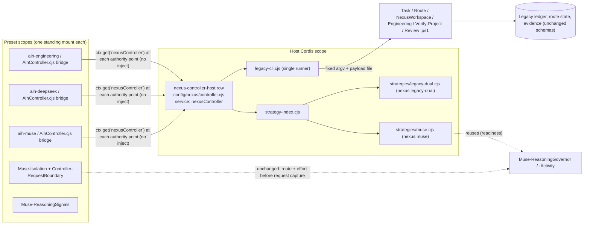

# Nexus plugin-first P1 implementation report · Trusted Controller and plugin foundation

This report records the first production-code milestone (P1, tasks C01–C04) of the approved [plugin-first architecture, Revision 2](NEXUS-PLUGIN-FIRST-ARCHITECTURE.md), following the [migration roadmap](NEXUS-PLUGIN-FIRST-MIGRATION-ROADMAP.md) and keeping the [CLI contract](NEXUS-CLI-CONTRACT.md) in view. **Implemented** means code and tests that exist in this change. **Future** means architecture that P1 deliberately does not build.

## 1. Revisions

| Item | Value |
|---|---|
| Starting revision | `dev` at `7448ac9a97bb8b5008f29f25d953706841cdee76` (merge of PR #38). Its tree is byte-identical to the audited baseline `f80d0a324333851db55b4c81f27a1ef24b2b0161`: `git diff f80d0a32 7448ac9a` is empty, so no newer implementation diverges from the architecture baseline. |
| Working branch | `feature/nexus-plugin-first-p1` in the main checkout `/Users/kaloyannikolov/Projects/Nexus`, created from `dev`. |
| Ending revision | **Uncommitted** working tree on that branch (no commit was authorized). New files under `config/nexus/` are staged with `git add` only because `MusePresetDependencyClosure.cjs prepare` refuses untracked closure files in a source checkout. Nothing was committed, pushed or merged. |
| Pinned runtime | DSH `0.2.2-rc.1` (`dsh-v0.2.2-rc.1` → `66491b05e3f05ad35bcdd4f6cd7ed26041d9e3db`), `@deepseek-ai/cordis` `4.1.0`, Node `24.18.1` (darwin-arm64), PowerShell `7.5.3`. `runtime/package.json` and `runtime/package-lock.json` are byte-identical to the isolated test installation used for every run. |
| Other worktrees | `Nexus-dsh-0.2.2` (`feature/dsh-0.2.2-migration`, clean) and `tmp/nexus-plugin-first-audit` (`codex/dsh-0.2.2-plugin-first-audit`, only the three untracked architecture documents) were left untouched. The three documents were copied into this branch. |
| Platform | macOS 27.2 arm64 (Darwin 27.2.0), native. |

## 2. Implemented architectural boundaries



| Boundary | Implemented in P1 | Not done (future) |
|---|---|---|
| Trusted host Controller (C01) | One host Cordis row, `nexus-controller-host`, provides `nexusController`. It owns strategy dispatch with contract validation, the single legacy PowerShell runner, per-task-generation transition lanes, session-event claims (dedup), runtime readiness, bridge attachment and service lifecycle (admission closes first on disposal, in-flight transitions drain, strategies are released). | The task API (`submit/getStatus/follow/cancel/respond`), intake receipts, approval broker and managed sessions are P2. Binding cache/persistence and turn sequencing still live in the bridge (see §9). |
| Thin compatibility bridge (C01) | `AihController.cjs` keeps every DSH hook (`nexus/session-prepare`, `session/event`, `agent/pre-step`, `agent/disposed`) and existing turn semantics, but no longer spawns processes, branches on Muse vs Dual for policy, or writes task/attempt transitions outside the Controller lane. It resolves the host service at every authority point **without** injecting it, so a missing/closed/incompatible host keeps the bridge mounted and makes it refuse. | Retiring per-mount binding caches (one binding writer) after parity, per the audit. |
| Strategy extension boundary (C02) | `strategy-index.cjs`: stable ids, contract major 1, exact idempotent disposers, duplicate-id and duplicate-engine rejection, unsupported-major rejection, readiness, typed `strategy-missing`, a closed decision vocabulary (`runRoot`, `runReview`, `refuse`, `degradeLegacy`) with **no completion decision**. No model/provider mapping. | Nova strategies, `decide(TaskView, Event, ReadPorts)` with multi-decision plans, persisted decisions and pins (P3+). |
| Muse through the boundary (C03) | `strategies/muse.cjs` (`nexus.muse`): one `muse_main` role, no review/delegation/workers/fallback, the historical refusal notice, no step routing, fail-closed inconclusive binding, "No Muse fallback" routing notice. Reuses `Muse-ReasoningGovernor.cjs` and `Muse-ReasoningActivity.cjs` (readiness checks their APIs). Adaptive reasoning, phase signals, tool-activity observation and the request/model-selection capture ordering stay in `Muse-Isolation`, `Muse-ReasoningSignals` and `Controller-RequestBoundary` exactly as before. | Moving Muse route-state writes under the Controller's serialized lane (needs PS routing concurrency tests). |
| Dual compatibility | `strategies/legacy-dual.cjs` (`nexus.legacy-dual`) states the existing Dual policy only. Dual's step router, review path, worker composition, delegation block and gates are unchanged. | No Dual migration (by instruction). |
| Composition (C04) | Generated host row in `data/cordis.patch.yml` (absolute file URL into `data/.agent-presets/.nexus-host`), new closure profile `host`, atomic publication with the plane closures, and `Verify-NexusComposition.mjs` requiring a live, ready service with every plane bridge attached. | CLI transport rows (`task-ipc`), single-host election and writer guard (P2). |

## 3. Changed files and why

| File | Change |
|---|---|
| `config/nexus/controller.cjs` (new) | Host Controller core (`createControllerCore`), Cordis host plugin (`apply` → `ctx.effect` disposer + `ctx.provide('nexusController')`), and `resolveControllerAccess` for bridges (host mode in Cordis, embedded core only for bare unit harnesses that call `apply()` on a plain object). |
| `config/nexus/legacy-cli.cjs` (new) | The PowerShell runner moved **verbatim** from the bridge: host resolution, toolchain root, Windows cmd.exe capture, payload file, fixed argv, 320 s timeout, 64 MiB buffer, exit-3 and verification recovery, redacted diagnostics. Adds accounting (invocations, failures, timeouts, concurrency). `parseCliJson`, `structuredCliStdout`, `verificationCliStdout`, `controllerCliFailure` and `redactControllerDiagnostic` are textually identical to the originals (checked with `Function.prototype.toString`). |
| `config/nexus/strategy-index.cjs` (new) | Strategy registry and decision validation (§4). |
| `config/nexus/strategies/muse.cjs`, `legacy-dual.cjs` (new) | EMv2 Muse and EMv1 Dual strategies (§2). |
| `config/AihController.cjs` | Bridge rewiring: delegate CLI calls to `core.legacy.invoke`; route `begin-attempt`, `attempt-event`, `failure`, `evidence`, `complete`, `set-review-requested` through `core.transition(lane)`; claim `session/event` deliveries; replace the four `engine === 'muse'` / `aih-muse` policy branches with `core.decide`; fail closed with a `controller-unavailable` notice when the host is absent. Existing exports are unchanged (helpers are re-bound from `legacy-cli.cjs`). Net −111 lines. |
| `scripts/Build-NexusHomePatch.cjs` | Emits the `nexus-controller-host` row first in the generated insert block; exports `HOST_CONTROLLER_ROW`. |
| `scripts/MusePresetDependencyClosure.cjs` | New closure profile `host` (entry `nexus/controller.cjs`, manifest `.nexus-host-closure.json`). The plane closures pick up `config/nexus/*` automatically through the require graph. |
| `scripts/Install-NexusPresets.ps1` | Publishes `.nexus-host` atomically with the three plane closures (same stage/backup/rollback), prepares the `host` profile in source trees, clearer failure text. |
| `setup.sh`, `scripts/Setup.ps1` | Prepare the `host` closure profile at install (prepare copies `config/nexus/*` into the installed `config/`). |
| `scripts/Verify-NexusComposition.mjs` | Resolves `nexusController` from the booted composition and requires readiness, contract major 1, mandatory strategies and one attached bridge per plane. |
| `scripts/Test-Harness.ps1` | Registers `NexusControllerCore`, `NexusLegacyCli`, `NexusControllerBridge` in the production lane. |
| `tests/AihControllerHost.Tests.cjs` | The six runner source assertions now read the runner where it lives (`config/nexus/legacy-cli.cjs`) with the same expected strings, plus two new assertions: the bridge delegates to the host runner and no longer imports `node:child_process`. |
| `tests/PowerShellPortability.Tests.ps1` | The existing JS-executable allowlist entry and toolchain-root assertion now also cover `config/nexus/legacy-cli.cjs`, where the runner moved (same expected properties; the bridge must still pass its owner tree). |
| `tests/ControllerSessionBootstrap.Tests.cjs` | Its crash subprocess builds a real Cordis root and applies the bridge; it now loads the host Controller row first, as the P1 product composition does. The suite's other assertions are unchanged, including that a preset bridge never publishes a process-global service. |
| `tests/NexusControllerCore.Tests.cjs`, `NexusLegacyCli.Tests.cjs`, `NexusControllerBridge.Tests.cjs`, `tests/lib/FakePwshHost.cjs` (new) | New contract, fault and parity suites (§8). |
| `tests/diagnostics/NexusControllerOverhead.cjs` (new) | Old-vs-new admission benchmark (§10). |
| `docs/architecture/evidence/p1/` (new) | `muse-review-notice.txt` (pre-P1 literal extracted mechanically from `7448ac9a`), traces and measurements. |

## 4. Service and strategy contracts (implemented, contract major 1)

**`nexusController` service** (host fiber; `contractMajor: 1`, `build: 'nexus-controller-p1-1'`):

| Member | Contract |
|---|---|
| `decide(engine, view, event)` | Resolves the strategy serving `engine`, requires exactly one decision, validates it. Throws `strategy-missing`, `strategy-decision-forbidden` (e.g. `complete`), `strategy-decision-invalid`, `strategy-decide-failed`, `nexus-controller-closed`. Returns the frozen decision plus `strategyId`/`contractMajor`. |
| `transition(laneKey, label, work)` | Serializes authoritative writes per task generation (`taskInstanceId`, else normalized workspace + display id). The work still calls the legacy writer (TaskController keeps its ledger mutex). A failed transition does not poison its lane. Refused after disposal. |
| `claimEvent(sessionId, event)` | True once per `(sessionId, seq, type)`; events without a numeric `seq` are never deduplicated; bounded to 512 keys per session; `forgetSession` on agent disposal. |
| `legacy.invoke(script, args, { payload, tolerateNonZeroJson, envOverlay })` | The single runner (§3). `envOverlay` scopes `DSH_AIH_PROFILE` to one child, exactly as before. |
| `attachBridge({ plane })` → `detach` | Exact, idempotent; returns false after disposal already released it. |
| `readiness({ requirePlanes })` | `{ ready, problems, strategies[], bridges[], attachedPlanes[], legacyCli }`. Mandatory: `nexus.muse`, `nexus.legacy-dual`. With `requirePlanes`, Muse requires an attached `aih-muse` bridge. |
| `metrics()`, `dispose()`, `closed` | Counters (decisions, rejections, transitions, lane depth, event claims/dedups, refused admissions, runner stats). `dispose()` closes admission, awaits in-flight transitions, releases strategies, clears claims and attachments; idempotent. |

**StrategyV1 descriptor**: `{ id, contractMajor: 1, build, label, engines[], roles[], planes[], mandatory, capabilities: { independentReview, delegation, workers, fallback } }`. **Implementation**: `{ decide(view, event) → [Decision], readiness(context)?, dispose()? }`. **Events** in P1: `explicit-review`, `engineering-turn`, `routing-failure`, `binding-inconclusive`. A strategy has no write port, no model mapping and no completion decision.

## 5. Current dependency graph

```
config/nexus/controller.cjs
├── ./legacy-cli.cjs                 (node:child_process, fs, os, crypto)
├── ./strategy-index.cjs             (pure)
├── ./strategies/muse.cjs
│   ├── ../../Muse-ReasoningGovernor.cjs   (pure, existing)
│   └── ../../Muse-ReasoningActivity.cjs   (pure, existing)
└── ./strategies/legacy-dual.cjs     (pure)

config/AihController.cjs (bridge, per plane closure)
├── ./nexus/controller.cjs           (resolveControllerAccess, embedded core for bare harnesses)
├── ./nexus/legacy-cli.cjs           (re-bound helper exports)
└── existing: Dsh-SessionEvents, Preset-ShellEnvironment, Engineering-/Muse-Isolation, registry/*, ContextCompaction, CCv2 hosts
```

Host closure (`.nexus-host`, from the real `copy`/`validate` run): `Muse-ReasoningActivity.cjs`, `Muse-ReasoningGovernor.cjs`, `nexus/controller.cjs`, `nexus/legacy-cli.cjs`, `nexus/strategies/legacy-dual.cjs`, `nexus/strategies/muse.cjs`, `nexus/strategy-index.cjs`. No registry, routing or ledger module is reachable from the host row. Each plane closure carries its own copy of `config/nexus/*`; shared state flows only through the Cordis service object, never module singletons.

## 6. Cordis registration and lifecycle

- **Registration.** `Build-NexusHomePatch.cjs` emits `- id: nexus-controller-host` with the absolute file URL of the published host closure, ahead of the preset rows. The plugin's `apply` registers one composite effect (core disposal) and `ctx.provide('nexusController', core)`. Both are owned by the host fiber.
- **No load-order dependency.** Bridges do not `inject` the service (Cordis `inject` is all-required: a missing service would unload the bridge and silently remove its hooks). They call `ctx.get('nexusController')` (pinned Cordis `reflect.get`, strict: active providers only) at every authority point, attach on first success and re-attach if the provider instance changes. Readiness proves attachment on the real boot.
- **Duplicates.** A second provider in the same isolation is rejected by Cordis itself (`service "nexusController" has been registered at <…>`), and the first provider stays authoritative: verified on real Cordis 4.1.0.
- **Disposal.** Unloading the host fiber unregisters the service and runs the composite effect: admission closes immediately, in-flight transitions drain, then strategies are released. Bridges then resolve `null` and refuse every session step with a `controller-unavailable` notice, with zero CLI calls and no `next()`. Remount starts with no attachments or claims carried over. Bridge unload detaches exactly once through its own `ctx.effect`.
- **Observed scoping (P0 finding).** On the pinned real composition, `aih-controller` is a **standing mount applied once per preset at boot** (three instances: `aih-engineering`, `aih-deepseek`, `aih-muse`), not per agent. All three resolve the same host service across the preset scope boundary (no isolation of `nexusController`).

## 7. EMv1 / EMv2 compatibility

**Method.** `tests/NexusControllerBridge.Tests.cjs` Part A drives the real `agent/pre-step` hook of a bridge against a synthetic PowerShell host and records a normalized trace: controller-CLI sequence, hook outcome, number of `next()` calls (each one is the only path to inference) and controller notices. It ran against the **pre-P1 bridge** (`config/AihController.cjs` of `7448ac9a`, the baseline clone's installed copy, byte-identical to `HEAD`) and the **P1 bridge**. The two trace files are identical (`diff` empty; stored as `evidence/p1/bridge-trace-pre-p1.json` and `bridge-trace-p1.json`).

| Scenario | Outcome (both builds) | Controller CLIs per turn (both builds) |
|---|---|---|
| EMv2 Muse `/review …` | reject, `next()`×0, exact historical notice (`muse-review-unavailable`) | 2: `NexusWorkspace:resolve`, `Task:test-task`; never `Review.ps1`/`Context.ps1` |
| EMv2 Muse engineering turn | admitted, `next()`×1, "attempt 1 started … · engine=muse" | 4: resolve, test-task, `ContextLifecycleCli:snapshot`, `Task:begin-attempt` (no `Engineering.ps1` step router) |
| EMv1 Dual engineering turn | admitted, `next()`×1, "… · step-routed" | 5: resolve, test-task, snapshot, `Engineering:uncertainty-create`, `Task:begin-attempt` |
| Muse, inconclusive binding validation | reject, `next()`×0 | 2 |
| Dual (unmarked), inconclusive validation | historical legacy degradation, `next()`×1 | 2 |
| Muse, attempt-start CLI returns garbage | historical unmarked-session continuation, `next()`×1 | 4 |

**Findings.**
- EMv2 = Muse is preserved: one main agent `muse_main`, no Dual step router, no independent reviewer (explicit refusal with the byte-identical notice, also checked against `evidence/p1/muse-review-notice.txt` extracted mechanically from `7448ac9a`), no delegation or fallback, Muse-specific fail-closed paths unchanged.
- Adaptive Reasoning Governor, reasoning-phase signals, trusted tool-activity observations and per-request effort are **not moved**: `Muse-Isolation.cjs`, `Muse-ReasoningSignals.cjs`, `Muse-ReasoningRuntime.cjs`, `Muse-ReasoningGovernor.cjs`, `Muse-ReasoningActivity.cjs` and `Controller-RequestBoundary.cjs` are byte-unchanged, so model selection is still captured on `agent/inbox/claimed`/`agent/pre-step` before the request and never by mutating a captured request. The production-lane suites `MuseIsolation`, `MuseReasoningGovernor`, `MuseReasoningRuntime`, `MuseReasoningSignals`, `MuseReasoningActivity`, `ComposedRoutingAuthority`, `ComposedRoutingMatrix` and `RuntimeRoutingTrace` exercise them on both builds (§8).
- EMv1 Dual remains operational through its existing path: step router, legacy review dispatch, unmarked-session degradation, worker composition and delegation block unchanged.
- **No additional model or subprocess calls**: identical controller-CLI sequences and identical `next()` counts per turn; the strategy and Controller paths contain no model client. A strategy cannot reach a model (no LLM/provider import, checked in `NexusControllerCore`).
- **Behavior change by design (only when the host service is absent):** previously the bridge could not be separated from its runner. Now, if the host Controller is missing, closed or of another contract major, every session step on every plane is refused with a `controller-unavailable` notice (`NexusControllerBridge` B1/B2). In a correctly installed product this cannot happen silently: `Verify-NexusComposition` fails and `Install-NexusPresets.ps1` rolls back (negative control in §8).
- **Defect closed (latent in production):** with two standing mounts observing one session, the pre-P1 bridge recorded the attempt failure twice and requested two reroutes for one `turn/end` (`{"failure":2,"route":2,"total":6}`, `evidence/p1/duplicate-turn-end-pre-p1.json`). P1 processes it once and ignores replays (B3). Pinned DSH dispatches `session/event` through the session carrier's scope (`ctx.events.dispatch('emit', [carrier, …])`), so in the shipped composition a session's events most likely reach only its own preset mount; the multi-mount case is therefore classified as latent, and the dedup as defence in depth plus protection against replayed deliveries.

## 8. Tests: commands and results

All runs used isolated APFS clones of the existing isolated test installation (`~/Nexus-DSH-0.2.2-Test/root`, never modified) under the session scratch directory, with private `HOME`/`TMPDIR`, closures and home patch regenerated inside each clone (no path back to the original root), a dead `HTTPS_PROXY`, no provider credential, and synthetic Git identity. The user's Nexus on port 3080 and the test instance on 3081 were not touched.

Roots: **pre-P1** = clone of the test install with `HEAD` (`7448ac9a`) scripts/tests, closures and patch regenerated in place; **P1** = the same clone plus this working tree (`scripts/`, `tests/`, `docs/` synced; closures prepared from the source with `MusePresetDependencyClosure.cjs prepare … '' | engineering | deepseek | host`; `Install-NexusPresets.ps1` run inside the clone). Runners: `run-lane.sh` → `pwsh scripts/Test-Harness.ps1 -InstallRoot <root> -Lane production -ContinueOnFailure`; single suites via the pinned `runtime/node/bin/node tests/<Suite>` or `pwsh -File tests/<Suite>.ps1 -InstallRoot <root>`.

**Production lane** (evidence: `evidence/p1/production-lane-pre-p1.json`, `production-lane-p1.json`).

| Lane | Rows | Pass | Assertions passed / failed | Failing rows |
|---|---:|---:|---:|---|
| pre-P1 | 106 | 104 | 3,250 / 2 | `ContextRestrictedProductionV2`, `Harness` |
| P1 | 109 | 107 | 3,285 / 2 | `ContextRestrictedProductionV2`, `Harness` |

Both failing rows are **pre-existing and environmental**, identical to migration report §L3: `ContextRestrictedProductionV2` needs CCv2 lab modules that the installer omits by design, and `Harness` trips on credential-shaped fake fixtures. No row changed result. The three new rows pass: `NexusControllerCore` (15 groups), `NexusLegacyCli` (8), `NexusControllerBridge` (10). Every roadmap-named suite in the lane passes on both: `ControllerRouteSelection`, `ComposedRoutingAuthority`, `ComposedRoutingMatrix`, `RuntimeRoutingTrace`, `MuseIsolation`, `MuseReasoningGovernor`/`Runtime`/`Signals`/`Activity`, `TaskIdentity`, `ControllerRouting`, `RoutingIntegrity`, `NexusRouteAdmission`, `NexusModeContract`, `VisualLoop`, `VisualControllerLifecycle`, `AihController`, `AihControllerIdentity`, `ControllerSessionBootstrap`, `EngineeringIsolation`, `NexusEngineContract`, `SetupUpgrade`, `MusePresetDependencyClosure`, `MusePresetCleanInstall`, `ControllerPresetCleanInstall`, `ControllerPresetInstalled`, `MuseInstall`, the V1 compaction suites and the CCv2 restriction suites.

**Failures found during P1 and how each was classified and resolved**

| Run | Failure | Classification | Resolution |
|---|---|---|---|
| First baseline attempt (git-archive root with symlinked runtime) | 19 rows | Environmental: not an installed root (no closure manifests, no generated patch, symlinked runtime). | Rebuilt the baseline as an installed clone; the documented 104/106 reproduced. |
| First P1 lane | `ContextCompactionF1Loop`, `F2Prod`, `F5Prod`, `F5Slow`, `Partial`, `ControllerSessionBootstrap` | **Introduced.** Host-mode detection used `typeof ctx.get === 'function'`; legacy harnesses stub `get` on plain objects, so the bridge failed closed. | Host mode now requires a Cordis context (`ctx.reflect.get`, verified on real Cordis for root and plugin contexts). `ControllerSessionBootstrap`'s crash child applies the bridge to a real Cordis root, so it now also loads the host row, matching the P1 composition. New B2b assertion. |
| First P1 lane | `PowerShellPortability` (two assertions) | **Introduced** (source-text checks followed code that moved). | Comments reworded; the existing allowlist entry and toolchain-root assertion now cover `config/nexus/legacy-cli.cjs`, the runner's new file, with the same expected properties. |
| First P1 lane | `NexusControllerCore` detach after disposal | **Introduced** (real gap). | `detach()` returns false once disposal released the attachment. |
| Second P1 lane | 7 rows (timeouts, lease renewal, lifecycle) | **Environmental**: the Mac entered deep idle overnight (pmset `DarkWake … Deep Idle`, lane 14,324 s). | Run discarded (`production-lane-p1-invalid-slept.json` kept for transparency); re-run awake with a keep-awake hold → 107/109. |

**Out-of-lane roadmap suites** (same commands on both roots):

| Suite | pre-P1 | P1 | Classification |
|---|---|---|---|
| `RegistryCore` | pass | pass | — |
| `RegistryR63Binding` | pass | pass | — |
| `RegistryR70Readiness` | pass | pass | — |
| `RegistryR631Lockdown` | crash `eng: no decision: Command failed: pwsh …` | identical | Pre-existing, unresolved (not in the shipped lane; expects `pwsh` routing fixtures this macOS root lacks). |
| `RegistryR632Execution` | `R6.3.2 muse pin … ENOENT` | identical | Pre-existing, unresolved. |
| `RegistryR74RollbackRecovery` | fails (35 cases this run; C/E only in an earlier run) | fails (30 cases, a subset of the baseline's failures) | Pre-existing and nondeterministic (`Command failed: pwsh …`), unresolved. Not attributable to P1. |

**Real composition (pinned DSH, in-process `runProfile('web')`)**: `Verify-NexusComposition.mjs` on the P1 clone → `ok: true`, three planes mounted, stock presets absent, `nexusController` ready, both strategies ready, bridges attached for all three planes (`evidence/p1/composition-real-boot.json`). Negative control with the host row removed → `ok: false`, `nexus-controller-service-absent`, planes still mounted (`composition-negative-no-host-row.json`); `Install-NexusPresets.ps1` would roll back.

**Requested new-test coverage**

| Requirement | Where |
|---|---|
| Strategy registration and disposal; duplicate registration; unsupported contract version; missing mandatory strategy | `NexusControllerCore` (index contract, mandatory Muse) |
| Missing mandatory service; plugin lifecycle and teardown; duplicate plugin registration | `NexusControllerCore` real Cordis 4.1.0 (duplicate host row rejected, unload unregisters and closes admission, remount clean); `NexusControllerBridge` B1/B2; composition negative control |
| Controller state ownership | `NexusControllerCore` (no completion decision, forbidden decisions, lanes, closed admission); `NexusControllerBridge` B4 |
| Repeated/deduplicated session events | `NexusControllerCore` claims; `NexusControllerBridge` B3 |
| Routing failures; stale task binding; attempt recovery | Bridge A4/A5; existing `AihControllerIdentity`, `TaskIdentity`, `ControllerSessionBootstrap`, `ControllerRouting` (unchanged, pass) |
| PowerShell timeout / partial output | `NexusLegacyCli` (hung CLI killed at timeout, truncated JSON, exit 3, non-zero verification, redaction, payload cleanup) |
| Muse adaptive reasoning parity | Muse suites unchanged and passing; `NexusControllerCore` strategy parity and module identity |
| Dual compatibility | Bridge A3/A4 old-vs-new identical traces; existing Dual suites |
| No unauthorized requests or extra model calls | Identical `next()` counts and CLI sequences old vs new; B1/B2 zero CLI and zero `next()` when the host is absent |

## 9. Remaining known limitations

- **Turn sequencing and binding authority still live in the bridge.** The bridge keeps the binding cache, `persistBindings` (three standing mounts still write `session-bindings.json`, with the existing stamp/merge conflict protection), stale-binding recovery, route checks, verify/review/visual turns and completion tail. P1 centralizes the runner, strategy policy, transition ordering, event claims and lifecycle; it does not yet make the host the single binding writer. The audit's "retire duplicated binding-map write authority only after parity" remains open and is the main P2 prerequisite inside the Controller.
- **Remaining engine-specific code** is routing/identity, not strategy policy: Muse vs engineering isolation target lookup and `muse_main` role mapping for registry pins (`AihController.cjs` registry transition helpers), the preparation path's Muse route checks, and preset↔engine mapping (`engineForPreset`). A future strategy must still be added to `engineForPreset`/`assertEngineBinding` and the registry mode descriptor; the Controller's turn path itself needs no new branch.
- **Lanes serialize within one host process only.** Cross-process exclusion still relies on TaskController's workspace mutex. A single-host writer guard is a P2 deliverable.
- **Route-state writes** by `Muse-ReasoningRuntime`/`Muse-ReasoningSignals` (Muse preset rows) and by `Route.ps1` are not yet under the Controller lane.
- **Owner-peer bypass (P0 finding, P2 gate):** the pinned gateway skips `remoteAccess.decide` for `owner` principals (`dsh-api-gateway` `prepareInvocation`, owner check before resource resolution), and browser/launch-token peers are created as `owner` (`dsh-client-connection` `publishPeer`). P1 adds no route and no managed sessions, so it neither widens nor closes this. Every model step, whatever route triggered it, still passes the bridge's fail-closed `agent/pre-step` check. A supported guard for every managed-session mutation path remains a blocking P2 gate.
- **Not run:** Windows and Linux (x86_64/aarch64) lanes, the CCv2 lab lane, live provider turns, a long-lived real `dsh web --no-open` host session with a real agent turn (the real composition was booted in-process by `Verify-NexusComposition`, which mounts every plane and the host service but runs no turn). Cold-boot timing over 20 boots and resident memory under a live host were not measured.
- **Windows runner path** (cmd.exe capture) is moved verbatim but was not executed on Windows in P1.

## 10. Performance observations

Measured with `tests/diagnostics/NexusControllerOverhead.cjs` on the pinned Node 24.18.1, darwin-arm64, `--expose-gc` (`evidence/p1/controller-overhead.json`). Synthetic CLI transport; each fake controller CLI is a real Node child process (about 30 ms), so turn wall time is dominated by subprocess spawning in both builds.

| Measure | Result |
|---|---|
| Host core construction | 0.80 ms; about 38 KiB retained heap |
| Service resolution (`ctx.get` + contract check), 20,000 warm calls | p50 < 0.1 µs, p95 0.1 µs |
| Strategy dispatch (`decide`) | p50 0.2 µs, p95 0.4 µs |
| Empty serialized transition (lane bookkeeping) | p50 0.5 µs, p95 0.9 µs |
| Event claim | p50 0.4 µs, p95 1.1 µs |
| Root-turn admission, EMv2 Muse, 20 warm iterations | pre-P1 p50 130.1 / p95 134.4 ms; P1 p50 129.8 / p95 135.4 ms (Δp95 +1.0 ms, +0.8%) |
| Root-turn admission, EMv1 Dual | pre-P1 p50 161.6 / p95 163.7 ms; P1 p50 164.1 / p95 176.5 ms (Δp50 +2.5 ms; Δp95 +12.8 ms, +7.8%) |
| Controller-CLI subprocesses per turn | Muse 4 → 4, Dual 5 → 5 (identical sequences) |
| Model requests | none issued in either build; `next()` (sole inference path) count identical per scenario |

**Interpretation.** The Controller's own work is microseconds per turn. The Dual p95 difference (n = 20, single outliers drive p95, about one fake-process spawn of jitter) is within the architecture's proposed budget ("warm p95 incremental admission under the larger of 20 ms or 5%"), but it is reported, not assumed away. No additional LLM call, coordinator or reviewer call and no additional subprocess per turn was introduced. **Not measured:** 100-iteration runs on a quiet machine, 20 cold boots, resident memory of a live host, CPU, Windows/Linux. The production-lane wall time is not a performance signal: the valid P1 lane ran 3,486 s versus 836 s for the baseline, entirely inside the `Intelligence.*` PowerShell suites (no P1 code) while the lid was closed (pmset deep idle until 09:32); P1-related suites took the same time on both (e.g. `VisualControllerLifecycle` 22 s / 25 s).

## 11. Safe rollback

1. **Before any commit:** `git restore config/AihController.cjs scripts setup.sh tests/AihControllerHost.Tests.cjs tests/ControllerSessionBootstrap.Tests.cjs tests/PowerShellPortability.Tests.ps1`, `git rm -r --cached config/nexus`, and delete the new untracked files. Nothing else in the repository changed.
2. **On an installed tree after deployment:** reinstall the previous revision (setup + `Install-NexusPresets.ps1`). The installer publishes all four closures and the patch atomically and restores the previous closures and `data/cordis.patch.yml` if verification fails. Removing only the host row is **not** a rollback: the P1 bridges then refuse every engineering turn by design. Roll back bridges and host row together.
3. **Data:** P1 adds no store and changes no schema (`session-bindings.json` schema 1, task ledger schema 1, attempts, evidence, route state, registry configuration are untouched), so no data migration or conversion is needed in either direction. `data/logs/nexus-controller.log` is an additive diagnostic log.
4. Drain or finish active sessions before restarting into either version; the DSH composition is startup-only.

## 12. P1 GO/NO-GO verdict

**GO for P1, scoped as stated.** Against the success criteria:

| # | Criterion | Status |
|---:|---|---|
| 1 | Trusted Controller service exists | Met: one host `nexusController`, verified live on the real pinned composition. |
| 2 | Well-defined strategy boundary | Met: `strategy-index.cjs`, contract major 1, typed failures, no completion decision. |
| 3 | Muse runs through it | Met: all Muse policy decisions in the Controller's turn path come from `nexus.muse`. |
| 4 | EMv2 behavior equivalent | Met on the measured surface: identical normalized traces, byte-identical notice, Muse suites unchanged and passing. |
| 5 | EMv1 Dual operational | Met: identical traces, Dual suites pass. |
| 6 | Registry and task authorities preserved | Met: no new store, no schema change, registry modules untouched, ledger writes unchanged and now ordered by the Controller lane. |
| 7 | No duplicate writers or hooks | Met for the scope P1 owns: one runner, one service (duplicates rejected by Cordis), one claim per session event, exact attach/detach, no hook duplication on remount. **Open:** three standing bridges still persist `session-bindings.json` (pre-existing, conflict-checked); P2 must make the host the single binding writer. |
| 8 | Cordis composition and disposal | Met: real Cordis 4.1.0 lifecycle tests plus real DSH boot and negative control. |
| 9 | Deterministic and real-host gates pass | Met for the production lane (107/109 = baseline set) and the real composition boot. Not covered: a live `dsh web --no-open` turn, Linux/Windows lanes, CCv2 lab lane. |
| 10 | Nova can be added without mode branching in the Controller | Met for the turn path: a new strategy registers a descriptor and decisions. Remaining engine coupling is routing/identity (`engineForPreset`, registry role mapping), listed in §9. |

Rollout condition: ship only with the host row and bridges together (§11). The behavior change when the host is absent (refuse every engineering turn) is intentional and verified.

## 13. Readiness for P2 (Nexus CLI)

**Ready to start P2, with these carried gates (from the architecture and P0 findings):**

1. **Single binding writer** inside the host Controller (retire per-mount `persistBindings`) before CLI and GUI share one authority. P1's lanes, claims and service lifecycle are the foundation for it.
2. **Owner-peer mutation guard** for managed sessions (gateway skips `remoteAccess.decide` for `owner`; browser/launch-token peers are `owner`). Blocking P2 gate, unchanged by P1.
3. **Single host and writer election** (`NexusHost.ps1`, lifetime guard) and authenticated IPC. Not started.
4. **Task API surface**: P1's `decide/transition/claimEvent/legacy/readiness` are internal ports, not the v1 CLI operations. `submit/getStatus/getResult/follow/cancel/respond` and intake are P2 work, layered on the same service so CLI and GUI use one authority.
5. **Readiness for the CLI**: `readiness()` already reports contract, strategies and attached planes; `hello`/`listModes` can project it. Host readiness must remain distinct from a successful Web probe, as the CLI contract requires.

P2 was not started.
