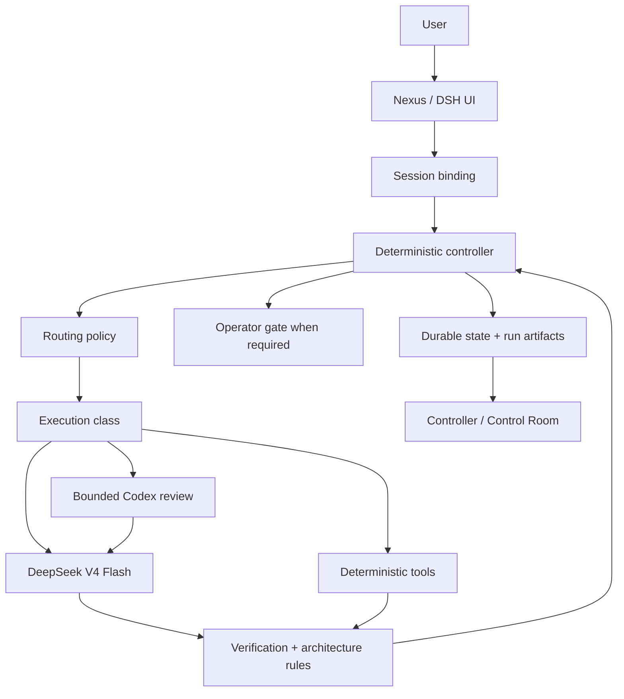

# Architecture overview

Nexus is a Windows-first AI engineering harness layered on the existing DeepSeek Harness (DSH) runtime. It deliberately keeps DSH's sessions, tools, permissions, Git integration, providers, and web client while moving engineering authority into deterministic controller modules.

## Core principle

> The model performs engineering work. The controller owns engineering truth.

That means the model may plan, implement, debug, self-review, and repair, but it does not own task identity, routing policy, attempt numbering, verification truth, review requirements, operator-gate state, or final completion.

## System shape



## Major layers

### 1. DSH runtime

DSH remains the runtime substrate. Nexus does not replace its session model, shell/filesystem tools, background jobs, permissions, web server, provider integrations, Git support, or project discovery.

### 2. Controller layer

PowerShell controller modules and the GUI bridge own deterministic state transitions. Important modules include task lifecycle, routing, context, verification, completion, review packets, worktrees, architecture rules, and telemetry.

### 3. Model execution layer

DeepSeek V4 Flash is the ordinary engineering executor. The controller routes to an execution class and supplies task/context boundaries. Codex is a bounded independent reviewer, not a permanent lead model.

### 4. Durable state

Task state is external to chat history. Project-scoped state lives under `.ai-harness`; runtime/global journals live under the Nexus data directory. JSON replacements are used for mutable snapshots; histories that matter for auditability are JSONL.

### 5. Control Room

The Control Room is an observer/operator surface over controller-owned records. It has a lightweight compact endpoint and a richer detailed endpoint. The browser does not invent lifecycle transitions from polling differences.

## Authority boundaries

| Concern | Authority |
| --- | --- |
| Task identity | Controller / session binding |
| Workspace identity | Controller-side normalized binding |
| Execution class | Routing policy |
| Root implementation | DeepSeek by default |
| Attempt number | Task ledger |
| Verification truth | Deterministic verification producer + evidence |
| Review requirement | Routing/completion policy |
| Review verdict | Bounded review result |
| Operator actions | Current controller gate `allowedActions` |
| Completion | Deterministic controller |
| UI state | Read/derived from authoritative records |

## Identity model

A task ID alone is not globally unique. Nexus resolves identity as:

```text
session
  -> persisted binding
  -> normalized workspace
  + taskId
```

This prevents `TASK-0003` in one repository from surfacing routing, attempts, reviews, or verification from another repository with the same task ID.

Records that cannot be matched to the authoritative workspace/task identity fail closed.

## Runtime flow

A typical engineering turn is:

```text
user prompt
-> session binding / task resolution
-> routing decision
-> attempt start (for real engineering execution)
-> DeepSeek execution
-> /verify or controller verification path
-> evidence
-> attempt pass/fail/interrupted
-> optional review / operator gate
-> deterministic completion
```

Reloads, reconnects, and UI polling are not execution events and therefore do not increment attempts.

## Why deterministic control

Moving control out of the model provides several benefits:

- model context can end without losing task state;
- retries have explicit identity and bounds;
- failed verification is distinguishable from a crashed verifier;
- critical/repeated-failure review policy is enforceable;
- operator actions can be bounded and stale-safe;
- the UI can show what actually happened instead of interpreting conversation text;
- the same task ID can safely exist in multiple workspaces;
- completion can be enforced independently of model confidence.

## Compatibility strategy

Nexus prefers official DSH extension points and controller-owned modules. Deterministic upstream bundle patches exist only where the pinned DSH version exposes no suitable hook. They are version-guarded, fail closed on unexpected structure, and covered by regression tests.

For UI-specific implementation details, see [Control Room](control-room.md) and the detailed historical notes in [../nexus-ui.md](../nexus-ui.md).